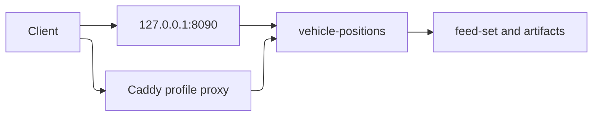
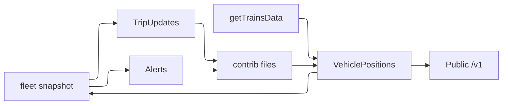
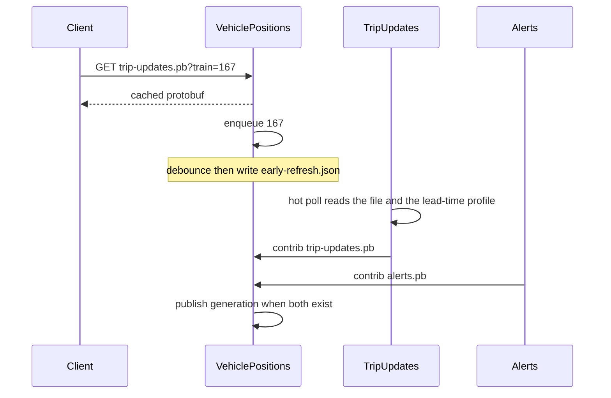
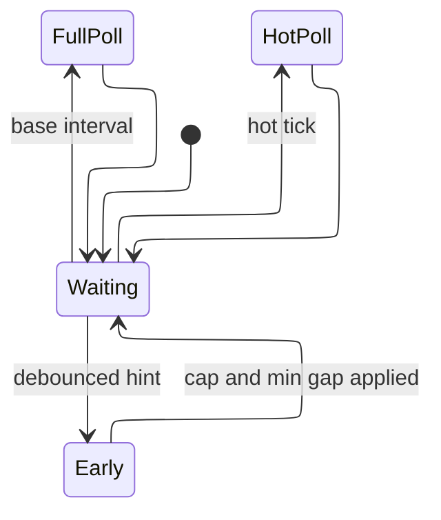
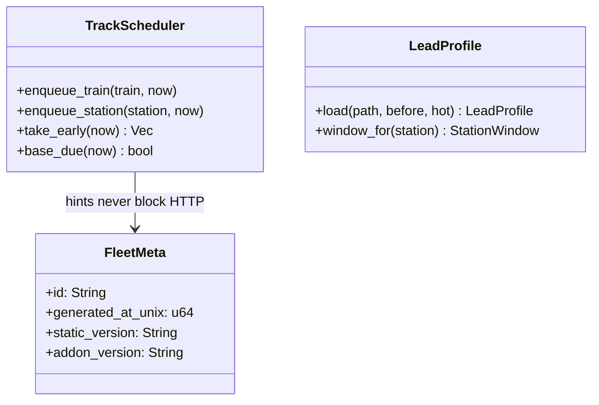
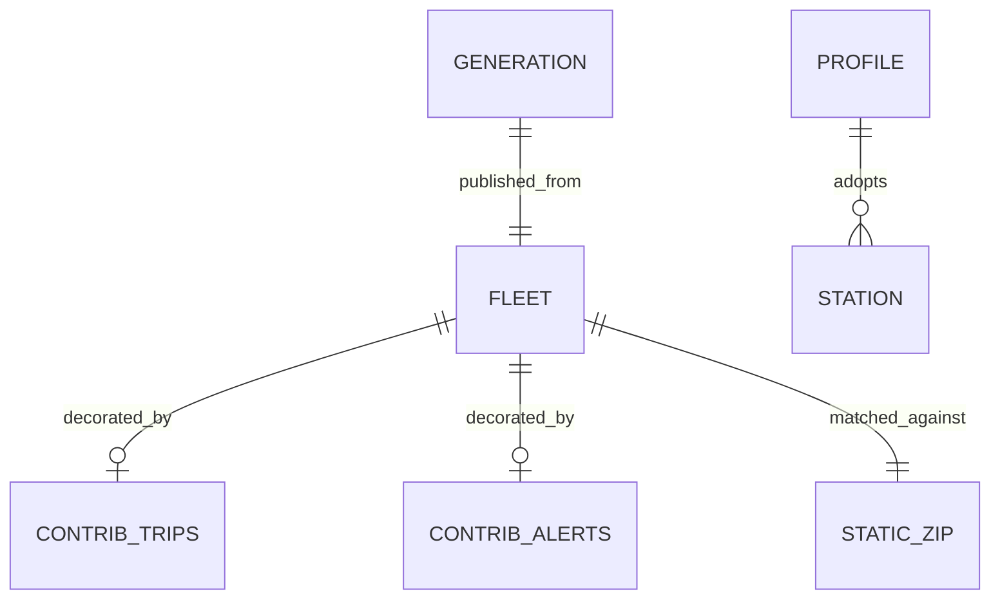
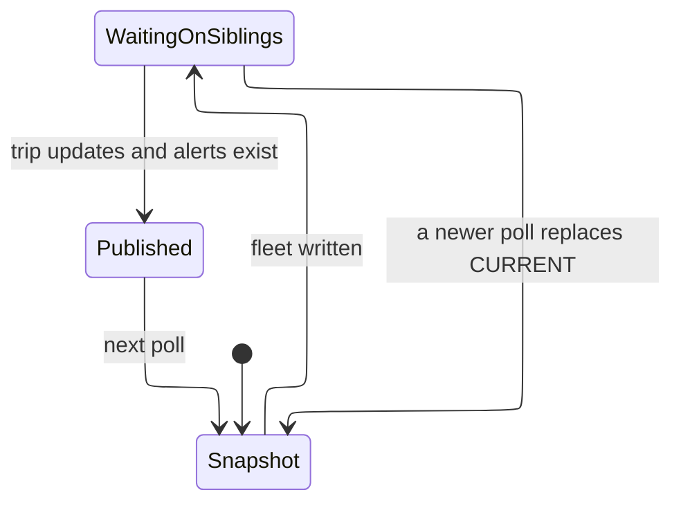
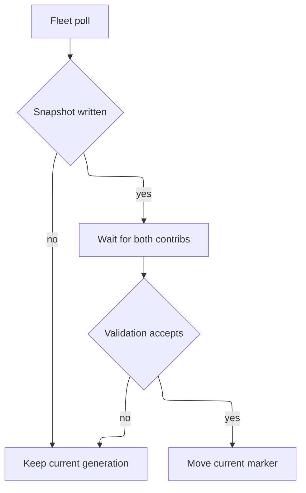

# Design Document

> **Superseded on 2026-11-07** by [`docs/one-container.md`](../../../docs/one-container.md). The owner chose one container with every helper inside it. This spec records how the three-container roles were built, and the one-container plan removes them.

## Overview

Three processes link `amtrak-gtfs-rt-service`. `AMTRAK_ROLE` selects the role. Unset means the combined process, so `cargo run` and the existing image smoke test stay valid. Compose runs the three roles. VehiclePositions polls once, writes `fleet/{id}`, and publishes a generation only when `contrib/{id}/trip-updates.pb` and `contrib/{id}/alerts.pb` exist. HTTP reads that generation from memory.

This covers requirements 1.1–1.4, 2.1–2.4, 3.1–3.7, 4.1–4.6, and 5.1–5.5.

gtfs-mcp and Trackside are the two consumers. Both read `feed-set.json`, then `official-static.zip`, `platform-addon.zip`, and the three protobufs. `static.zip` remains for callers that already load the combined file. New public names are additions. Existing URLs, content types, manifest fields, and protobuf header meanings stay.

`static.zip` stays the combined schedule. `official-static.zip` is the download. `platform-addon.zip` is schema `amtrak-platform-addon/v1`: `addon.txt` lists the files to copy over the official zip. Those files are the repaired `stop_times.txt` and the platform `stops.txt` when they differ. The Java validator stays in the vehicle-positions image. Vehicle-positions keeps the public port. A Caddy proxy is optional and off unless Compose is started with `--profile proxy`. The deployment does not assume nginx or Tailscale Serve in front.

## Architecture

VehiclePositions owns the poll, the static refresh (the image already has the validator), the HTTP server, and the early-refresh queue. TripUpdates owns the track browser, NJ Transit, Hartford, and trip-update stamping. Alerts owns the notices browser and alert merging. The optional Caddy service is not one of the three required containers.

Track scheduling states:

## Components and Interfaces

`TrackScheduler` records hints and releases trains. `LeadProfile::load` reads `amtrak-station-lead-time/v1`. `write_fleet` and `write_contribution` are the disk contract. `serve::artifact` adds `ETag`, `Last-Modified`, and `304`, and spawns the interest hook.

The Python track poller loads the same profile and reads `tracks/early-refresh.json`. Its base interval is `AMTRAK_TRACKS_BASE_INTERVAL_SECS` (default 900). Between those runs it still fetches hot trains, so a station such as PVD keeps its tighter hot window.

## Data Models

A profile station is adopted only when `confidence` is `observed` and `compared_to_default` is `wider`. `sparse`, `no_track`, `none`, `covered`, and unknown stations keep the global lookahead and hot window. The lookback stays global.

## Error Handling

A bad profile, a failed browser, or a failed stamp does not fail the HTTP server. The assembler logs and leaves the current generation in place. A denied peer is `403`. An unknown generation is `404`. No current generation is `503`.

## Testing Strategy

Rust tests cover debounce, coalescing, the 24-train cap, the minimum gap, profile adoption, the cohort marker, `304`, a warm p99 under 100 milliseconds, and a trip-update response that returns while a two-second hook is still running. Python tests cover the same profile rules and the early-refresh cap. Live Amtrak tests stay ignored.
