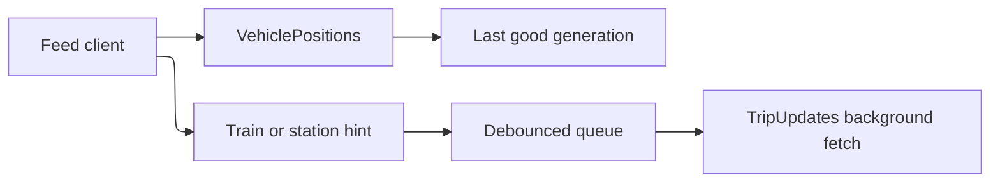
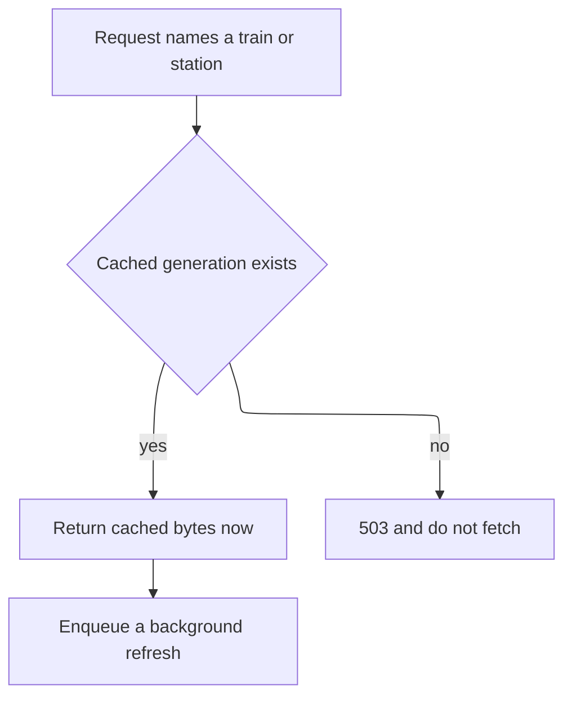
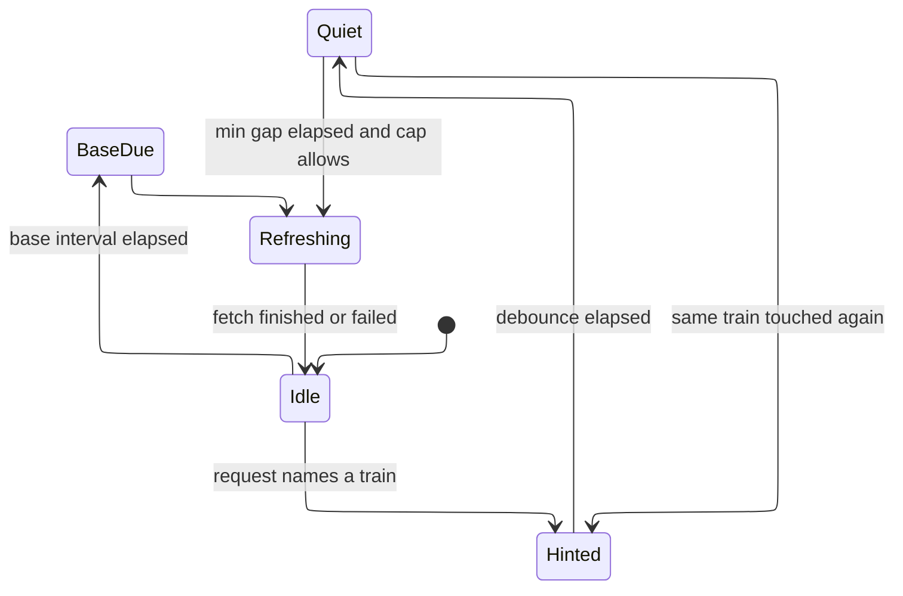

# Requirements Document

## Introduction

The feed is three containers that share one library and one `getTrainsData` poll. VehiclePositions serves the existing public URLs from memory. TripUpdates stamps tracks and gates. Alerts merges notices. A request never waits on a browser or an upstream fetch. Track checks run every 15 minutes, with debounced early refreshes and per-station lead-time profiles in the `amtrak-station-lead-time/v1` shape.

## Requirements

### Requirement 1

**User Story:** As a feed consumer, I want one manifest and three realtime products, so that I can keep using the URLs I already call.

#### Acceptance Criteria

1. WHEN a client GETs `/v1/feed-set.json` THEN the system SHALL return one generation id and the URLs for `static.zip`, `official-static.zip`, `platform-addon.zip`, `trip-updates.pb`, `vehicle-positions.pb`, and `alerts.pb`.
2. WHEN any of those four files for a new poll is missing THEN the system SHALL keep serving the previous complete generation.
3. WHEN `AMTRAK_ROLE` is `vehicle-positions` THEN the system SHALL be the only process that GETs `getTrainsData`.
4. IF the peer is not allowlisted THEN the system SHALL respond `403` and leave the generation unchanged.

### Requirement 2

**User Story:** As an MCP client, I want feed bytes immediately, so that a slow browser does not stall a tool call.

#### Acceptance Criteria

1. WHEN a client GETs a generation artifact THEN the system SHALL respond from the in-memory generation and SHALL NOT start a browser or an upstream fetch on that request.
2. WHEN the artifact bytes have not changed THEN the system SHALL send `ETag` and `Last-Modified`, and SHALL respond `304` when `If-None-Match` matches.
3. WHEN the same artifact is read repeatedly from a warm process THEN the system SHALL keep the local 99th percentile under 100 milliseconds.
4. WHEN the request includes `train` or `station` THEN the system SHALL still return the cached trip updates before any refresh runs.

### Requirement 3

**User Story:** As an operator, I want track checks on a polite schedule, so that a burst of clients does not hammer Amtrak.

#### Acceptance Criteria

1. WHEN TripUpdates is running THEN the system SHALL run a full track poll on `AMTRAK_TRACKS_BASE_INTERVAL_SECS`, default 900 seconds.
2. WHEN several requests name the same train inside the debounce window THEN the system SHALL queue one refresh for that train.
3. WHEN a train was refreshed less than `AMTRAK_TRACKS_MIN_GAP_SECS` ago THEN the system SHALL leave that train queued.
4. WHEN more trains are due than the per-flush cap THEN the system SHALL release at most 24 trains and keep the rest queued.
5. WHERE a station profile is `amtrak-station-lead-time/v1` and the station is `observed` and `wider` THEN the system SHALL use that station's suggested lookahead and hot window.
6. IF a station is missing or its confidence is `sparse`, `no_track`, or `none` THEN the system SHALL use the global window.
7. IF a station is `covered` THEN the system SHALL NOT narrow its lookahead from the profile.

### Requirement 4

**User Story:** As a feed consumer, I want Amtrak's official static GTFS and a separate platform add-on, so that track assignments stay valid without rewriting Amtrak's zip.

#### Acceptance Criteria

1. WHEN a generation is published THEN the system SHALL serve `official-static.zip` as the bytes downloaded from Amtrak, and SHALL serve `static.zip` as those bytes after the missing-stop repair and platform stops.
2. WHEN the add-on changes `stops.txt` or `stop_times.txt` THEN the system SHALL put only those files and `addon.txt` in `platform-addon.zip`, and SHALL set `platform_addon_version` to `amtrak-platform-addon/v1` plus a digest.
3. WHEN a consumer replaces each file named by the add-on's `files` line onto the official zip THEN the resulting GTFS files SHALL match `static.zip`.
4. IF the vehicle-positions image is built THEN the system SHALL keep the Java validator in that image, and SHALL keep serving the public URLs on that container.
5. IF Compose is started without the `proxy` profile THEN the system SHALL NOT start a reverse proxy.
6. IF Compose is started with `--profile proxy` THEN the system SHALL start a Caddy proxy that gzips, rate-limits per client IP, writes access logs, forwards `ETag` and `304`, and enables TLS only when `AMTRAK_PROXY_TLS` is set.
