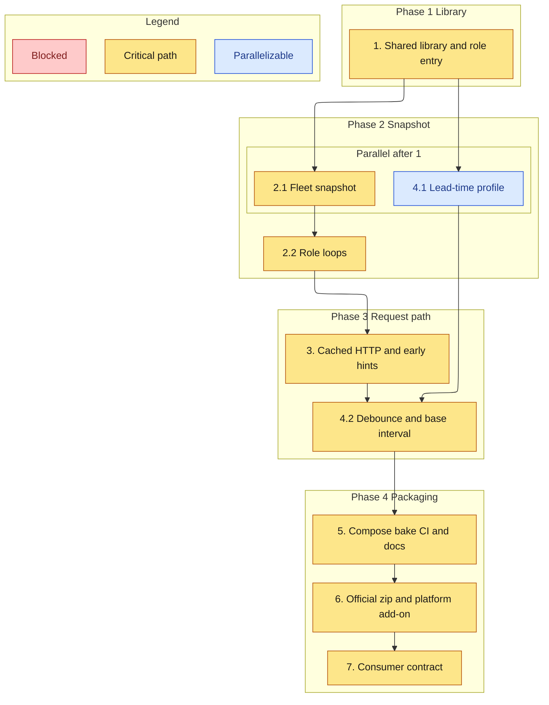

# Implementation Plan

> **Superseded on 2026-11-07** by [`docs/one-container.md`](../../../docs/one-container.md). The owner chose one container with every helper inside it. This spec records how the three-container roles were built, and the one-container plan removes them.

- [x] 1. Shared library and role entry
  - Move the service into `src/lib.rs` and select `AMTRAK_ROLE` in `run_service`.
  - _Requirements: 1.3_

- [x] 2. Fleet snapshot and publication gate
- [x] 2.1 Write and read the fleet snapshot and contributions
  - `cohort.rs` stores one poll and the sibling protobufs.
  - _Requirements: 1.1, 1.2_
- [x] 2.2 VehiclePositions, TripUpdates, and Alerts loops
  - Only VehiclePositions polls. The other roles decorate. The assembler publishes when both contributions exist.
  - _Requirements: 1.1, 1.2, 1.3_

- [x] 3. Cached HTTP and early hints
  - `ETag`, `Last-Modified`, `304`, and a spawned trip-interest hook.
  - _Requirements: 1.4, 2.1, 2.2, 2.3, 2.4_

- [x] 4. Lead-time profile and 15-minute schedule
- [x] 4.1 Parse `amtrak-station-lead-time/v1`
  - Adopt only `observed` plus `wider`. Fall back otherwise.
  - _Requirements: 3.5, 3.6, 3.7_
- [x] 4.2 Debounce, coalesce, cap, and the base interval
  - Rust `TrackScheduler` and the Python poller. Hot checks still run between base polls.
  - _Requirements: 3.1, 3.2, 3.3, 3.4_

- [x] 5. Compose, bake, rustdoc CI, and agent docs
  - Three images, `cargo doc -D warnings`, AGENTS.md matches the tree.
  - _Requirements: 1.1, 2.3_

- [x] 6. Official static zip and platform add-on
  - Serve the untouched download, the overlay, and the existing combined `static.zip`. Keep the validator in the positions image.
  - _Requirements: 4.1, 4.2, 4.3, 4.4_
- [x] 6.1 Optional Caddy proxy profile
  - Off by default. Gzip, per-IP rate limit, access logs, ETag forwarding, TLS only from `AMTRAK_PROXY_TLS`. Digest-pinned upstream images. The release gate scans the built image.
  - _Requirements: 4.5, 4.6_

- [x] 7. Consumer contract
  - Name gtfs-mcp and Trackside. Pin the public URL list, `feed-set.json` fields, content types, and artifact cache headers. Additions update the pin. Removals and renames fail the test.
  - _Requirements: 5.1, 5.2, 5.3, 5.4, 5.5_

## Task graph

Arrows mean depends-on. Critical path is the publication gate through cached HTTP. Profile parsing can proceed beside the snapshot once the library exists.

The critical path is the one that makes a generation visible on the existing URLs. Profile parsing does not block that path.
