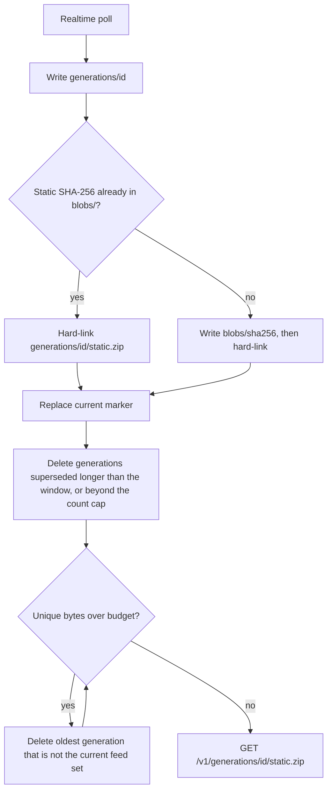
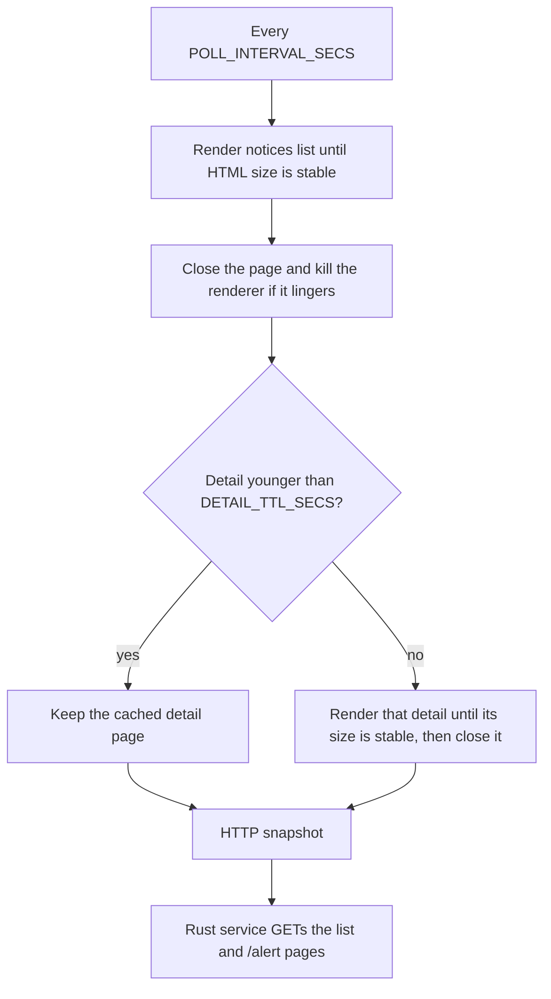
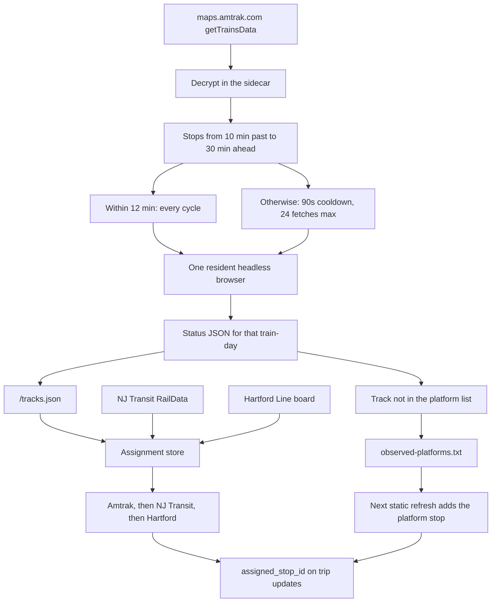

# Amtrak GTFS-RT

[](https://github.com/sohampatwardhan/Amtrak-GTFS-RT/actions/workflows/ci.yml)
[](https://github.com/sohampatwardhan/Amtrak-GTFS-RT/actions/workflows/validate-feeds.yml)

A small Rust service that produces **live GTFS-Realtime feeds for Amtrak** — TripUpdates,
VehiclePositions, and Alerts — plus the static GTFS they bind to, for use in third-party
transit apps (Transit, Transitland, OpenTripPlanner).

## Repository, release, and deployment state

- **Source:** `main` contains the Rust service, advisory consumption and the Playwright
  advisory-fetcher (with advisory detail text in `alerts.pb`), the `amtrak-status` station and
  train consumer, root-level Compose/Bake packaging for the service plus fetcher, and live
  track/platform assignments (default-off via `AMTRAK_TRACKS`).
- **Releases:** `v0.5.0` is the current release line, including those track assignments. A release
  is complete only when its GitHub Release exists with `image-release.txt` recording the tag,
  revisions, manifest digest, and both platform digests; until then the previous completed
  release, `v0.4.0`, stays the stable image. Pull the version tag, and pin the manifest digest
  from that release's `image-release.txt`:

  ```bash
  docker pull ghcr.io/sohampatwardhan/amtrak-gtfs-rt:0.5.0
  docker pull ghcr.io/sohampatwardhan/amtrak-gtfs-rt@sha256:<release-manifest-digest>
  ```

- **Superseded:** the `v0.3.0` tag exists, but its publication never completed and it has no
  GitHub Release. Its code is included in `v0.4.0` and later. Do not deploy `v0.3.0` or its
  partial images. `v0.2.0` was the last completed release before `v0.4.0`.
- **Deployment:** this repository does not record or authorize a running production deployment,
  anonymous public feed exposure, reverse-proxy trust, or orchestration.

It loads Amtrak's official static `GTFS.zip`, then on an interval delegates the
decrypt → parse → match → encode work to the
[`catenarytransit/amtrak-gtfs-rt`](https://github.com/catenarytransit/amtrak-gtfs-rt)
crate (which fetches and decrypts Amtrak's `getTrainsData`, matches each train to a GTFS
trip, and returns ready-made protobuf feeds). Complete static and realtime generations are
persisted immutably and served by a small `axum` HTTP server. A neutral `RtSource` trait wraps the data source so
fallback sources (TransitDocs, RailRat) can be added later without touching the core.

## Endpoints

| Path | Access | Content-Type | Description |
|------|--------|--------------|-------------|
| `/livez` | public | `application/json` | Process liveness, independent of feed readiness |
| `/readyz` | controlled | `application/json` | `200` only while the current generation is less than 300 seconds old |
| `/v1/feed-set.json` | controlled | `application/json` | Current generation ID, timestamp, static version, entity counts, and four immutable URLs |
| `/v1/generations/{id}/static.zip` | controlled | `application/zip` | Static GTFS for exactly generation `{id}` |
| `/v1/generations/{id}/{trip-updates,vehicle-positions,alerts}.pb` | controlled | `application/x-protobuf` | One GTFS-Realtime product from exactly generation `{id}` |

Fetch `/v1/feed-set.json` first and then use only the URLs it returns. Do not construct
generation URLs or substitute a newer ID between artifact requests. Every realtime header is
stamped with the manifest's static version and generation timestamp.

Feed, manifest, and readiness routes authorize the direct socket peer. With no explicit
allowlist, only loopback peers are admitted. `Forwarded` and `X-Forwarded-For` are ignored;
placing a reverse proxy at this authorization boundary requires a separately designed trusted-
proxy policy.

## Running

Requires a current stable Rust toolchain (the `amtrak-gtfs-rt` dependency uses
edition 2024; developed against 1.96) and **`protoc`**, the protobuf compiler —
the `gtfs-realtime` crate generates its Rust bindings from `.proto` files at build
time:

```bash
brew install protobuf          # macOS
sudo apt-get install -y protobuf-compiler   # Debian/Ubuntu
```

```bash
cargo run
```

On startup the service recovers a retained last-good generation, validates a newly fetched static
schedule when needed, and begins polling. Query the manifest rather than a mutable feed URL:

```bash
manifest=$(curl -fsS http://127.0.0.1:8080/v1/feed-set.json)
vehicle_url=$(printf '%s' "$manifest" | jq -r '.urls.vehicle_positions')
curl -fsS "http://127.0.0.1:8080${vehicle_url}" --output vehicle-positions.pb
```

## Container

Versioned releases are published for `linux/amd64` and `linux/arm64` at
`ghcr.io/sohampatwardhan/amtrak-gtfs-rt`. The image is public, so released tags can be pulled
without a registry login:

```bash
docker pull ghcr.io/sohampatwardhan/amtrak-gtfs-rt:0.5.0
```

`0.5.0` is the current release tag, while `latest` is a convenience pointer that can move. Until
the `v0.5.0` GitHub Release includes `image-release.txt`, `0.4.0` remains the last completed
image. Pin the manifest digest recorded in the corresponding GitHub Release for reproducible
production deployment:

```bash
docker pull ghcr.io/sohampatwardhan/amtrak-gtfs-rt@sha256:<release-manifest-digest>
```

The service ships as a digest-pinned, non-root, multi-stage image assembled from `scratch`. The
build compiles the locked Rust binary against musl and rebuilds MobilityData validator v8.0.1 from
its SHA-256-pinned source snapshot with reviewed security-version overrides. The complete upstream
validator suite runs during the build, and a fixed reproducible JAR digest gates copy-forward. The
runtime contains only the binary, that JAR, a minimized Corretto Java 17 runtime, musl, zlib, CA
roots, and license notices—no shell, package manager, curl, Rust toolchain, `protoc`, or repository
source.

### Build locally

The scratch service image is still the default build. `runtime` is the last Dockerfile stage, so
this does not include the advisory fetcher or a browser:

```bash
docker build --tag amtrak-gtfs-rt:local .
```

[`docker-bake.hcl`](docker-bake.hcl) builds that image and the separate advisory-fetcher image.
The fetcher target uses [`advisory-fetcher/Dockerfile`](advisory-fetcher/Dockerfile); the service
target stays `runtime`. The track sidecar is a third target and is not in the default bake group,
so `docker buildx bake` and the scratch release stay unchanged.

```bash
docker buildx bake                  # service + advisory-fetcher
docker buildx bake service          # scratch service only
docker buildx bake advisory-fetcher # advisory browser sidecar only
docker buildx bake track-fetcher    # optional track sidecar
```

**Image contract:** runs as UID/GID `10001`, entrypoint `/usr/local/bin/amtrak-gtfs-rt-service`
(PID 1), documented port `8080/tcp`, persistent volume `/data`, and a Docker healthcheck that
probes `/livez`. Container defaults differ from the host defaults so the persistence and validator
paths are correct inside the image:

| Variable | Host default | Container default |
|----------|--------------|-------------------|
| `AMTRAK_OUTPUT_DIR` | `./out` | `/data` |
| `AMTRAK_GTFS_VALIDATOR_JAR` | `./tools/gtfs-validator-v8.0.1-cli.jar` | `/opt/amtrak/gtfs-validator-v8.0.1-amtrak-hardened.1-cli.jar` |
| `AMTRAK_BIND_ADDR` | `127.0.0.1:8080` | `127.0.0.1:8080` (loopback-only) |
| `AMTRAK_ALLOWED_PEER_IPS` | empty | empty (loopback only) |

### Run — host networking (simplest safe posture)

With host networking the container shares the host's loopback, so the safe loopback default works
unchanged and only loopback peers are admitted:

This works directly with Docker Engine on Linux. Docker Desktop requires version 4.34 or later and
**Settings → Resources → Network → Enable host networking**; if that option is unavailable or
disabled, use the dedicated-bridge command below instead.

```bash
docker run --rm --network host \
  -v amtrak-data:/data \
  ghcr.io/sohampatwardhan/amtrak-gtfs-rt:0.5.0
# manifest is reachable from the host loopback (an admitted peer):
curl -fsS http://127.0.0.1:8080/v1/feed-set.json
```

### Run — dedicated bridge (explicit network policy required)

A bridge port map is **intentionally unreachable** with the loopback default. Bridged operation
must bind the wildcard address *and* name the exact peer(s) allowed to reach the feed boundary —
there is no wildcard allowlist and no proxy trust. Publish the port on host loopback only:

```bash
docker network create --subnet 172.31.240.0/24 --gateway 172.31.240.1 amtrak-net
docker run --rm --network amtrak-net \
  -p 127.0.0.1:8080:8080 \
  -e AMTRAK_BIND_ADDR=0.0.0.0:8080 \
  -e AMTRAK_ALLOWED_PEER_IPS=172.31.240.1 \
  -v amtrak-data:/data \
  ghcr.io/sohampatwardhan/amtrak-gtfs-rt:0.5.0
```

`AMTRAK_ALLOWED_PEER_IPS` must be the **exact** source IP the container observes for admitted
traffic. That IP is engine-dependent (the bridge gateway on a Linux bridge; it can differ on
Docker Desktop), so confirm it — a wrong value yields `403`, and the denied request logs its
observed `peer=<ip>` in the container logs. Authorization uses only the direct socket peer;
`Forwarded` and `X-Forwarded-For` are ignored.

### Health, readiness, manifest, and artifacts

```bash
# Docker liveness (public; used by HEALTHCHECK):
docker inspect -f '{{.State.Health.Status}}' <container>
curl -fsS http://127.0.0.1:8080/livez

# Feed readiness — 200 only while the current generation is < 300s old (peer-gated):
curl -fsS http://127.0.0.1:8080/readyz

# Manifest first, then only the URLs it returns (peer-gated):
manifest=$(curl -fsS http://127.0.0.1:8080/v1/feed-set.json)
static_url=$(printf '%s' "$manifest" | jq -r '.urls.static_zip')
curl -fsS "http://127.0.0.1:8080${static_url}" --output static.zip
```

`/livez` is the Docker health signal — process liveness only. `/readyz` is a separate,
peer-gated feed-availability signal. They are deliberately distinct: Docker must not restart a
healthy process that is merely waiting for its first good generation.

### Volume retention and rollback

Generations live only in the mounted volume, so **retain the named volume across upgrades**.
`GenerationStore` recovers the last complete, valid generation on startup and rejects partial
state, so recreating the container over the same volume — even before any successful upstream
refresh — recovers the previous last-good feed set byte-for-byte.

Each realtime poll publishes a new immutable generation. The static ZIP rarely changes, so it is
stored once under `blobs/<sha256>` and hard-linked into `generations/<id>/static.zip`. Served
URLs stay `/v1/generations/{id}/static.zip`; only the inode is shared.

After every publish, and again on startup, the store applies three limits to generations that
are **not** the current feed set:

1. **Retention window.** A generation is deleted once it has been superseded for
   `AMTRAK_GENERATION_RETAIN_SECS` (default 600). This keeps a reader that fetched the previous
   manifest able to download the artifact URLs it names. The supersession time is the newer
   generation's manifest mtime, so the window is measured from disk and survives restarts: after
   an outage, everything that went stale while the service was down is removed at startup.
2. **Count cap.** At most `AMTRAK_GENERATION_MAX` generations (default 20, current included) are
   kept. This is a backstop and wins over the window, so a fast poll cannot grow the store.
3. **Byte budget.** The oldest are deleted until unique bytes are within
   `AMTRAK_GENERATION_BUDGET_BYTES` (default 256 MiB; `0` disables this cap).

Every retained generation is held in memory for lock-free responses, so the count cap also bounds
resident memory. Startup reads only the current generation, prunes the volume by directory
metadata, and then loads the survivors, so it uses about the same memory however many
directories an older release left behind. The current generation is never deleted, even when it alone is larger than the budget. If
the filesystem still cannot hold the next publish, older non-current generations are removed
until there is room or only the current feed set remains.



A volume should be larger than the budget by about one static ZIP, because a publish briefly
keeps the previous generation beside the new one. On a 512 MiB tmpfs, the old unbounded layout
(about 19 MiB copied into every generation) filled the disk by the 27th publish and the next
publish failed. Dedup plus the 256 MiB cap keeps that from happening.

```bash
docker rm -f <container>                       # keep the volume
docker run -d --network amtrak-net -p 127.0.0.1:8080:8080 \
  -e AMTRAK_BIND_ADDR=0.0.0.0:8080 -e AMTRAK_ALLOWED_PEER_IPS=172.31.240.1 \
  -v amtrak-data:/data \
  ghcr.io/sohampatwardhan/amtrak-gtfs-rt@sha256:<release-manifest-digest>
```

Rollback is simply running the preceding image tag against the retained volume; immutable
artifacts are never rewritten and there is no on-disk migration.

### Smoke test

[`scripts/test-container.sh`](scripts/test-container.sh) runs a bounded, fail-closed smoke test
against a built image on an isolated bridge and named volume: it waits for health, readiness, and
the manifest; fetches and independently decodes all four artifacts; asserts denied-peer and
spoofed-header requests get `403`; asserts a wildcard bind without a policy and a non-writable
`/data` refuse to start; and verifies retained-volume recovery. It also records image size and
time-to-health and exports an SBOM plus a CVE report under `validation-reports/container/`. CVE
scanning prefers Docker Scout (needs `docker login`) and falls back to [grype](https://github.com/anchore/grype)
if it is installed (no auth required); unavailable CVE evidence is reported as such, never assumed
clean. The smoke-only shell/curl helper is separately digest-pinned and never enters the production
image. Reviewed release evidence is retained under
[`.security/risk-acceptance/evidence/`](.security/risk-acceptance/evidence/).

```bash
scripts/test-container.sh amtrak-gtfs-rt:local
```

### Release evidence and licensing

The tag-triggered or explicit main-only recovery workflow builds and tests each architecture separately, scans each exact
platform digest, attaches its SPDX SBOM as a registry attestation, and only then assembles the
public version tags. The final multi-platform digest receives a provenance attestation. The GitHub
Release records that digest and attaches per-platform SPDX SBOMs, vulnerability reports, and
license evidence. No release workflow deploys a running service.

The project is licensed `AGPL-3.0-only`. The complete project license and generated Rust
third-party notices are available inside every released image at `/licenses/`, in the repository,
and as GitHub Release assets. The minimized Java runtime and validator JAR retain their own legal
notices. OCI labels identify the exact source repository, revision, version, and project license.

**Still out of scope:** anonymous public exposure of a running feed service, reverse-proxy or
forwarded-identity trust, Docker Hub publication, and orchestration. Publishing the image does not
change the loopback-only default or authorize internet-facing deployment.

## Deployment

Run it under a process supervisor. The service exits with a non-zero status if any
of its long-lived tasks (poller, static refresher, HTTP server) stops unexpectedly,
so a supervisor configured to restart on failure will bring it back:

```ini
[Service]
ExecStart=/usr/local/bin/amtrak-gtfs-rt-service
Environment=AMTRAK_OUTPUT_DIR=/var/lib/amtrak-gtfs-rt
Restart=on-failure
```

The built-in HTTP layer is the supported access boundary. Do not expose the generation directory
through a generic file server: that would bypass peer authorization, readiness semantics, strict
identifier parsing, and manifest-first discovery.

## Configuration (environment variables)

| Variable | Default | Description |
|----------|---------|-------------|
| `AMTRAK_STATIC_URL` | `https://content.amtrak.com/content/gtfs/GTFS.zip` | Static GTFS source |
| `AMTRAK_OUTPUT_DIR` | `./out` | Where feed files are written and served from |
| `AMTRAK_POLL_SECS` | `45` | Realtime poll interval (seconds) |
| `AMTRAK_STATIC_REFRESH_SECS` | `86400` | Static feed refresh interval (seconds) |
| `AMTRAK_FILTER_CAPITAL_CORRIDOR` | `false` | Drop Capital Corridor (route 84); a better feed exists via 511.org |
| `AMTRAK_BIND_ADDR` | `127.0.0.1:8080` | HTTP bind address; non-loopback requires an allowlist |
| `AMTRAK_ALLOWED_PEER_IPS` | empty | Comma-separated exact peer IPs; empty admits loopback only |
| `AMTRAK_GTFS_VALIDATOR_JAR` | `./tools/gtfs-validator-v8.0.1-cli.jar` | Readable, approved MobilityData validator 8.0.1 CLI JAR (official host artifact or repository-hardened container build) |
| `AMTRAK_GENERATION_BUDGET_BYTES` | `268435456` (256 MiB) | Unique on-disk bytes kept for generations. The current feed set is never deleted. `0` disables the cap |
| `AMTRAK_GENERATION_RETAIN_SECS` | `600` | Seconds a superseded generation stays addressable, measured from the newer generation's write time on disk. `0` deletes it as soon as it is superseded |
| `AMTRAK_GENERATION_MAX` | `20` | Most generations kept on disk and in memory, current included. Must be at least `1`; wins over the retention window |
| `AMTRAK_VALIDATOR_CACHE` | on | Skip the Java GTFS validator when the static ZIP's SHA-256 already has an accept or standards-reject result. `off` validates every fetch |
| `AMTRAK_ADVISORIES` | off | Set to `on`, `true`, or `1` to merge Service Alerts & Notices into `alerts.pb`. Default off; fail-open |
| `AMTRAK_ADVISORIES_URL` | `https://www.amtrak.com/service-alerts-and-notices` | HTML snapshot URL. Point this at the advisory-fetcher sidecar; plain HTTP to `www.amtrak.com` is Akamai-blocked |
| `AMTRAK_ADVISORIES_TTL_SECS` | `900` | Minimum seconds between advisory page fetches |
| `AMTRAK_TRACKS` | off | Set to `on`, `true`, or `1` to publish live platform/track assignments. Default off; fail-open |
| `AMTRAK_TRACKS_PLATFORMS` | `NYP=1-21;NWK=A,1-5;NHV=1-4,8,10,12,14` | Covered stations and their real tracks (`STOP=labels`, ranges allowed). Each becomes a platform stop |
| `AMTRAK_TRACKS_REFRESH_SECS` | `60` | Seconds between background board refreshes |
| `AMTRAK_TRACKS_MAX_AGE_SECS` | `300` | Oldest board reading that may still be published |
| `AMTRAK_TRACKS_REQUEST_TIMEOUT_SECS` | `10` | Timeout for each board request |
| `AMTRAK_TRACKS_RAILDATA_BASE` | `https://raildata.njtransit.com/api/TrainData` | NJ Transit RailData `TrainData` base URL |
| `NJT_RAILDATA_USERNAME` | empty | Registered RailData username. Set with the password, or set neither |
| `NJT_RAILDATA_PASSWORD` | empty | Registered RailData password. Never commit this |
| `AMTRAK_TRACKS_NJT_STATIONS` | `NY,NP,NA,MP,NB,PJ,TR` | RailData station codes to read. Each code needs a map entry |
| `AMTRAK_TRACKS_STATION_MAP` | `NY=NYP,NP=NWK,NA=EWR,MP=MET,NB=NBK,PJ=PJC,TR=TRE` | RailData code to Amtrak GTFS `stop_id`. Overrides or extends the default |
| `AMTRAK_TRACKS_HARTFORD_URL` | `https://hartfordline.com/connecting-train-status/` | New Haven board. Set empty to skip it |
| `AMTRAK_TRACKS_HARTFORD_STOP` | `NHV` | Amtrak `stop_id` for that board |
| `AMTRAK_TRACKS_AMTRAK_URL` | empty | Sidecar URL for Amtrak's own status JSON. Empty skips that source. This is not `www.amtrak.com`; that host blocks plain HTTP |
| `AMTRAK_TRACKS_RETAIN_GRACE_SECS` | `900` | How long an Amtrak track stays published after the stop's latest time |

## Service Alerts & Notices

Station Advisories and Passenger Advisories from Amtrak's notices page are merged into the
published `alerts.pb` only when an operator turns them on. The Rust service does not run a
browser. `www.amtrak.com` resets plain HTTP clients (Akamai), so the supported source is the
Playwright sidecar in [`advisory-fetcher/`](advisory-fetcher/README.md). The sidecar snapshots the
notices list and each linked `/alert/...` detail page. The service GETs those pages on the fetcher
origin: `header_text` is the list title, and `description_text` is the detail body (effective
date, paragraphs, and PSN). A missing detail page keeps that alert's title and effective date.
A list fetch or parse failure adds no advisory entities and still publishes trip updates and
vehicle positions.

The fetcher re-renders the notices list on `POLL_INTERVAL_SECS` (default 15 minutes). It samples
the page HTML until the size is stable and the advisory markup is present, then closes the
renderer instead of waiting out the page's ~20 second timers. Detail pages already stored within
`DETAIL_TTL_SECS` (default 24 hours) are not rendered again; the HTTP server keeps serving them
for `DETAIL_MAX_STALE_SECS` (default 24 hours, and it must be at least the TTL). The list snapshot
still uses `MAX_STALE_SECS`.



From the repository root, one Compose file builds both images and runs them with advisories on.
The service container is the scratch `runtime` image. The fetcher is the other image. Chromium
is started with `--disable-dev-shm-usage`, so Compose gives it a 64 MiB `/dev/shm` instead of
1 GiB. The fetcher is not published to the host:

```bash
docker compose up -d --build
```

That stack sets:

```text
AMTRAK_ADVISORIES=on
AMTRAK_ADVISORIES_URL=http://advisory-fetcher:8080/service-alerts-and-notices
AMTRAK_BIND_ADDR=0.0.0.0:8080
AMTRAK_ALLOWED_PEER_IPS=172.31.240.1
```

The feed is published on host loopback port 8090 (`http://127.0.0.1:8090`), leaving host port
8080 free for other services. The allowlist is the gateway of the
Compose network `172.31.240.0/24`, which is the peer the container sees for that published port
on Docker Engine for Linux. A `403` means the observed peer differs; the denied request logs
`peer=<ip>`.

To run the Rust service alone with advisories left off, do not use this Compose file's service
environment. Build and run the scratch image by itself:

```bash
docker build --tag amtrak-gtfs-rt:local .
docker run --rm --network host -v amtrak-data:/data amtrak-gtfs-rt:local
```

Stopping the fetcher, or unsetting `AMTRAK_ADVISORIES`, leaves trip updates and vehicle positions
publishing. A missing fetcher does not fail a generation. Chromium stays in the fetcher image.
The scratch-image release workflow does not publish the fetcher; its browser base is outside that
image's zero-match vulnerability gate.

## Platform and track assignments

With `AMTRAK_TRACKS=on`, trip updates carry the live track at stations whose boards publish it,
in the form the GTFS-Realtime reference defines: `stop_time_properties.assigned_stop_id` names a
platform stop that exists in the published static feed.

**Static feed.** Amtrak's `stops.txt` has one plain stop per station, referenced directly by
`stop_times.txt`, so the service adds structure for each station in `AMTRAK_TRACKS_PLATFORMS`:

- a parent station `{stop}:station` (`location_type=1`);
- `parent_station={stop}:station` on the original stop, whose id and trips are unchanged;
- one platform stop per track, `{stop}:track:{label}` (`location_type=0`, `platform_code` = track).

Nothing else in Amtrak's feed changes, and the other files are copied byte-for-byte. The published
static version becomes `{feed_version}+tracks.{digest}`, where the digest changes only when the
platform list changes. The augmented bytes go through the same MobilityData validator gate; if
augmentation fails or is rejected, Amtrak's feed is published unchanged and no tracks are stamped.
The only new validator notice is a `stop_without_stop_time` warning per platform stop, because no
scheduled trip calls at a platform directly.

The default list covers tracks from published track maps: New York Penn 1–21, Newark Penn A and
1–5, and New Haven Union's platform tracks (1–4, 8, 10, 12, 14). A track Amtrak (or another
board) later reports that is not in that list is written to
`{AMTRAK_OUTPUT_DIR}/tracks/observed-platforms.txt` and the static feed is rebuilt, after a 30
second pause so a burst of new labels is one refresh. The track is stamped only once that
platform stop is in the published snapshot. The file is loaded on startup, so a restart does not
change the static version. Labels are platform tokens such as `4`, `2A`, `A`, or a short name
such as Buffalo's `MAIN`. Placeholder words (`TBD`, `NA`, `NONE`, `NULL`, `HOLD`, `GATE`,
`OPEN`, `BUS`) are ignored. Add a known list ahead of time with `AMTRAK_TRACKS_PLATFORMS`, for
example `NYP=1-21;NWK=A,1-5;NHV=1-4,8,10,12,14;EWR=1-4`. A station that is not in the static feed
at all is skipped.

**Trip updates.** A matching stop time gets `assigned_stop_id={stop}:track:{label}` and its
`stop_sequence`, and its `stop_id` is removed, as the reference prefers. A stop time is stamped only
when it is not skipped, has a predicted time between one hour before and twelve hours after the
generation, and visits its station exactly once in the trip. Vehicle positions are unchanged.

Consumers that match stop times by `stop_id` should fall back to `stop_sequence` when `stop_id` is
absent. Consumers that list every row of `stops.txt` should filter by `location_type` or
`parent_station` to avoid showing parent stations and platforms as separate places.

**Sources.** A background task reads the boards every `AMTRAK_TRACKS_REFRESH_SECS`; generation only
reads its latest results, so a slow or failed board never delays the feed. NJ Transit and Hartford
readings are published for at most `AMTRAK_TRACKS_MAX_AGE_SECS`, and a failed refresh never
extends that age. When two sources name the same train and stop, Amtrak's own status wins, then
NJ Transit, then the Hartford board. Amtrak is what the app shows; the other boards fill the gap
before Amtrak publishes a number.

- Amtrak's train-status API, for every station where that API publishes a track. The service does
  not call `www.amtrak.com` itself. Set `AMTRAK_TRACKS_AMTRAK_URL` to the
  [`track-fetcher`](track-fetcher/README.md) sidecar, which serves `GET /tracks.json`. On
  2026-10-17 the app showed track 1 at Providence for train 167 about ten minutes before arrival
  (`arrival.track.number` `1`, `asOf` 16:57, scheduled 17:06). Some stations publish hours earlier,
  and that value is already on the document once the train is near the stop, so the sidecar polls
  trains with a stop inside a 30-minute lookahead and a 10-minute lookback instead of the whole
  fleet. Trains inside about 12 minutes are fetched every cycle; the rest rotate with a 90-second
  cooldown and a cap of 24 fetches a cycle. A track Amtrak has shown is kept until the stop's
  latest scheduled or predicted time plus `AMTRAK_TRACKS_RETAIN_GRACE_SECS` (default 15 minutes),
  including when a later document drops the field after departure. An empty URL leaves this source
  off.
- NJ Transit RailData, for New York Penn, Newark Penn, Newark Airport, Metropark, New Brunswick,
  Princeton Junction, and Trenton. This needs a
  registered RailData account from the [NJ Transit developer portal](https://developer.njtransit.com/registration);
  set `NJT_RAILDATA_USERNAME` and `NJT_RAILDATA_PASSWORD` in the environment, never in the repo.
  NJ Transit allows 10 token requests a day, so the token is cached in
  `{AMTRAK_OUTPUT_DIR}/tracks/raildata-token.json` (mode `0600`, never served) and reused across
  restarts, and the service never makes more than 10 token requests in 24 hours. Rejected
  credentials pause NJ Transit requests for an hour. Without credentials, NJ Transit stations are
  skipped. Amtrak rows are those whose `TRAIN_ID` starts with `A`; the prefix and leading zeros are
  stripped before matching GTFS `trip_short_name`.
- The CTrail Hartford Line connecting-train board, for New Haven Union. Set
  `AMTRAK_TRACKS_HARTFORD_URL` empty to skip it.



The sidecar keeps a single `chromium-headless-shell` between polls and blocks image, font,
stylesheet, and media requests. The maps feed, which has no track field, is decrypted without a
browser and is only used to decide who is near a stop. The image uses the same headless-shell
build the advisory sidecar's on-device notes ran on a Raspberry Pi 5 (`linux/arm64`). One browser
stays resident across the 60-second polls, and each cycle issues at most 24 status requests.
Chromium stays in this sidecar image.

The root Compose file does not enable tracks. The sidecar is the `tracks` profile and is not
started by `docker compose up`:

```bash
AMTRAK_TRACKS=on \
AMTRAK_TRACKS_AMTRAK_URL=http://track-fetcher:8081/tracks.json \
  docker compose --profile tracks up -d --build
```

RailData still needs its own credentials, passed the same way as before:

```bash
AMTRAK_TRACKS=on NJT_RAILDATA_USERNAME=... NJT_RAILDATA_PASSWORD=... \
  docker run --rm --network host -v amtrak-data:/data \
  -e AMTRAK_TRACKS -e NJT_RAILDATA_USERNAME -e NJT_RAILDATA_PASSWORD amtrak-gtfs-rt:local
```

`amtrak-status` prints `track N` on a departure or remaining stop, reading the assigned platform
stop's `platform_code`.

## Resilience

- **Fallback chain.** Sources are tried in order; the first fresh, non-empty batch wins.
- **Last-good serving.** Source, conversion, validation, static, or publication failure leaves the
  current immutable generation unchanged and the scheduled poller retries later.
- **Atomic publication.** Static GTFS, three realtime feeds, and the manifest become visible only
  after durable generation-directory and current-marker commits. Readers see a complete old or
  complete new generation, never a mixture.
- **Version consistency.** A valid replacement static snapshot remains pending until realtime has
  been built, validated, and committed against it.
- **Freshness semantics.** Readiness becomes false at exactly 300 seconds of generation age while
  liveness remains independently available.

## Project layout

| File | Responsibility |
|------|----------------|
| `src/config.rs` | Environment-driven configuration |
| `src/sources/mod.rs` | `RtSource` trait and the `RtBatch` normalization model |
| `src/sources/amtrak.rs` | Amtrak source, wrapping the catenary crate |
| `src/sources/advisories.rs` | Optional Service Alerts & Notices scraper (`AMTRAK_ADVISORIES`) |
| `src/sources/tracks/` | Optional platform/track assignments (`AMTRAK_TRACKS`): Amtrak status documents, RailData client, Hartford board, precedence and retention, background refresher, stamper |
| `track-fetcher/` | Optional sidecar (`AMTRAK_TRACKS_AMTRAK_URL`): decrypts the maps feed, polls trains near a stop, serves `/tracks.json` |
| `src/static_augment.rs` | Platform stops added to the published static feed when tracks are on |
| `src/static_gtfs.rs` | Exact-byte static GTFS validation and pending/active lifecycle |
| `src/orchestrator.rs` | Source selection, coherent generation build/validation, and recoverable polling |
| `src/serve.rs` | Controlled immutable HTTP delivery and freshness health |
| `src/writer.rs` | Durable immutable generation persistence and recovery |

## Testing

```bash
cargo test                      # unit + integration (offline)
cargo test -- --include-ignored # also runs live tests against Amtrak's endpoints
```

The feeds are verified two ways in the suite: RT protobuf round-trips through the
decoder, and a live end-to-end test fetches real Amtrak data and asserts non-empty,
statically-bound output.

## Validation gate

Spec compliance is enforced separately by
[MobilityData's gtfs-validator](https://github.com/MobilityData/gtfs-validator) and
[gtfs-realtime-validator](https://github.com/MobilityData/gtfs-realtime-validator),
run against feeds generated from live data:

```bash
./scripts/validate-feeds.sh
```

The script generates feeds (or reuses `out/`), fetches and pins both validators,
validates each RT feed type in its own directory, and prints every notice by
severity. Reports land in `validation-reports/`. It needs Java 17 and Maven, and
falls back to Docker automatically if they aren't installed.

**How the gate decides.** It fails when a validator reports an ERROR code that is
not listed in [`validation/baseline.json`](validation/baseline.json). Occurrence
*counts* are not gated — they track how many trains are running and vary
legitimately between runs, whereas a new error *code* is a real regression.

The baseline currently records eleven known RT error codes, most of them inherited
from upstream (trips and stations that appear in live data but not in Amtrak's
published schedule) and two that are fixable here (`E039` `is_deleted` on a
FULL_DATASET feed, `E049` unpopulated header incrementality). Each entry is
annotated with its cause; they are debt to burn down, not permanent exemptions.
Amtrak's static GTFS currently produces **zero** ERROR notices, so the static side
is gated at zero.

CI runs this nightly, on pushes that touch the pipeline, and on demand — not on
pull requests, since an Amtrak outage would otherwise block unrelated work.

## Consumer migration

The mutable `/trip-updates.pb`, `/vehicle-positions.pb`, `/alerts.pb`, `/static.zip`, and `/health`
routes are removed from the generation API. Controlled consumers must switch atomically to
manifest-first discovery, accept `application/x-protobuf` for realtime products, and treat `403`,
`404`, and `503` distinctly: unauthorized peer, unknown immutable generation/artifact, and no
current or fresh generation respectively. Rollback uses the preceding service binary and retained
generation directory; it never rewrites immutable artifacts.

## Changelog

See [CHANGELOG.md](CHANGELOG.md).

## License

**AGPL-3.0-only.** This service depends on the AGPL-3.0-licensed
[`catenarytransit/amtrak-gtfs-rt`](https://github.com/catenarytransit/amtrak-gtfs-rt)
crate, which does the core decryption and GTFS matching. Thanks to the Catenary project.
