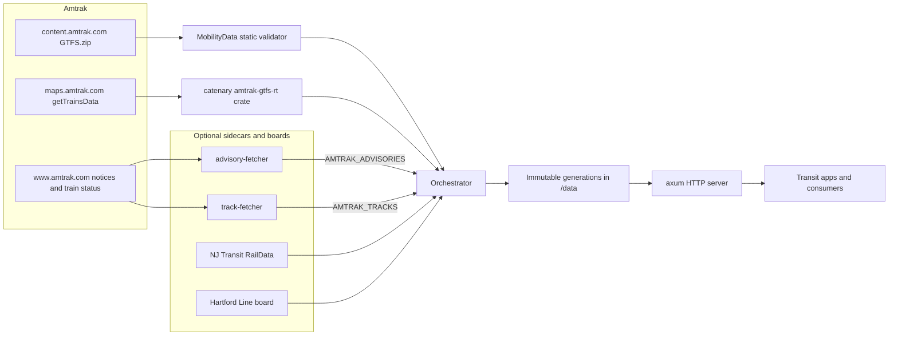
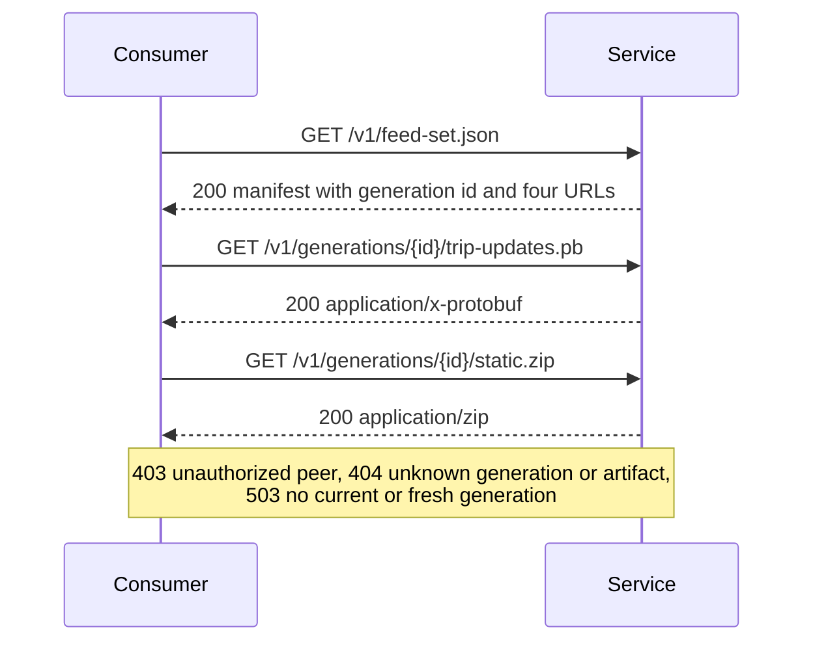
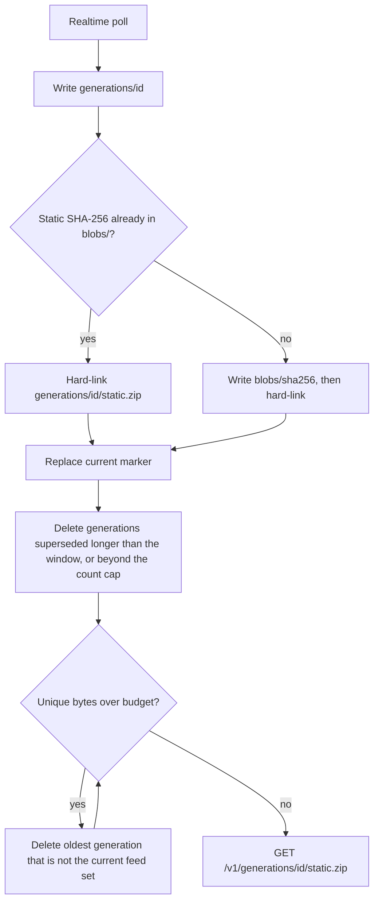
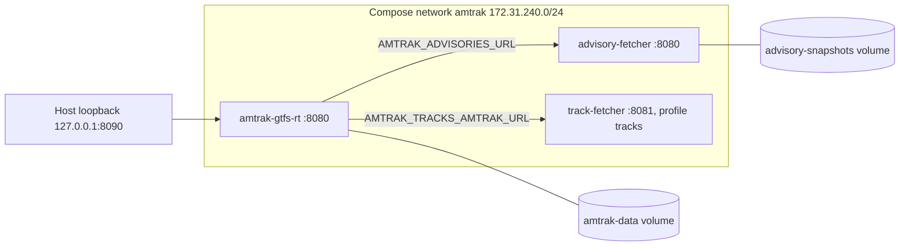
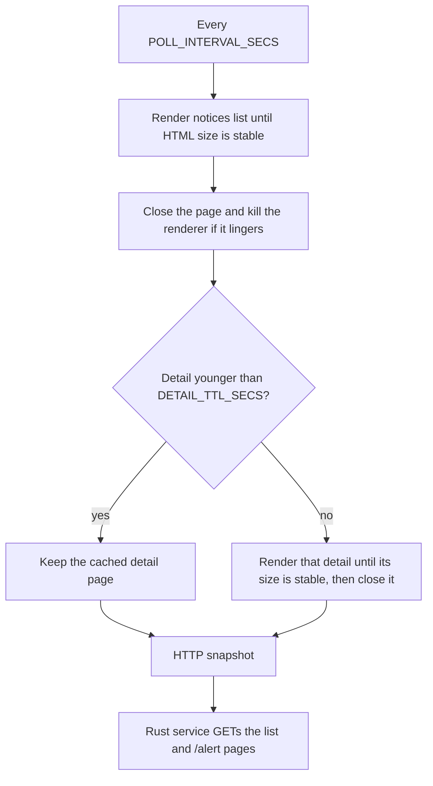
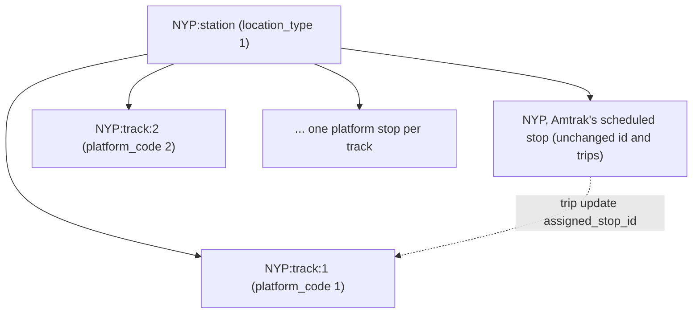
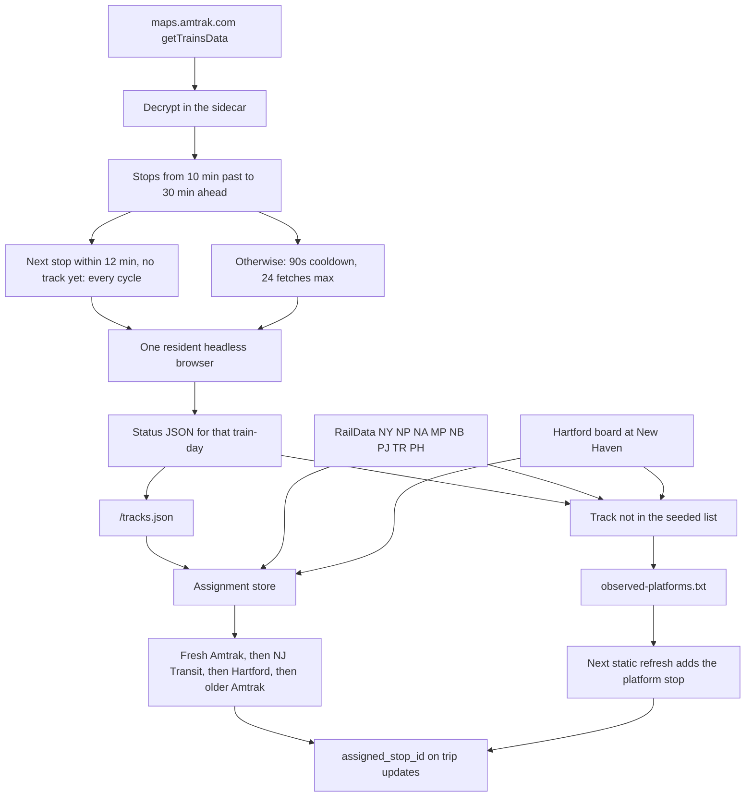
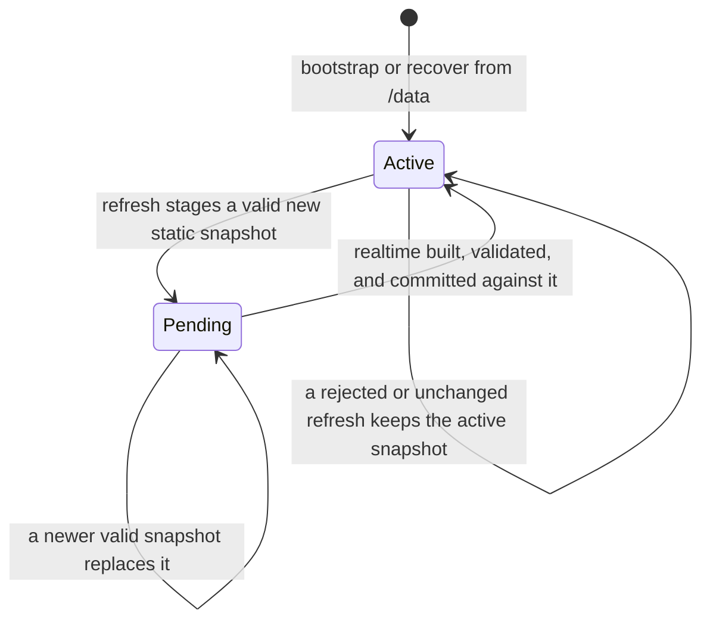

# Amtrak GTFS-RT

[](https://github.com/sohampatwardhan/Amtrak-GTFS-RT/actions/workflows/ci.yml)
[](https://github.com/sohampatwardhan/Amtrak-GTFS-RT/actions/workflows/validate-feeds.yml)

A small Rust service that produces **live GTFS-Realtime feeds for Amtrak** — TripUpdates,
VehiclePositions, and Alerts — plus the static GTFS they bind to, for use in third-party
transit apps (Transit, Transitland, OpenTripPlanner).

It loads Amtrak's official static `GTFS.zip`, then on an interval delegates the
decrypt → parse → match → encode work to the
[`catenarytransit/amtrak-gtfs-rt`](https://github.com/catenarytransit/amtrak-gtfs-rt) crate, which
fetches and decrypts Amtrak's `getTrainsData`, matches each train to a GTFS trip, and returns
ready-made protobuf feeds. Complete static and realtime generations are persisted immutably and
served by a small `axum` HTTP server. A neutral `RtSource` trait wraps the data source so fallback
sources (TransitDocs, RailRat) can be added later without touching the core.

Two optional features add data Amtrak's feed does not carry. Both are off by default and fail
open, so turning them on never stops trip updates or vehicle positions from publishing:

- **[Service Alerts & Notices](#service-alerts--notices)** (`AMTRAK_ADVISORIES`): station and
  passenger advisories in `alerts.pb`.
- **[Platform and track assignments](#platform-and-track-assignments)** (`AMTRAK_TRACKS`): the live
  track a train will use, from Amtrak, NJ Transit, and the Hartford Line.



## Release and deployment status

- **Source:** `main` contains the Rust service, the Playwright `advisory-fetcher` (with advisory
  detail text in `alerts.pb`), the `track-fetcher` sidecar for Amtrak's own track numbers, the
  `amtrak-status` station and train CLI, root-level Compose and Bake packaging, and live track and
  platform assignments (default-off via `AMTRAK_TRACKS`). Changes merged after a release are
  listed under **Unreleased** in [CHANGELOG.md](CHANGELOG.md).
- **Releases:** `v0.6.2` (2026-10-19) is the current release. A release is complete when its
  GitHub Release carries `image-release.txt` with the tag, revisions, manifest digest, and both
  platform digests; until then, `v0.5.0` stays the stable image. The release workflow publishes
  the scratch service image only; build the browser sidecars from this repository. Pull the
  version tag, and pin the manifest digest from that release's `image-release.txt`:

  ```bash
  docker pull ghcr.io/sohampatwardhan/amtrak-gtfs-rt:0.6.2
  docker pull ghcr.io/sohampatwardhan/amtrak-gtfs-rt@sha256:<release-manifest-digest>
  ```

> [!CAUTION]
> Do not deploy `v0.3.0`, `v0.6.0`, or `v0.6.1`, or their partial images. Those tags exist, but
> their publication never completed and they have no GitHub Release. `v0.3.0` ships in `v0.4.0`
> and later; `v0.6.0` and `v0.6.1` ship in `v0.6.2`.

> [!IMPORTANT]
> This repository does not record or authorize a running production deployment, anonymous public
> feed exposure, reverse-proxy trust, or orchestration. Publishing the image does not change the
> loopback-only default.

## Endpoints

| Path | Access | Content-Type | Description |
|------|--------|--------------|-------------|
| `/livez` | public | `application/json` | Process liveness, independent of feed readiness |
| `/readyz` | controlled | `application/json` | `200` only while the current generation is less than 300 seconds old |
| `/v1/feed-set.json` | controlled | `application/json` | Current generation ID, timestamp, static version, entity counts, and four immutable URLs |
| `/v1/generations/{id}/static.zip` | controlled | `application/zip` | Static GTFS for exactly generation `{id}` |
| `/v1/generations/{id}/{trip-updates,vehicle-positions,alerts}.pb` | controlled | `application/x-protobuf` | One GTFS-Realtime product from exactly generation `{id}` |

> [!IMPORTANT]
> Fetch `/v1/feed-set.json` first and then use only the URLs it returns. Do not construct
> generation URLs or substitute a newer ID between artifact requests. Every realtime header is
> stamped with the manifest's static version and generation timestamp, so the four artifacts of
> one manifest always belong together.



**Access control.** Controlled routes authorize the direct socket peer. With no explicit
allowlist, only loopback peers are admitted. `Forwarded` and `X-Forwarded-For` are ignored; placing
a reverse proxy at this authorization boundary requires a separately designed trusted-proxy policy.

## Running from source

Requires a current stable Rust toolchain (the `amtrak-gtfs-rt` dependency uses edition 2024;
developed against 1.96) and **`protoc`**, the protobuf compiler. The `gtfs-realtime` crate
generates its Rust bindings from `.proto` files at build time:

```bash
brew install protobuf                        # macOS
sudo apt-get install -y protobuf-compiler    # Debian/Ubuntu
```

```bash
cargo run
```

On startup the service recovers a retained last-good generation, validates a newly fetched static
schedule when needed, and begins polling. Query the manifest rather than a mutable feed URL:

```bash
manifest=$(curl -fsS http://127.0.0.1:8080/v1/feed-set.json)
vehicle_url=$(printf '%s' "$manifest" | jq -r '.urls.vehicle_positions')
curl -fsS "http://127.0.0.1:8080${vehicle_url}" --output vehicle-positions.pb
```

## Container

Versioned releases are published for `linux/amd64` and `linux/arm64` at
`ghcr.io/sohampatwardhan/amtrak-gtfs-rt`. The image is public, so released tags can be pulled
without a registry login:

```bash
docker pull ghcr.io/sohampatwardhan/amtrak-gtfs-rt:0.6.2
```

> [!TIP]
> `latest` is a convenience pointer that can move. For reproducible production deployment, pin the
> manifest digest recorded in the release's `image-release.txt`:
>
> ```bash
> docker pull ghcr.io/sohampatwardhan/amtrak-gtfs-rt@sha256:<release-manifest-digest>
> ```

The service ships as a digest-pinned, non-root, multi-stage image assembled from `scratch`. The
build compiles the locked Rust binary against musl and rebuilds MobilityData validator v8.0.1 from
its SHA-256-pinned source snapshot with reviewed security-version overrides. The complete upstream
validator suite runs during the build, and a fixed reproducible JAR digest gates copy-forward. The
runtime contains only the binary, that JAR, a minimized Corretto Java 17 runtime, musl, zlib, CA
roots, and license notices — no shell, package manager, curl, Rust toolchain, `protoc`, or
repository source.

**Image contract:** runs as UID/GID `10001`, entrypoint `/usr/local/bin/amtrak-gtfs-rt-service`
(PID 1), documented port `8080/tcp`, persistent volume `/data`, and a Docker healthcheck that
probes `/livez`. Container defaults differ from the host defaults so the persistence and validator
paths are correct inside the image:

| Variable | Host default | Container default |
|----------|--------------|-------------------|
| `AMTRAK_OUTPUT_DIR` | `./out` | `/data` |
| `AMTRAK_GTFS_VALIDATOR_JAR` | `./tools/gtfs-validator-v8.0.1-cli.jar` | `/opt/amtrak/gtfs-validator-v8.0.1-amtrak-hardened.1-cli.jar` |
| `AMTRAK_BIND_ADDR` | `127.0.0.1:8080` | `127.0.0.1:8080` (loopback-only) |
| `AMTRAK_ALLOWED_PEER_IPS` | empty | empty (loopback only) |

### Build locally

The scratch service image is the default build. `runtime` is the last Dockerfile stage, so this
does not include either fetcher or a browser:

```bash
docker build --tag amtrak-gtfs-rt:local .
```

[`docker-bake.hcl`](docker-bake.hcl) builds that image and the separate fetcher images. The
`track-fetcher` target is not in the default group, so `docker buildx bake` and the scratch release
stay unchanged:

```bash
docker buildx bake                  # service + advisory-fetcher
docker buildx bake service          # scratch service only
docker buildx bake advisory-fetcher # advisory browser sidecar only
docker buildx bake track-fetcher    # optional track sidecar
```

### Run with host networking (simplest safe posture)

With host networking the container shares the host's loopback, so the safe loopback default works
unchanged and only loopback peers are admitted:

```bash
docker run --rm --network host \
  -v amtrak-data:/data \
  ghcr.io/sohampatwardhan/amtrak-gtfs-rt:0.6.2
# manifest is reachable from the host loopback (an admitted peer):
curl -fsS http://127.0.0.1:8080/v1/feed-set.json
```

> [!NOTE]
> This works directly with Docker Engine on Linux. Docker Desktop requires version 4.34 or later and
> **Settings → Resources → Network → Enable host networking**. If that option is unavailable or
> disabled, use the dedicated bridge below instead.

### Run on a dedicated bridge (explicit network policy required)

A bridge port map is **intentionally unreachable** with the loopback default. Bridged operation
must bind the wildcard address *and* name the exact peer(s) allowed to reach the feed boundary.
There is no wildcard allowlist and no proxy trust. Publish the port on host loopback only:

```bash
docker network create --subnet 172.31.240.0/24 --gateway 172.31.240.1 amtrak-net
docker run --rm --network amtrak-net \
  -p 127.0.0.1:8080:8080 \
  -e AMTRAK_BIND_ADDR=0.0.0.0:8080 \
  -e AMTRAK_ALLOWED_PEER_IPS=172.31.240.1 \
  -v amtrak-data:/data \
  ghcr.io/sohampatwardhan/amtrak-gtfs-rt:0.6.2
```

> [!WARNING]
> `AMTRAK_ALLOWED_PEER_IPS` must be the **exact** source IP the container observes for admitted
> traffic. That IP is engine-dependent (the bridge gateway on a Linux bridge; it can differ on
> Docker Desktop), so confirm it. A wrong value yields `403`, and the denied request logs its
> observed `peer=<ip>` in the container logs.

### Health, readiness, manifest, and artifacts

```bash
# Docker liveness (public; used by HEALTHCHECK):
docker inspect -f '{{.State.Health.Status}}' <container>
curl -fsS http://127.0.0.1:8080/livez

# Feed readiness — 200 only while the current generation is < 300s old (peer-gated):
curl -fsS http://127.0.0.1:8080/readyz

# Manifest first, then only the URLs it returns (peer-gated):
manifest=$(curl -fsS http://127.0.0.1:8080/v1/feed-set.json)
static_url=$(printf '%s' "$manifest" | jq -r '.urls.static_zip')
curl -fsS "http://127.0.0.1:8080${static_url}" --output static.zip
```

`/livez` is the Docker health signal: process liveness only. `/readyz` is a separate, peer-gated
feed-availability signal. They are deliberately distinct, so Docker does not restart a healthy
process that is merely waiting for its first good generation.

### Volume retention and rollback

> [!IMPORTANT]
> Generations live only in the mounted volume, so **retain the named volume across upgrades**.

`GenerationStore` recovers the last complete, valid generation on startup and rejects partial
state, so recreating the container over the same volume — even before any successful upstream
refresh — recovers the previous last-good feed set byte-for-byte.

Each realtime poll publishes a new immutable generation. The static ZIP rarely changes, so it is
stored once under `blobs/<sha256>` and hard-linked into `generations/<id>/static.zip`. Served URLs
stay `/v1/generations/{id}/static.zip`; only the inode is shared.

After every publish, and again on startup, the store applies three limits to generations that are
**not** the current feed set:

1. **Retention window.** A generation is deleted once it has been superseded for
   `AMTRAK_GENERATION_RETAIN_SECS` (default 600). This keeps a reader that fetched the previous
   manifest able to download the artifact URLs it names. The supersession time is the newer
   generation's manifest mtime, so the window is measured from disk and survives restarts: after
   an outage, everything that went stale while the service was down is removed at startup.
2. **Count cap.** At most `AMTRAK_GENERATION_MAX` generations (default 20, current included) are
   kept. This is a backstop and wins over the window, so a fast poll cannot grow the store.
3. **Byte budget.** The oldest are deleted until unique bytes are within
   `AMTRAK_GENERATION_BUDGET_BYTES` (default 256 MiB; `0` disables this cap).

Every retained generation is held in memory for lock-free responses, so the count cap also bounds
resident memory. Startup reads only the current generation, prunes the volume by directory
metadata, and then loads the survivors, so it uses about the same memory however many directories
an older release left behind. The current generation is never deleted, even when it alone is
larger than the budget. If the filesystem still cannot hold the next publish, older non-current
generations are removed until there is room or only the current feed set remains.



> [!TIP]
> Size the volume about one static ZIP larger than the budget, because a publish briefly keeps the
> previous generation beside the new one. On a 512 MiB tmpfs, the old unbounded layout (about
> 19 MiB copied into every generation) filled the disk by the 27th publish. Dedup plus the 256 MiB
> cap keeps that from happening.

Rollback is running the preceding image tag against the retained volume. Immutable artifacts are
never rewritten and there is no on-disk migration:

```bash
docker rm -f <container>                       # keep the volume
docker run -d --network amtrak-net -p 127.0.0.1:8080:8080 \
  -e AMTRAK_BIND_ADDR=0.0.0.0:8080 -e AMTRAK_ALLOWED_PEER_IPS=172.31.240.1 \
  -v amtrak-data:/data \
  ghcr.io/sohampatwardhan/amtrak-gtfs-rt@sha256:<release-manifest-digest>
```

### Smoke test

[`scripts/test-container.sh`](scripts/test-container.sh) runs a bounded, fail-closed smoke test
against a built image on an isolated bridge and named volume. It:

- waits for health, readiness, and the manifest, then fetches and independently decodes all four
  artifacts;
- asserts that denied-peer and spoofed-header requests get `403`, and that a wildcard bind without
  a policy and a non-writable `/data` refuse to start;
- verifies retained-volume recovery;
- records image size and time-to-health, and exports an SBOM plus a CVE report under
  `validation-reports/container/`.

CVE scanning prefers Docker Scout (needs `docker login`) and falls back to
[grype](https://github.com/anchore/grype) if it is installed (no auth required). Unavailable CVE
evidence is reported as such, never assumed clean. The smoke-only shell/curl helper is separately
digest-pinned and never enters the production image. Reviewed release evidence is retained under
[`.security/risk-acceptance/evidence/`](.security/risk-acceptance/evidence/).

```bash
scripts/test-container.sh amtrak-gtfs-rt:local
```

### Release evidence and licensing

The tag-triggered (or explicit main-only recovery) workflow builds and tests each architecture
separately, scans each exact platform digest, attaches its SPDX SBOM as a registry attestation, and
only then assembles the public version tags. The final multi-platform digest receives a provenance
attestation. The GitHub Release records that digest and attaches per-platform SPDX SBOMs,
vulnerability reports, and license evidence. No release workflow deploys a running service.

The project is licensed `AGPL-3.0-only`. The complete project license and generated Rust
third-party notices are available inside every released image at `/licenses/`, in the repository,
and as GitHub Release assets. The minimized Java runtime and validator JAR retain their own legal
notices. OCI labels identify the exact source repository, revision, version, and project license.

> [!NOTE]
> Still out of scope: anonymous public exposure of a running feed service, reverse-proxy or
> forwarded-identity trust, Docker Hub publication, and orchestration.

## Deployment

Run it under a process supervisor. The service exits with a non-zero status if any of its
long-lived tasks (poller, static refresher, HTTP server) stops unexpectedly, so a supervisor
configured to restart on failure brings it back:

```ini
[Service]
ExecStart=/usr/local/bin/amtrak-gtfs-rt-service
Environment=AMTRAK_OUTPUT_DIR=/var/lib/amtrak-gtfs-rt
Restart=on-failure
```

> [!WARNING]
> The built-in HTTP layer is the supported access boundary. Do not expose the generation directory
> through a generic file server: that would bypass peer authorization, readiness semantics, strict
> identifier parsing, and manifest-first discovery.

## Configuration (environment variables)

| Variable | Default | Description |
|----------|---------|-------------|
| `AMTRAK_STATIC_URL` | `https://content.amtrak.com/content/gtfs/GTFS.zip` | Static GTFS source |
| `AMTRAK_OUTPUT_DIR` | `./out` | Where feed files are written and served from |
| `AMTRAK_POLL_SECS` | `45` | Realtime poll interval (seconds) |
| `AMTRAK_STATIC_REFRESH_SECS` | `86400` | Static feed refresh interval (seconds) |
| `AMTRAK_FILTER_CAPITAL_CORRIDOR` | `false` | Drop Capital Corridor (route 84); a better feed exists via 511.org |
| `AMTRAK_BIND_ADDR` | `127.0.0.1:8080` | HTTP bind address; non-loopback requires an allowlist |
| `AMTRAK_ALLOWED_PEER_IPS` | empty | Comma-separated exact peer IPs; empty admits loopback only |
| `AMTRAK_GTFS_VALIDATOR_JAR` | `./tools/gtfs-validator-v8.0.1-cli.jar` | Readable, approved MobilityData validator 8.0.1 CLI JAR (official host artifact or repository-hardened container build) |
| `AMTRAK_GENERATION_BUDGET_BYTES` | `268435456` (256 MiB) | Unique on-disk bytes kept for generations. The current feed set is never deleted. `0` disables the cap |
| `AMTRAK_GENERATION_RETAIN_SECS` | `600` | Seconds a superseded generation stays addressable, measured from the newer generation's write time on disk. `0` deletes it as soon as it is superseded |
| `AMTRAK_GENERATION_MAX` | `20` | Most generations kept on disk and in memory, current included. Must be at least `1`; wins over the retention window |
| `AMTRAK_VALIDATOR_CACHE` | on | Skip the Java GTFS validator when the static ZIP's SHA-256 already has an accept or standards-reject result. `off` validates every fetch |
| `AMTRAK_ADVISORIES` | off | Set to `on`, `true`, or `1` to merge Service Alerts & Notices into `alerts.pb`. Default off; fail-open |
| `AMTRAK_ADVISORIES_URL` | `https://www.amtrak.com/service-alerts-and-notices` | HTML snapshot URL. Point this at the advisory-fetcher sidecar; plain HTTP to `www.amtrak.com` is Akamai-blocked |
| `AMTRAK_ADVISORIES_TTL_SECS` | `900` | Minimum seconds between advisory page fetches |
| `AMTRAK_TRACKS` | off | Set to `on`, `true`, or `1` to publish live platform/track assignments. Default off; fail-open |
| `AMTRAK_TRACKS_PLATFORMS` | `NYP=1-21;NWK=A,1-5;NHV=1-4,8,10,12,14` | Covered stations and their real tracks (`STOP=labels`, ranges allowed). Each becomes a platform stop |
| `AMTRAK_TRACKS_REFRESH_SECS` | `60` | Seconds between background board refreshes |
| `AMTRAK_TRACKS_MAX_AGE_SECS` | `300` | Oldest board reading that may still be published |
| `AMTRAK_TRACKS_REQUEST_TIMEOUT_SECS` | `10` | Timeout for each board request |
| `AMTRAK_TRACKS_RAILDATA_BASE` | `https://raildata.njtransit.com/api/TrainData` | NJ Transit RailData `TrainData` base URL |
| `NJT_RAILDATA_USERNAME` | empty | Registered RailData username. Set with the password, or set neither |
| `NJT_RAILDATA_PASSWORD` | empty | Registered RailData password. Never commit this |
| `AMTRAK_TRACKS_NJT_STATIONS` | `NY,NP,NA,MP,NB,PJ,TR,PH` | RailData station codes to read. Each code needs a map entry |
| `AMTRAK_TRACKS_STATION_MAP` | `NY=NYP,NP=NWK,NA=EWR,MP=MET,NB=NBK,PJ=PJC,TR=TRE,PH=PHL` | RailData code to Amtrak GTFS `stop_id`. Overrides or extends the default |
| `AMTRAK_TRACKS_HARTFORD_URL` | `https://hartfordline.com/connecting-train-status/` | New Haven board. Set empty to skip it |
| `AMTRAK_TRACKS_HARTFORD_STOP` | `NHV` | Amtrak `stop_id` for that board |
| `AMTRAK_TRACKS_AMTRAK_URL` | empty | Sidecar URL for Amtrak's own status JSON. Empty skips that source. This is not `www.amtrak.com`; that host blocks plain HTTP |
| `AMTRAK_TRACKS_RETAIN_GRACE_SECS` | `900` | How long an Amtrak track stays published after the stop's latest time |

> [!CAUTION]
> Pass `NJT_RAILDATA_USERNAME` and `NJT_RAILDATA_PASSWORD` through the environment only. Never put
> them in the repository, a Compose file, or an image.

The browser sidecars have their own settings, documented in
[`advisory-fetcher/README.md`](advisory-fetcher/README.md) and
[`track-fetcher/README.md`](track-fetcher/README.md).

## Compose stack

From the repository root, one Compose file builds and runs the scratch service with the advisory
sidecar, advisories on. The track sidecar is the `tracks` profile and is not started by a plain
`docker compose up`:

```bash
docker compose up -d --build
```



That stack sets:

```text
AMTRAK_ADVISORIES=on
AMTRAK_ADVISORIES_URL=http://advisory-fetcher:8080/service-alerts-and-notices
AMTRAK_BIND_ADDR=0.0.0.0:8080
AMTRAK_ALLOWED_PEER_IPS=172.31.240.1
```

The feed is published on host loopback port 8090 (`http://127.0.0.1:8090`), leaving host port 8080
free for other services. The allowlist is the gateway of the Compose network, which is the peer
the container sees for that published port on Docker Engine for Linux. A `403` means the observed
peer differs; the denied request logs `peer=<ip>`. Neither sidecar is published to the host.

Both sidecars run Chromium with `--disable-dev-shm-usage`, so Compose gives each a 64 MiB
`/dev/shm` instead of 1 GiB. Chromium stays in the sidecar images and never enters the scratch
service image. The scratch-image release workflow does not publish the sidecars; their browser
base is outside that image's zero-match vulnerability gate.

> [!TIP]
> Both sidecars use `chromium-headless-shell`, the lightest browser that passes Amtrak's Akamai
> check. If Amtrak starts rejecting it, rebuild both with full Chromium and Xvfb and run them
> headful. The images get larger and headful Chromium uses more memory:
>
> ```bash
> FETCHER_BROWSER_BUNDLE=full FETCHER_BROWSER_MODE=xvfb-headful docker compose up -d --build
> ```

To run the Rust service alone with advisories left off, skip Compose and run the scratch image by
itself:

```bash
docker build --tag amtrak-gtfs-rt:local .
docker run --rm --network host -v amtrak-data:/data amtrak-gtfs-rt:local
```

## Service Alerts & Notices

Station Advisories and Passenger Advisories from Amtrak's notices page are merged into the
published `alerts.pb` only when an operator turns them on. The Rust service does not run a
browser. `www.amtrak.com` resets plain HTTP clients (Akamai), so the supported source is the
Playwright sidecar in [`advisory-fetcher/`](advisory-fetcher/README.md). The sidecar snapshots the
notices list and each linked `/alert/...` detail page. The service GETs those pages on the fetcher
origin: `header_text` is the list title, and `description_text` is the detail body (effective
date, paragraphs, and PSN). A missing detail page keeps that alert's title and effective date.

The fetcher re-renders the notices list on `POLL_INTERVAL_SECS` (default 15 minutes). It samples
the page HTML until the size is stable and the advisory markup is present, then closes the
renderer instead of waiting out the page's ~20 second timers. Detail pages already stored within
`DETAIL_TTL_SECS` (default 24 hours) are not rendered again; the HTTP server keeps serving them for
`DETAIL_MAX_STALE_SECS` (default 24 hours, and it must be at least the TTL). The list snapshot
still uses `MAX_STALE_SECS`.



> [!NOTE]
> Advisories fail open. A list fetch or parse failure, a stopped fetcher, or unsetting
> `AMTRAK_ADVISORIES` adds no advisory entities and still publishes trip updates and vehicle
> positions. A missing fetcher does not fail a generation.

## Platform and track assignments

With `AMTRAK_TRACKS=on`, trip updates carry the live track at stations whose boards publish it, in
the form the GTFS-Realtime reference defines: `stop_time_properties.assigned_stop_id` names a
platform stop that exists in the published static feed.

> [!IMPORTANT]
> Turning tracks on changes the published **static** feed as well as trip updates. Consumers that
> list every row of `stops.txt` should filter by `location_type` or `parent_station`, so parent
> stations and platforms do not show up as separate places. Consumers that match stop times by
> `stop_id` should fall back to `stop_sequence` when `stop_id` is absent.

### Static feed

Amtrak's `stops.txt` has one plain stop per station, referenced directly by `stop_times.txt`, so
the service adds structure for each station in `AMTRAK_TRACKS_PLATFORMS`:

- a parent station `{stop}:station` (`location_type=1`);
- `parent_station={stop}:station` on the original stop, whose id and trips are unchanged;
- one platform stop per track, `{stop}:track:{label}` (`location_type=0`, `platform_code` = track).



Nothing else in Amtrak's feed changes, and the other files are copied byte-for-byte (after the
[stop-reference repair](#validation-gate), when one applies). The published
static version becomes `{feed_version}+tracks.{digest}`, where the digest changes only when the
platform list changes. The augmented bytes go through the same MobilityData validator gate; if
augmentation fails or is rejected, Amtrak's feed is published unchanged and no tracks are stamped.
The only new validator notice is a `stop_without_stop_time` warning per platform stop, because no
scheduled trip calls at a platform directly.

### Platform list and observed tracks

The seeded list covers tracks from published track maps: New York Penn 1–21, Newark Penn A and
1–5, and New Haven Union's platform tracks (1–4, 8, 10, 12, 14). Add a known list ahead of time
with `AMTRAK_TRACKS_PLATFORMS`, for example `NYP=1-21;NWK=A,1-5;NHV=1-4,8,10,12,14;EWR=1-4`.

A track any source later reports that is not in that list is recorded as an observed platform in
`{AMTRAK_OUTPUT_DIR}/tracks/observed-platforms.txt`, and the static feed is rebuilt. The rebuild
waits 30 seconds so a burst of new labels is one refresh, and runs at most once every 10 minutes.
The track is stamped only once that platform stop is in the published snapshot.

- The file holds only observed labels, not the configured ones, so removing a track from
  `AMTRAK_TRACKS_PLATFORMS` takes effect, and deleting the file resets observations.
- It is loaded on startup, so a restart does not change the static version. A file that does not
  parse is renamed to `observed-platforms.txt.invalid` and ignored.
- Only stations in the active static feed are observed, and at most 1000 labels are kept.
- If the static validator rejects the feed with the observed platforms, it is rebuilt with the
  configured platforms alone, so one bad observation cannot remove every platform stop.

Labels are platform tokens such as `4`, `14`, `2A`, `A`, or the named track `MAIN` (Buffalo).
Anything else, such as `TBD`, is ignored. A station that is not in the static feed at all is
skipped.

### Trip updates

A matching stop time gets `assigned_stop_id={stop}:track:{label}` and its `stop_sequence`, and its
`stop_id` is removed, as the reference prefers. A stop time is stamped only when it is not skipped,
has a predicted time between one hour before and twelve hours after the generation, and visits its
station exactly once in the trip. Vehicle positions are unchanged.

### Sources and precedence

A background task reads the boards every `AMTRAK_TRACKS_REFRESH_SECS`; generation only reads its
latest results, so a slow or failed board never delays the feed. NJ Transit and Hartford readings
are published for at most `AMTRAK_TRACKS_MAX_AGE_SECS`, and a failed refresh never extends that
age.

When two sources name the same train and stop, the order is:

1. Amtrak's own status, while its document is fresh (fetched by the sidecar within
   `AMTRAK_TRACKS_MAX_AGE_SECS`). This is what the Amtrak app shows.
2. NJ Transit RailData.
3. The Hartford Line board.
4. An older Amtrak track that is still before departure.

The other boards fill the gap before Amtrak publishes a number, and a live NJ Transit or Hartford
reading replaces a stale Amtrak track, so a blocked sidecar cannot hold a track over a board's
track change.



#### Amtrak's train-status API

Amtrak's own status covers every station where Amtrak posts a track. The service does not call
`www.amtrak.com` itself: set `AMTRAK_TRACKS_AMTRAK_URL` to the
[`track-fetcher`](track-fetcher/README.md) sidecar, which serves `GET /tracks.json`. An empty URL
leaves this source off.

On 2026-10-17 the app showed track 1 at Providence for train 167 about ten minutes before arrival
(`arrival.track.number` `1`, `asOf` 16:57, scheduled 17:06). Some stations publish hours earlier,
and that value is already on the document once the train is near the stop, so the sidecar polls
trains with a stop inside a 30-minute lookahead and a 10-minute lookback instead of the whole
fleet. A train whose next stop is within about 12 minutes and still has no track is fetched every
cycle; every other train in the window, including one that has just left a stop, rotates with a
90-second cooldown, and a cycle makes at most 24 fetches. A track Amtrak has shown is kept until
the stop's latest scheduled or predicted time plus `AMTRAK_TRACKS_RETAIN_GRACE_SECS` (default 15
minutes), including when a later document drops the field after departure.

Stations where Amtrak's status documents carried a track on 2026-10-17:

| Amtrak | Station | When the track appeared |
| --- | --- | --- |
| `RTE` | Route 128, MA | Hours ahead |
| `PVD` | Providence, RI | About 8–10 minutes before arrival (train 167, track 1) |
| `KIN` | Kingston, RI | Overnight (`asOf` 01:18, train 167, track 1) |
| `OSB` | Old Saybrook, CT | Hours ahead |
| `NYP` | New York Penn | Hours ahead on the New York–Washington board (train 109, track 12, gate `W`) |
| `PHL` | Philadelphia 30th Street | Minutes before the stop |
| `WIL` | Wilmington, DE | Minutes before the stop |
| `BAL` | Baltimore Penn | Minutes before the stop |
| `BWI` | BWI Airport, MD | Hours ahead |
| `FBG` | Fredericksburg, VA | Minutes before the stop |
| `RVR` | Richmond Staples Mill Road, VA | Minutes before the stop |
| `NFK` | Norfolk, VA | Not recorded |
| `RHI` | Rhinecliff, NY | Overnight (`asOf` 01:19, train 49, track 1) |
| `BUF` | Buffalo-Depew, NY | Hours ahead (`asOf` 12:29, train 49, track `MAIN`) |
| `WTI` | Waterloo, IN | Overnight (`asOf` 01:19, train 49, track 1) |
| `TCL` | Tuscaloosa, AL | Not recorded |
| `LAJ` | La Junta, CO | Not recorded |

> [!NOTE]
> Amtrak publishes no list of the stations it posts tracks for. This table is a one-day sample: a
> twelve-train sample, the Lake Shore Limited (train 49), and the New York–Washington board. The
> sidecar reads whatever Amtrak posts, so a station not listed here is picked up as soon as Amtrak
> shows a track for it.

Amtrak posted no track that day for train 167 at Westerly (`WLY`), New Haven (`NHV`), or its New
York arrival, and none for train 1164 at Princeton Junction (`PJC`). New Haven comes from the
Hartford board and Princeton Junction from NJ Transit RailData. A track posted minutes before the
stop is why trains near a stop are polled every cycle; one posted hours ahead is already on the
document when the train enters the window.

The sidecar keeps a single `chromium-headless-shell` between polls and blocks image, font,
stylesheet, and media requests, and every host outside `amtrak.com`. The maps feed, which has no
track field, is decrypted without a browser and only decides who is near a stop. A browser failure
ends that cycle's fetches, and relaunches back off from 1 to 15 minutes. If every fetch in a cycle
fails, `/tracks.json` goes `503` after five minutes instead of serving old documents as current. In
Compose the sidecar runs read-only, with no capabilities, a 768 MB memory limit, and no published
port. The image uses the same headless-shell build the advisory sidecar's on-device notes ran on a
Raspberry Pi 5 (`linux/arm64`).

```bash
AMTRAK_TRACKS=on \
AMTRAK_TRACKS_AMTRAK_URL=http://track-fetcher:8081/tracks.json \
  docker compose --profile tracks up -d --build
```

> [!WARNING]
> The sidecar sends up to 24 status requests a minute to `www.amtrak.com`, fewer once trains near
> a stop already show their tracks. Check that this volume suits Amtrak's terms of use before
> running it.

#### NJ Transit RailData

RailData covers every station both railroads schedule. Amtrak rows are those whose `TRAIN_ID`
starts with `A`; the prefix and leading zeros are stripped before matching GTFS
`trip_short_name`. The codes are Appendix V of NJ Transit's Rail Real-time Data API, checked
against Amtrak's station codes:

| RailData | Amtrak | Station |
| --- | --- | --- |
| `NY` | `NYP` | New York Penn |
| `NP` | `NWK` | Newark Penn |
| `NA` | `EWR` | Newark Liberty Airport |
| `MP` | `MET` | Metropark |
| `NB` | `NBK` | New Brunswick |
| `PJ` | `PJC` | Princeton Junction |
| `TR` | `TRE` | Trenton |
| `PH` | `PHL` | Philadelphia 30th Street |

New York and the six New Jersey stops are Amtrak's scheduled stops in the state (FY25 fact sheet)
plus New York Penn. Philadelphia is the Atlantic City Line's terminal, which Amtrak also serves.
North Philadelphia (`NF` / `PHN`) is not polled: a few Keystone trains stop, and NJ Transit does
not. Wilmington, Baltimore, BWI, New Carrollton, and Washington are stop codes on Amtrak
itineraries in the same API, and NJ Transit does not operate them. Westerly is not in that station
list.

This source needs a registered RailData account from the
[NJ Transit developer portal](https://developer.njtransit.com/registration). Without credentials,
NJ Transit stations are skipped. One cached token is reused for the whole pass, and it is kept in
`{AMTRAK_OUTPUT_DIR}/tracks/raildata-token.json` (mode `0600`, never served). A token is requested
only when the cache is empty or older than 23 hours, and never more than 10 times in 24 hours, NJ
Transit's limit. The pass stops when credentials are rejected or that budget is spent. Any failed
token request (rejected credentials, an NJ Transit error such as `Missing user account.` for an
unknown username, or a network failure) pauses NJ Transit requests for an hour, so each failure
costs one request.

```bash
AMTRAK_TRACKS=on NJT_RAILDATA_USERNAME=... NJT_RAILDATA_PASSWORD=... \
  docker run --rm --network host -v amtrak-data:/data \
  -e AMTRAK_TRACKS -e NJT_RAILDATA_USERNAME -e NJT_RAILDATA_PASSWORD amtrak-gtfs-rt:local
```

> [!NOTE]
> The station codes were checked against NJ Transit's API appendix and Amtrak's station list, not
> yet against a live RailData response.

#### CTrail Hartford Line board

The CTrail Hartford Line connecting-train board covers New Haven Union, which is not an NJ Transit
RailData station. Amtrak's own status had no New Haven track for train 167 on 2026-10-17, while
this board showed track 3. Set `AMTRAK_TRACKS_HARTFORD_URL` empty to skip it.

## Station and train status CLI

`amtrak-status` answers station-departure and train-status questions from one coherent generation
of the local feed service, or straight from Amtrak. It renders times in each station's local zone,
shows delay against the schedule, prints `track N` where a platform is assigned, and always names
the generation it read. It is built only with the `status` feature, so it stays out of the
released service image:

```bash
cargo run --features status --bin amtrak-status -- station NYP --limit 10
cargo run --features status --bin amtrak-status -- train 167
cargo run --features status --bin amtrak-status -- train 167 --source amtrak
```

`--source local` (the default) reads `--base-url` (default `http://127.0.0.1:8080`). Exit codes:
`0` success, including a resolved "no such station or train" answer; `1` a feed fetch or decode
failure; `2` a usage error; `3` the service has no current generation.

## Resilience

- **Fallback chain.** Sources are tried in order; the first fresh, non-empty batch wins.
- **Last-good serving.** Source, conversion, validation, static, or publication failure leaves the
  current immutable generation unchanged and the scheduled poller retries later.
- **Atomic publication.** Static GTFS, three realtime feeds, and the manifest become visible only
  after durable generation-directory and current-marker commits. Readers see a complete old or
  complete new generation, never a mixture.
- **Version consistency.** A valid replacement static snapshot remains pending until realtime has
  been built, validated, and committed against it.
- **Freshness semantics.** Readiness becomes false at exactly 300 seconds of generation age while
  liveness remains independently available.



## Project layout

| Path | Responsibility |
|------|----------------|
| `src/main.rs` | Wiring: configuration, sources, static bootstrap, supervised tasks |
| `src/config.rs` | Environment-driven configuration |
| `src/sources/mod.rs` | `RtSource` trait and the `RtBatch` normalization model |
| `src/sources/amtrak.rs` | Amtrak source, wrapping the catenary crate |
| `src/sources/advisories.rs` | Optional Service Alerts & Notices scraper (`AMTRAK_ADVISORIES`) |
| `src/sources/tracks/` | Optional platform/track assignments (`AMTRAK_TRACKS`): Amtrak status documents, RailData client, Hartford board, precedence and retention, background refresher, stamper |
| `src/static_augment.rs` | Platform stops added to the published static feed when tracks are on |
| `src/static_repair.rs` | Drops stop times that name a stop missing from upstream `stops.txt` |
| `src/static_gtfs.rs` | Exact-byte static GTFS validation and pending/active lifecycle |
| `src/orchestrator.rs` | Source selection, coherent generation build/validation, and recoverable polling |
| `src/serve.rs` | Controlled immutable HTTP delivery and freshness health |
| `src/writer.rs` | Durable immutable generation persistence and recovery |
| `src/bin/amtrak_status.rs`, `src/bin/status/` | `amtrak-status` CLI (`--features status`) |
| `advisory-fetcher/` | Optional browser sidecar that snapshots Amtrak's notices pages |
| `track-fetcher/` | Optional browser sidecar (`AMTRAK_TRACKS_AMTRAK_URL`): decrypts the maps feed, polls trains near a stop, serves `/tracks.json` |
| `scripts/` | Container smoke test, feed validation gate, release tooling |
| `docs/` | Design specs, implementation plans, and research notes |

## Testing

```bash
cargo test                          # unit + integration (offline)
cargo test --features status        # also the amtrak-status CLI
cargo test -- --include-ignored     # also runs live tests against Amtrak's endpoints

(cd advisory-fetcher && python -m pytest tests -q)   # sidecar tests, no browser or network
(cd track-fetcher && python -m pytest tests -q)
```

The feeds are verified two ways in the suite: RT protobuf round-trips through the decoder, and a
live end-to-end test fetches real Amtrak data and asserts non-empty, statically-bound output.
CI also builds both sidecar images, in both browser bundles, natively on amd64 and arm64.

The [release gates](.github/workflows/release-gates.yml) workflow runs the release's per-platform
image checks on pull requests before a tag is pushed: it builds the linux/amd64 service image, runs
[`scripts/test-container.sh`](scripts/test-container.sh), and scans it with the pinned syft and
grype from [`scripts/install-release-scanners.sh`](scripts/install-release-scanners.sh) under the
same zero-match policy. Because the smoke test fetches live Amtrak data, it runs only when a PR
touches the image inputs (`Dockerfile`, `.dockerignore`, `container/`, `src/config.rs`,
`Cargo.toml`, `Cargo.lock`, or the smoke/scanner/policy scripts), which includes every release PR's
version bump. It also runs weekly and on demand, so a new advisory against the current image shows
up before release day. On failure the Grype report and smoke diagnostics are uploaded as an
artifact. arm64 is still checked only by the release itself.

## Validation gate

Spec compliance is enforced separately by
[MobilityData's gtfs-validator](https://github.com/MobilityData/gtfs-validator) and
[gtfs-realtime-validator](https://github.com/MobilityData/gtfs-realtime-validator), run against
feeds generated from live data:

```bash
./scripts/validate-feeds.sh
```

The script generates feeds (or reuses `out/`), fetches and pins both validators, validates each RT
feed type in its own directory, and prints every notice by severity. Reports land in
`validation-reports/`. It needs Java 17 and Maven, and falls back to Docker automatically if they
aren't installed.

**How the gate decides.** It fails when a validator reports an ERROR code that is not listed in
[`validation/baseline.json`](validation/baseline.json). Occurrence *counts* are not gated — they
track how many trains are running and vary legitimately between runs, whereas a new error *code*
is a real regression.

The baseline currently records eleven known RT error codes, most of them inherited from upstream
(trips and stations that appear in live data but not in Amtrak's published schedule) and two that
are fixable here (`E039` `is_deleted` on a FULL_DATASET feed, `E049` unpopulated header
incrementality). Each entry is annotated with its cause; they are debt to burn down, not permanent
exemptions. Amtrak's static GTFS currently produces **zero** ERROR notices, so the static side is
gated at zero.

**Repaired stop references.** Before validation, the service drops any `stop_times.txt` row whose
`stop_id` is missing from `stops.txt` and logs a warning per stop
(`stop times name a stop missing from stops.txt; dropped`). Without this, one undefined stop makes
the GTFS parser reject Amtrak's whole schedule (`The id OSM is not known`), and the service keeps
serving the last accepted one. Amtrak's 20261018 feed is a known case: the Mardi Gras
Service calls at Ocean Springs (`OSM`) without defining it, so those four calls are dropped and the
rest of each trip is kept. A feed with no such rows is published unchanged.

> [!NOTE]
> CI runs this gate nightly, on pushes that touch the pipeline, and on demand — not on pull
> requests, since an Amtrak outage would otherwise block unrelated work.

## Consumer migration

> [!WARNING]
> The mutable `/trip-updates.pb`, `/vehicle-positions.pb`, `/alerts.pb`, `/static.zip`, and
> `/health` routes are removed from the generation API.

Controlled consumers must switch atomically to manifest-first discovery, accept
`application/x-protobuf` for realtime products, and treat `403`, `404`, and `503` distinctly:
unauthorized peer, unknown immutable generation or artifact, and no current or fresh generation
respectively. Rollback uses the preceding service binary and retained generation directory; it
never rewrites immutable artifacts.

## Changelog

See [CHANGELOG.md](CHANGELOG.md).

## License

**AGPL-3.0-only.** This service depends on the AGPL-3.0-licensed
[`catenarytransit/amtrak-gtfs-rt`](https://github.com/catenarytransit/amtrak-gtfs-rt) crate, which
does the core decryption and GTFS matching. Thanks to the Catenary project.
