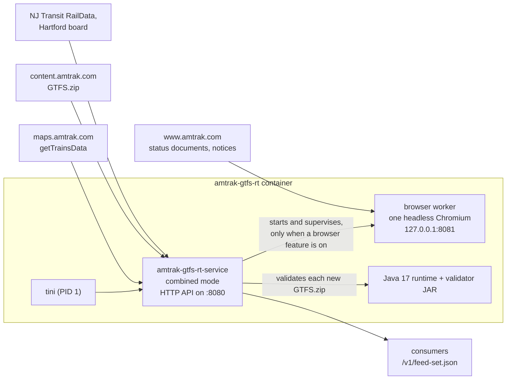

# Design: one container

- **Status:** accepted by the owner on 2026-11-07, including decisions D1 and D2 below (approved on #69).
- **Supersedes:** [`docs/rearchitecture.md`](rearchitecture.md) (three containers, one per feed) and `.kiro/specs/three-feed-containers/`.
- **Goal:** Amtrak GTFS-RT is one container image, and it just works. One `docker run`, or one Compose service, publishes the manifest, the static ZIPs, and all three GTFS-Realtime feeds. The image includes every helper the service needs. Each optional source can be turned on or off with an environment flag.

## Why

The three-container split from #42 never shipped in a release. It added coordination that a single process doesn't need:

- **Shared-volume handoff.** VehiclePositions writes a fleet snapshot to disk, and the other two roles write contributions that an assembler waits for. That handoff is the whole cause of #49 (snapshots copied every poll and never pruned), #51 (one stopped container stalls every feed), and #54 (a newly observed platform takes up to 24 hours to publish).
- **More images.** The split shipped three images plus a proxy, and v0.7.1 still publishes two sidecar images. Each one needs its own build, smoke test, scan, SBOM, and license notices (#50).
- **Same public result.** Consumers already see one endpoint. Every public URL is served by one process on one port, so splitting the internals gave consumers nothing.

The binary already has the right shape. With `AMTRAK_ROLE` unset, `run_combined` (`src/lib.rs`) runs all three feeds in one process, hands data off in memory, and wraps the optional sources so they fail open. The only thing missing is the browser helper inside the same image.

## The image

One image, `ghcr.io/sohampatwardhan/amtrak-gtfs-rt`, for `linux/amd64` and `linux/arm64`.

| Part | What it is | Notes |
| --- | --- | --- |
| Init | `tini` as PID 1 | Reaps zombies and forwards signals. The image no longer depends on Compose's `init: true`. |
| Service | `amtrak-gtfs-rt-service` in combined mode | Static musl binary, as today. It polls `getTrainsData` once per cycle, downloads `GTFS.zip`, and serves the HTTP API. |
| Browser worker | One Python package with one headless Chromium | It serves Amtrak's track and gate status documents and the service-notices HTML on `127.0.0.1` only. It replaces `track-fetcher/` and `advisory-fetcher/`. |
| Validator | A Java 17 runtime built with `jlink`, plus the hardened MobilityData validator JAR | The runtime must be built against glibc. Today's runtime comes from Alpine and uses musl, so it does not run on the Debian base Chromium needs. |
| Base | `debian:bookworm-slim` or `python:3.12-slim-bookworm` | Headless-shell Chromium needs glibc and its shared libraries, so the image can no longer be `scratch`. |



### Process model

- **Service process.** `tini` starts the service. The service starts the browser worker only when at least one browser feature is on (`AMTRAK_TRACKS_AMTRAK` or `AMTRAK_ADVISORIES`). With both off, no Python or Chromium process runs.
- **Restarts.** The service restarts the worker when it exits, with backoff. After repeated consecutive failures, the service exits non-zero so the container restart policy takes over. This is the rule recorded in #63, decision 2.
- **Fail open.** HTTP handlers never wait on the worker. Track stamps and notices fail open exactly as they do today: a dead worker means no Amtrak track numbers and no notices, and every feed keeps publishing.
- **Shutdown.** `SIGTERM` stops the worker and then the service, within Docker's default 10-second grace period.
- **Network.** The worker listens on `127.0.0.1` only. The service reaches it through `AMTRAK_TRACKS_AMTRAK_URL` and `AMTRAK_ADVISORIES_URL`, which default to the worker's endpoints. Those variables stay as overrides and are no longer something users have to set.
- **One browser.** The resident Chromium serves status documents. Each notices cycle opens a new context in that same browser and closes it when done, instead of launching a second Chromium.
- **Akamai.** The rules about `www.amtrak.com` are unchanged: no fingerprint spoofing, no copied cookies, no curl-impersonate.

### Hardening

These are defaults in the image and in the Compose file. Users don't have to add them.

- The image runs as non-root user `10001`.
- The root filesystem is read-only. `/tmp` and the worker's home directory are tmpfs, and `/data` is the only volume.
- All capabilities are dropped, and `no-new-privileges` is set.
- Compose sets memory and PID limits, plus `shm_size: 64mb` for Chromium.
- The healthcheck runs `amtrak-gtfs-rt-service --healthcheck`. It fails when the service's `/livez` fails, or when a browser feature is on and the worker has been down past its restart budget.

## Feature flags

Every optional source has an on/off flag. The defaults are chosen so a bare `docker run` gives the full feed. Flags accept `on`, `true`, `1`, `off`, `false`, `0`, or `no`, as `AMTRAK_TRACKS` does today. Any other value is a startup error.

| Flag | Default | What it controls | Browser? |
| --- | --- | --- | --- |
| `AMTRAK_TRACKS` | on | Master switch for track, platform, and gate stamping, and for the platform stops added to `static.zip` | no |
| `AMTRAK_TRACKS_AMTRAK` (new) | on | Amtrak's own track and gate status documents | yes |
| `AMTRAK_TRACKS_HARTFORD` (new) | on | The Hartford Line board for New Haven. Replaces "set `AMTRAK_TRACKS_HARTFORD_URL` empty". | no |
| NJ Transit RailData | on when `NJT_RAILDATA_USERNAME` and `NJT_RAILDATA_PASSWORD` are both set | NJ Transit tracks. No credentials means the source is skipped, as today. | no |
| `AMTRAK_ADVISORIES` | **on** (D2) | Amtrak station and passenger notices merged into `alerts.pb` | yes |
| `AMTRAK_FILTER_CAPITAL_CORRIDOR` | off | Drops Capital Corridor (route 84) | no |

The TransitDocs ASM and Pacific Surfliner alerts come from the main poll and have no flag. The other variables in the README configuration table (poll intervals, retention, the track tuning knobs) stay as they are.

At startup, the service logs one line listing each source and whether it is on. That covers the startup banner requested in #57.

## Decisions for the owner

These two decisions are written up as proposals in this document. Approving it approves them, and either can be changed in review.

### D1. `docker run` works without extra flags

Today the image binds `127.0.0.1:8080`, and an empty `AMTRAK_ALLOWED_PEER_IPS` admits loopback clients only. So `docker run -p 8090:8080 ghcr.io/sohampatwardhan/amtrak-gtfs-rt` starts, but every request through the published port gets `403`. Requests through a published port arrive from the Docker bridge gateway, not from loopback.

**Proposed:** the image binds `0.0.0.0:8080`, and the allowlist accepts a new keyword, `gateway`, which the service resolves to the container's default gateway at startup. The image defaults `AMTRAK_ALLOWED_PEER_IPS=gateway`. Who can reach the service is then decided by the `-p` binding, which is how Docker users already expect to control exposure:

```bash
docker run -d -p 127.0.0.1:8090:8080 -v amtrak-data:/data ghcr.io/sohampatwardhan/amtrak-gtfs-rt
```

The README leads with this command. `-p 127.0.0.1:8090:8080` keeps the feed local. `-p 8090:8080` exposes it on every interface, with the same consequences as for any other container.

The host-binary rule stays the same: outside the image, binding a non-loopback address without an allowlist still refuses to start. `Forwarded` and `X-Forwarded-For` are still ignored.

**Alternative:** keep the loopback default and document the two variables. That's safer if someone pulls the image without reading anything, but it doesn't "just work".

### D2. Notices on by default

`AMTRAK_ADVISORIES` defaults off today because it needed a separate sidecar. With the worker in the image, turning it on costs one browser context every 15 minutes in a Chromium that is already running for tracks.

**Proposed:** default on. `AMTRAK_ADVISORIES=off` turns it off.

## What gets removed

Only `amtrak-gtfs-rt` remains as a published package. Everything else that duplicates it is removed.

| Item | Fate | When |
| --- | --- | --- |
| `ghcr.io/sohampatwardhan/amtrak-gtfs-rt-track-fetcher`, `-advisory-fetcher` | Last published at v0.7.1. Get a deprecation notice in the README and in the package description, no further releases, then are unlinked from the repository and deleted once the owner confirms | Release after the stack lands |
| `-trip-updates`, `-alerts` (named in `docker-compose.yml`) | Never published. The names are dropped. | With the split removal |
| `trip-updates.Dockerfile`, `alerts.Dockerfile`, `track-fetcher/Dockerfile`, `advisory-fetcher/Dockerfile`, their `docker-bake.hcl` targets | Deleted. The root `Dockerfile` builds the one image. | Split removal and release PRs |
| `src/roles.rs`, `src/cohort.rs`, `AMTRAK_ROLE`, fleet and contribution snapshots | Deleted. Combined mode is the only mode. | Split removal |
| `track-fetcher/` and `advisory-fetcher/` as separate packages, and the vendored harness copies | Merged into one worker package, `browser-worker/`. One package needs no vendored harness (#59) | Worker PR (#73) |
| Rust `lead_time.rs`/`schedule.rs` vs Python `schedule.py` | Python stays, Rust copy deleted (#66) | Scheduler PR |
| `scripts/test-compose-stack.sh`, `scripts/test-fetcher-image.sh`, CI's fetcher-image matrix | Replaced by one image smoke test on amd64 and arm64 | Split removal |
| Compose services `vehicle-positions`, `trip-updates`, `alerts` | One service, `amtrak-gtfs-rt`, the same name v0.7.1 used | Image PR |
| Optional Caddy proxy (`--profile proxy`) | Kept as an optional profile. It adds TLS, gzip, and a rate limit, and nothing else covers that. It stays a local build. | No change |

## Upgrading

- **From v0.7.1 (service plus two sidecars).** The Compose service keeps its name, `amtrak-gtfs-rt`, and its published port `127.0.0.1:8090`. Remove the `track-fetcher` and `advisory-fetcher` services and any `AMTRAK_TRACKS_AMTRAK_URL` or `AMTRAK_ADVISORIES_URL` overrides that point at them. The built-in worker replaces them.
- **From `main` between #42 and this stack.** The three-container layout was never released, so no published image changes. Local `docker-compose.override.yml` files that name `vehicle-positions` need to name `amtrak-gtfs-rt` again.
- **Unchanged.** The public HTTP contract, generation URLs, platform stop ids, the `platform_code` text, and the `+tracks.{digest}` suffix.

## Costs

- **Image size.** The image grows from about 190 MB to several hundred MB, mostly Chromium. The image PR measures and records the real number.
- **Footprint when browser features are off.** With `AMTRAK_TRACKS_AMTRAK=off` and `AMTRAK_ADVISORIES=off`, the running container is the Rust service plus a Java run on each new static ZIP. That's roughly what the scratch image runs today.
- **Shared fate.** A Chromium crash or an out-of-memory kill no longer takes the feeds with it. The kernel kills the largest process, which is Chromium, and the service restarts the worker. Shared memory and PID limits are a single budget.
- **The image is no longer `scratch`.** It now has a Debian base, Python, and Chromium. The release vulnerability gate, the SBOM, and the license notices cover all of them (#50).

## Implementation plan

Each step is one PR. They are stacked in this order and merged into `main` with merge commits.

| PR | Work | Issues |
| --- | --- | --- |
| 0 | Approve the 2026-11 Cargo risk acceptance and mark the v0.2.0 record superseded before it expires on 2026-11-12 | #58 |
| 1 | This document. Retarget AGENTS.md and mark the three-container design superseded | #63 |
| 2 | Feature flags: add `AMTRAK_TRACKS_AMTRAK` and `AMTRAK_TRACKS_HARTFORD`, default the worker URLs, default `AMTRAK_ADVISORIES` on, add the startup source line | #70 |
| 3 | The one image: browser worker inside, glibc Java runtime, `tini`, supervision, `SIGTERM`, the `127.0.0.1` worker bind, hardening, healthcheck, one Compose service, D1 network default | #71, #52 |
| 4 | Remove the split: roles, cohort snapshots, `AMTRAK_ROLE`, per-role Dockerfiles, and the fetcher-image CI jobs. `.github/rulesets/main.json` is updated in the same PR. | #72 (closes #49, #51, #54) |
| 5 | One browser worker package from both fetchers. A single package replaces the shared-harness extraction | #73, #59 |
| 6 | One track scheduler | #66 |
| 7 | Combined-mode tests, including all browser features off and one poll per cycle, and validation of both static ZIPs | #55 |
| 8 | Precomputed ETags, zero-copy serving, and RFC 9110 conditional-request precedence | #56 |
| 9 | Conditional requests for the daily `GTFS.zip` refresh | #60 |
| 10 | Release the one image with license notices for everything in it. Retire the other package names. | #74 (supersedes #50) |
| 11 | README, Compose comments, CHANGELOG, and the upgrade notes above | #57 |

Later: #61 (train match rate) and #62 (fallback source, v1.1).

PR 5 lands before PR 3 and PR 4, so the one image embeds a single worker that already serves both
paths on `127.0.0.1:8081`, and no intermediate build runs two workers.

PR 4 renames CI jobs that the main ruleset requires, so it can't pass its own required checks. Merge it through the admin pull-request bypass, then run `scripts/apply-rulesets.sh`.
