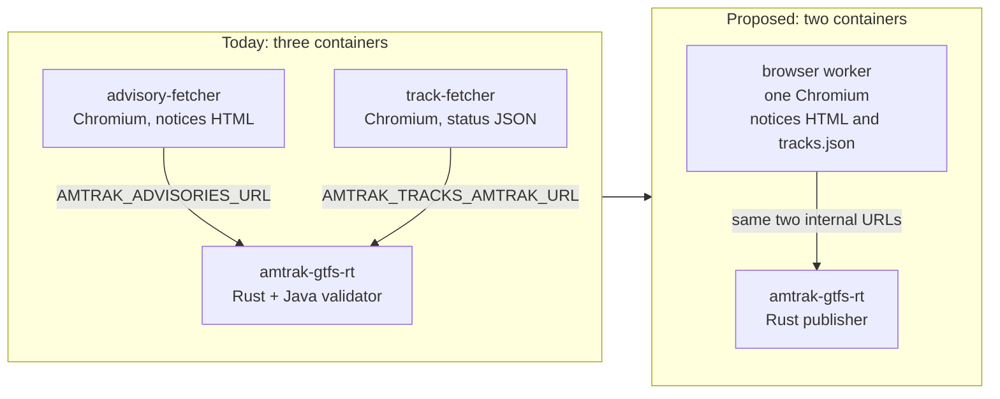
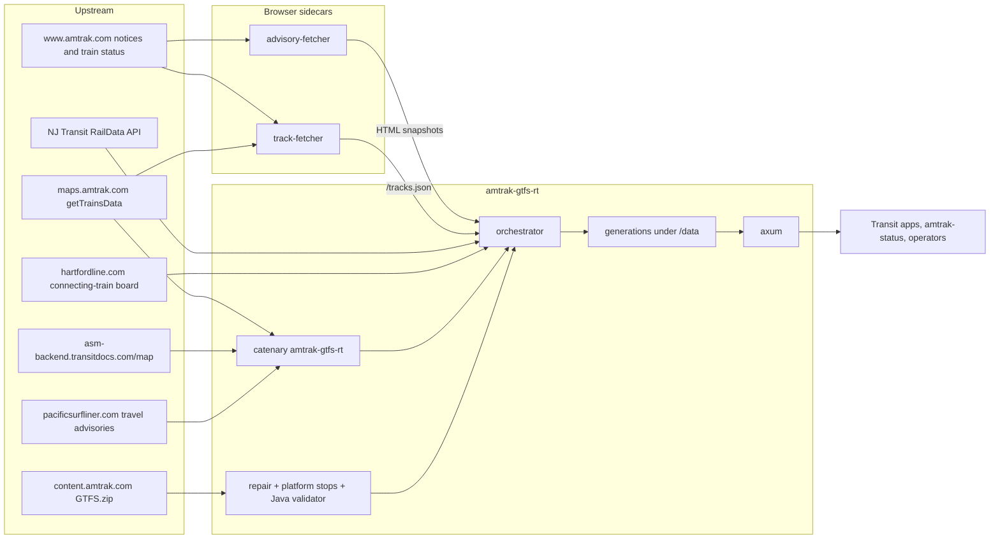
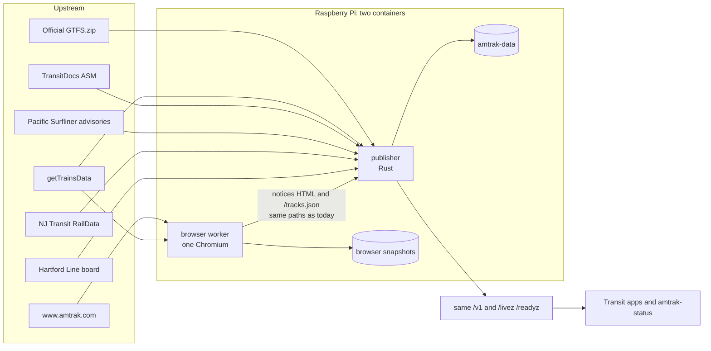

# Re-architecture proposal: one publisher, one browser, official static GTFS

- **Status:** proposal only. This document does not change the running service, the images, or the Raspberry Pi.
- **Date:** 2026-11-01
- **Owner intent:** Amtrak already publishes the static GTFS. This project should keep producing the three GTFS-Realtime feeds (TripUpdates, VehiclePositions, Alerts) and stay feature-rich, with fewer containers and fewer moving parts.
- **What this proposal does:** folds today's three containers into two, keeps every current user-facing feature, and treats `https://content.amtrak.com/content/gtfs/GTFS.zip` as the schedule. It does not drop a feature. Two places where our bytes differ from that official ZIP are called out as open questions at the end, because they exist to keep matching and track assignments working.

The repository has no Kiro spec layout (`.kiro/specs/`). This file is the design.

## Recommendation in one page

Run **two containers** on the Pi:

1. **Publisher** (`amtrak-gtfs-rt`, the existing Rust process). It downloads Amtrak's official static GTFS, matches realtime trains to that schedule's `trip_id` / `stop_id` / `route_id`, and serves the same HTTP API it serves today, including `static.zip` on the generation URL. Track stamping, NJ Transit RailData, the Hartford Line board, advisory merge, the Capital Corridor filter, immutable generations, and peer checks stay in this process.
2. **Browser worker** (one image, one Chromium). It replaces both `advisory-fetcher` and `track-fetcher`. `www.amtrak.com` still resets plain HTTP clients, so the notices pages and the train-status documents stay behind one headless browser. Compose gives that one container the old DNS names, so the publisher's URLs do not change.

Keep the decrypt-and-match path this repo already uses: the `catenarytransit/amtrak-gtfs-rt` crate (AGPL-3.0) and its `amtk` decryptor, pointed at a parsed copy of Amtrak's official GTFS. [Piero Maddaleni's `piemadd/amtrak` library](https://github.com/piemadd/amtrak) (v3.0.17) is a TypeScript client of `api.amtraker.com`. It does not decrypt `getTrainsData`, does not emit GTFS-Realtime, and does not join `trip_id`s. Depending on it would add a Node runtime or a third-party API, plus that API's attribution terms. Details and the comparison table are below.

No user-facing feature moves off the public API. `amtrak-status` stays a CLI. There is no dashboard in this repo today.

## Current architecture

There is no systemd unit, cron file, or Pi-specific deploy script in the repo. The Pi instructions are `docker compose pull && docker compose up -d` from a release checkout (`README.md`). Schedulers that run on the device are in-process loops. GitHub Actions cron jobs validate feeds and release gates; they do not run on the Pi.

### Containers and processes

| Piece | Image / binary | What it does | Schedule | Listens |
| --- | --- | --- | --- | --- |
| Publisher | `ghcr.io/sohampatwardhan/amtrak-gtfs-rt` from the root `Dockerfile` `runtime` stage (scratch, UID 10001). Compose service `amtrak-gtfs-rt`. | Downloads static GTFS, repairs and optionally augments it, validates it with MobilityData's Java CLI, polls realtime, stamps tracks, merges advisories, writes an immutable generation, serves HTTP. | Poll every `AMTRAK_POLL_SECS` (45s). Static refresh every `AMTRAK_STATIC_REFRESH_SECS` (86400s), sooner when the platform table changes. Board refresher every `AMTRAK_TRACKS_REFRESH_SECS` (60s). | `8080` in the container. Compose publishes `127.0.0.1:8090`. |
| Advisory sidecar | `ghcr.io/sohampatwardhan/amtrak-gtfs-rt-advisory-fetcher`. Python 3.12, Playwright, `chromium-headless-shell`. | Renders Amtrak's notices list and `/alert/...` detail pages so the publisher can turn them into GTFS-RT alerts. Akamai blocks a plain HTTP client. | List every `POLL_INTERVAL_SECS` (900s). Detail pages reused for `DETAIL_TTL_SECS` (86400s). | `8080` on the Compose network only. Not published on the host. |
| Track sidecar | `ghcr.io/sohampatwardhan/amtrak-gtfs-rt-track-fetcher`. Same browser shape, plus `cryptography`. Compose `mem_limit: 768m`, read-only root, no capabilities. | Decrypts `maps.amtrak.com` `getTrainsData` in Python to choose trains near a stop, then uses one resident browser to read `www.amtrak.com` train-status JSON (track and gate). | Every 60s, at most 24 status fetches per cycle. | `8081` on the Compose network only. |
| `amtrak-status` | Cargo binary, `--features status`. Not in the released image. | Station board and train status from the local publisher, or directly from Amtrak. | On demand. | None. |
| `python -m fetcher.dump` | Inside the track-fetcher image, or a local venv. | Prints tracks and gates for named trains, then exits. | On demand. | None. |

Inside the publisher process the supervised tasks are the poller, the static refresher, and the HTTP server (`src/main.rs`). The track board refresher is a separate spawned task. NJ Transit and the Hartford board are HTTP calls from that refresher. They never had their own container.

`docker-bake.hcl` builds the same three images. The default bake group is the publisher plus advisory-fetcher; track-fetcher is an extra target. Compose always runs all three unless `AMTRAK_TRACKS=off` and `track-fetcher` is scaled to zero.

### Data flow

**Realtime trains.** `AmtrakSource` (`src/sources/amtrak.rs`) calls `amtrak_gtfs_rt::fetch_amtrak_gtfs_rt` with the parsed static feed. That crate (v0.9.1, AGPL-3.0, git dependency) decrypts `https://maps.amtrak.com/services/MapDataService/trains/getTrainsData` through the `amtk` crate, matches each train to a GTFS trip (including a date-offset check for trains that run past midnight), and returns three `FeedMessage`s. The publisher stamps one header on all three: GTFS-Realtime 2.0, `FULL_DATASET`, and `feed_version` equal to the static snapshot's version (`src/orchestrator.rs`).

**Alerts already inside that crate.** Two sources ride along, and both fail open:

- Train-scoped alerts from `https://asm-backend.transitdocs.com/map` (TransitDocs ASM), joined to a train by origin date and train number.
- Pacific Surfliner travel-advisory HTML scraped from `https://www.pacificsurfliner.com/plan-your-trip/alerts/travel-advisories/`.

**Alerts this repo adds.** With `AMTRAK_ADVISORIES=on`, `WithAdvisories` GETs the advisory sidecar and appends entities. A station advisory's `informed_entity.stop_id` is the Amtrak station code, which is the GTFS `stop_id`. A passenger advisory's `route_id`s come from `route_long_name`. `header_text` is the list title. `description_text` is the detail page (effective date, paragraphs, PSN) when the sidecar has it. A missing sidecar or a parse failure publishes the other feeds anyway.

**Tracks and gates.** With `AMTRAK_TRACKS` on (the default), `WithTracks` sets `stop_time_properties.assigned_stop_id` to a platform stop that this service inserted into the static feed, fills `stop_sequence`, and clears `stop_id`, which is what the GTFS-Realtime reference asks for. A gate has no GTFS-RT field, so it lives on that platform stop: `platform_code` `24 (Gate H)`, stop id `{stop}:track:{track}:gate:{gate}`. Vehicle positions are left alone.

Board precedence, unchanged by this proposal:

1. A fresh Amtrak status document (from the track sidecar).
2. NJ Transit RailData, for stations in `AMTRAK_TRACKS_NJT_STATIONS`, when `NJT_RAILDATA_USERNAME` and `NJT_RAILDATA_PASSWORD` are set.
3. The CTrail Hartford Line HTML board, mapped to `AMTRAK_TRACKS_HARTFORD_STOP` (default `NHV`).
4. An older Amtrak track that is still inside the retain-grace window (`AMTRAK_TRACKS_RETAIN_GRACE_SECS`, default 900).

A track label that is not in the seeded list is appended to `{AMTRAK_OUTPUT_DIR}/tracks/observed-platforms.txt`. The static feed is rebuilt after a 30 second debounce, at most once every 10 minutes, then re-validated. If that validation fails, the service rebuilds with the configured platforms only.

**Who calls the publisher.** The README names Transit, Transitland, and OpenTripPlanner as the intended consumers. They are told to GET `/v1/feed-set.json` and then only the four URLs in that document. `amtrak-status --source local` is the in-repo consumer (default `http://127.0.0.1:8080`). Docker's healthcheck and `amtrak-gtfs-rt-service --healthcheck` call `/livez`. The sidecars are consumed only by the publisher. Nothing in the repo is a web dashboard.

The `RtSource` trait can hold a fallback chain. TransitDocs and RailRat position sources are named in the README and are not implemented. The poller has one source.

### What we do to static GTFS that Amtrak already publishes

The bytes start as Amtrak's ZIP (`AMTRAK_STATIC_URL`, default `https://content.amtrak.com/content/gtfs/GTFS.zip`). Before they are served, the publisher may change them:

1. **Dangling stop repair** (`src/static_repair.rs`). `stop_times.txt` rows whose `stop_id` is missing from `stops.txt` are dropped. Amtrak's 20261018 feed calls at Ocean Springs (`OSM`) without defining that stop. `gtfs-structures` then refuses the whole ZIP (`The id OSM is not known`). A clean ZIP is stored unchanged.
2. **Platform augmentation** (`src/static_augment.rs`), when tracks are on. For each station in the platform table the service adds a parent `{stop}:station`, points the original stop at that parent, and adds one stop per track (`{stop}:track:{label}`, `location_type=0`, `platform_code` = the label) plus one more when a gate was posted. `feed_version` becomes `{feed_version}+tracks.{digest}`. Other files are copied through. The GTFS-Realtime `assigned_stop_id` is only valid if the consumer's static feed contains that stop.
3. **Standards gate.** MobilityData gtfs-validator 8.0.1 (a JAR rebuilt in the image, run on a minimized Corretto 17) must accept the bytes. Results are cached by SHA-256 (`AMTRAK_VALIDATOR_CACHE`). This is why the scratch image contains a JRE. The validator runs when the ZIP or the platform table changes, not on every 45 second poll.
4. **Republication.** The accepted ZIP is stored once under `blobs/<sha256>` and hard-linked into each generation as `static.zip`. Clients download it from `/v1/generations/{id}/static.zip`. The three protobuf headers carry that generation's `static_version`, so a client can see which snapshot the realtime was matched against.

Official Amtrak `stops.txt` is one stop per station. It does not contain these platform stops. The schedule files (routes, trips, stop times, calendar) are Amtrak's, aside from repair (1).

### Public and internal endpoints

| Endpoint | Who can call | Body |
| --- | --- | --- |
| `GET /livez` | Anyone who can open the socket | JSON process liveness. Docker health. Independent of feed age. |
| `GET /readyz` | Allowlisted peer. Default: loopback only. `Forwarded` is ignored. | JSON. 200 while the current generation is under 300 seconds old. |
| `GET /v1/feed-set.json` | Same peer gate | `generation_id`, `generated_at_unix`, `static_version`, source name, entity counts, and four relative URLs. |
| `GET /v1/generations/{id}/static.zip` | Same | `application/zip` for that generation only. |
| `GET /v1/generations/{id}/trip-updates.pb` | Same | `application/x-protobuf` |
| `GET /v1/generations/{id}/vehicle-positions.pb` | Same | `application/x-protobuf` |
| `GET /v1/generations/{id}/alerts.pb` | Same | `application/x-protobuf` |

Unknown generation, bad id, or a removed artifact is 404. No current or fresh generation is 503. A peer outside the allowlist is 403. The old mutable paths (`/trip-updates.pb`, `/vehicle-positions.pb`, `/alerts.pb`, `/static.zip`, `/health`) already return 404. This proposal does not bring them back.

Internal, not published on the host:

| Endpoint | Producer | Consumer |
| --- | --- | --- |
| `GET /service-alerts-and-notices` and `GET /alert/<slug>.html` | advisory-fetcher | Publisher, `AMTRAK_ADVISORIES_URL` |
| `GET /healthz` on the advisory sidecar | advisory-fetcher | Operators. Always 200 in current code once the process is up. Staleness is the snapshot's HTTP status. |
| `GET /tracks.json` | track-fetcher | Publisher, `AMTRAK_TRACKS_AMTRAK_URL` |
| `GET /healthz` on the track sidecar | track-fetcher | Docker `HEALTHCHECK`. 503 when no poll has finished within `LIVENESS_SECS`, or after three failed polls in a row. |

`/v1/feed-set.json` on the host, with the Compose stack, is `http://127.0.0.1:8090/v1/feed-set.json`. The allowlisted peer is the Compose bridge gateway `172.31.240.1`.

### Operator surface that is part of the product

Environment variables in the root README (static URL, poll and refresh intervals, Capital Corridor filter, bind address, peer allowlist, public URL, validator path and cache, generation budget / retain / max, advisories URL and TTL, the whole `AMTRAK_TRACKS_*` set, NJ Transit credentials, Hartford URL and stop). Sidecar variables live in `advisory-fetcher/README.md` and `track-fetcher/README.md`.

`amtrak-status station <code> [--limit N] [--source local|amtrak] [--base-url URL]` and `amtrak-status train <number>`. Output includes local time, delay against the schedule, `track N` when a platform was assigned, alerts, and the generation id. Exit codes 0, 1, 2, and 3 are part of the contract.

Persistence and recovery: last-good generation on startup, atomic publish, static dedup, retention window (600s), count cap (20), byte budget (256 MiB). Readiness and liveness stay separate so Docker does not restart a process that is waiting for a first good generation.

Validation: `./scripts/validate-feeds.sh` runs MobilityData's static validator and gtfs-realtime-validator. CI workflow `.github/workflows/validate-feeds.yml` runs that daily at 09:17 UTC, on pipeline pushes, and on demand. New realtime ERROR codes fail unless listed in `validation/baseline.json`. Current baseline codes are E003, E004, E011, E022, E025, E029, E035, E039, E041, E043, E049, mostly trains or stations that exist in the live feed and not in the published schedule. Static ERROR count is gated at zero. `scripts/test-container.sh` is the image smoke test. Release gates (weekly Monday 08:41 UTC, plus image-input PRs) scan the service image.

## `piemadd/amtrak` compared with this repo

Studied on 2026-11-01: [github.com/piemadd/amtrak](https://github.com/piemadd/amtrak), default branch `master`, package version **3.0.17**, last push 2026-08-19, language JavaScript/TypeScript, code license **AGPL-3.0**. Author: Piero Maddaleni. The library README also states that **data from the Amtraker API** is under the Open Data Commons Attribution License (ODC-By) v1.0, adopted 2026-08-19, with a grace period the README sets through 2026-10-31. That data license is separate from the code license. This proposal does not copy either repository's source.

What the published library actually does is in `src/index.ts`: five functions, each an `axios` GET with a `User-Agent` of `AmtrakerAmtrakDotJS/3.0.16`.

| | This repo today | `piemadd/amtrak` 3.0.17 |
| --- | --- | --- |
| Role | GTFS-Realtime producer | Client of a hosted tracking API |
| Fetch | `maps.amtrak.com/.../getTrainsData`, plus ASM, Surfliner, and (via sidecars) `www.amtrak.com` | `https://api.amtraker.com/v3/trains`, `/v3/trains/:id`, `/v3/stations`, `/v3/stations/:id`, `/v3/stale` |
| Decryption | In the `amtk` crate, called by catenary. The ciphertext is Amtrak's map feed. | None in v3. The hosted API returns JSON that Amtraker has already parsed. |
| Polling | Publisher every 45s. Track sidecar every 60s. Advisory sidecar every 15 min. The library has no loop of its own. | The caller polls. The library has no interval. `/v3/stale` reports `avgLastUpdate`, `activeTrains`, and a `stale` flag. |
| Data model | GTFS-RT `FeedMessage`: `trip_id`, `route_id`, stop-time events, vehicle position (lat, lon, speed, bearing), alerts with `informed_entity`. | `Train` keyed by train number: `trainID` like `5-9` (number plus origin day-of-month), lat/lon, speed in MPH, 8-way heading, station list (`code`, scheduled and actual times, `bus`, `platform` string, status), free-text `alerts[]`. `StationMeta` is a directory (name, code, tz, lat/lon, address, train ids), not GTFS `stops.txt`. |
| Stop / trip matching | Catenary joins the map feed to the official GTFS (`trip_short_name`, date offset, `stop_id`). This repo then joins boards to that trip by train number and station code. | Station codes are Amtrak codes. There is no GTFS `trip_id` or `stop_id` join, and no static GTFS input. |
| Tracks | `assigned_stop_id` plus a platform stop in the served static feed. Gates in `platform_code`. | `Station.platform` string on the train object, when Amtraker filled it. |
| License fit | This repo is AGPL-3.0-only because it links catenary. | Code is AGPL-3.0, which can sit beside this repo's license. The **API data** terms in the library README require attribution that a person using the product can actually see, with a link to Amtraker. Redistributing that JSON inside a GTFS-RT feed would have to carry that notice. Their README asks for a project `User-Agent`. |

Older trees associated with the same author (for example historical `fetchTrainData` against `getTrainsData`) did decrypt the map feed with the same general scheme `amtk` already implements: a trailing key segment, then AES-CBC with a PBKDF2-derived key. That code is not in `piemadd/amtrak` v3. This proposal does not port it and does not paste it. Re-implementing a decryptor we already link would be a second copy to keep correct when Amtrak rotates the map script.

### Options

**(a) Depend on the library.** Poor fit. It is Node, not Rust. Calling it means a Node process beside the publisher, which is another container, or shelling out on each poll. The functions return Amtraker JSON, so GTFS matching would still be our code, pointed at a feed we do not control. Freshness, outages, and the ODC-By notice become part of every feed we publish. The `/v3/stale` flag is a useful idea and we already have a local equivalent in `/readyz`.

**(b) Port or borrow the approach.** The v3 approach is "HTTP GET a third-party API." Borrowing that replaces a direct read of Amtrak with Amtraker as the source of trains. The historical decrypt approach duplicates `amtk`. Two ideas in their model are already how this system works, and this document attributes them: a platform string on the station event (we publish that as `assigned_stop_id` / `platform_code`), and a train identity of number plus origin day (catenary's date-offset join is the GTFS form of that). Nothing else in v3 fills a hole in our feeds.

**(c) Keep our own path. This is the recommendation.** Stay on catenary + `amtk` + Amtrak's official GTFS for TripUpdates and VehiclePositions. Keep ASM and Surfliner alerts that the crate already returns. Keep our advisory and track features behind one browser worker. Do not add `api.amtraker.com` as a source. If a later change quotes their code, keep this repo AGPL-3.0-only, keep their copyright notice, and do not drop the catenary repository-link requirement that crate's manifest states.

## Piero Maddaleni's other transit projects

Surveyed 2026-11-01 from the public profile [github.com/piemadd](https://github.com/piemadd) (Piero Maddaleni, Chicago; the profile README points at Amtraker and Transitstatus). The profile has on the order of 200 public repositories. Most are unrelated to this feed. The ones that touch Amtrak, Via, Brightline, GTFS, or live train maps are below. Several of the live services sit in the `transitstatus` organization rather than under `piemadd/` itself; they are included because his profile lists them as his projects.

License note used in the table: "no LICENSE file" means GitHub has no license file to detect. A `package.json` `"license"` field is recorded where one exists, and it is not treated as permission to copy source. No code from these repositories is copied into this proposal.

| Repository | What it is | License as published | Use in this re-architecture |
| --- | --- | --- | --- |
| [piemadd/amtrak](https://github.com/piemadd/amtrak) | npm client of `api.amtraker.com` v3. See the comparison above. | Code: AGPL-3.0, with a `LICENSE` file. README: ODC-By for Amtraker API data. | Do not depend on it. Credit the train-id and platform ideas already attributed above if the implementation mentions them. |
| [piemadd/amtraker-v3](https://github.com/piemadd/amtraker-v3) | Bun service behind that API. Fork of `eiiot/amtraker-v3`. Polls about every 15 seconds and folds Amtrak, Via Rail, and Brightline into one train model. Platforms come from `platformsapi.amtraker.com`; a stops backup is `gtfs.piemadd.com`. | No `LICENSE` file. `package.json` says ISC. The parent repo also has no GitHub license. | Do not copy. It explains where the npm client's Via and Brightline rows come from. Via and Brightline are outside this Amtrak GTFS-RT product. |
| [transitstatus/store](https://github.com/transitstatus/store) | Multi-feed collector. Relevant jobs: Amtrak map-feed proxy (~30s), Amtrak alerts (~10 min), merged platform boards (~10s) from NJ Transit RailData, Moynihan Train Hall, and Metrolink. A CTrail job exists and is disabled in its config. | No `LICENSE` file. `package.json` says ISC. | Do not copy. Useful as a map of extra platform boards (Moynihan is one this repo does not read). If a later change adopts that approach, credit him and still do not paste the unlicensed script. |
| [transitstatus/gtfs-schedule-data](https://github.com/transitstatus/gtfs-schedule-data) | Downloader for many official GTFS zips, including `content.amtrak.com` `GTFS.zip`, Hartford Line, Via, Brightline, and NJ Transit. For Amtrak it inserts a synthetic Ocean Springs stop instead of dropping those stop times. | No `LICENSE` file. `package.json` says ISC. | Do not switch our static URL to `gtfs.piemadd.com`. The official ZIP URL matches ours. The Ocean Springs idea is an alternative to our row-drop repair; see open question 2. Do not copy coordinates or files. |
| [piemadd/amtraker-fetch-proxy](https://github.com/piemadd/amtraker-fetch-proxy) | Small proxy in front of Amtrak requests. The store's map-feed job calls a worker under this name. | No license file. | Do not reuse. Our publisher already fetches the map host directly. |
| [piemadd/better-transit-alerts-spec](https://github.com/piemadd/better-transit-alerts-spec) | "Better Transit Alerts Specification", a GTFS extension sketch. | MIT, `LICENSE` present, copyright 2023 Piero Maddaleni. | Wire format stays GTFS-Realtime. No spec text is copied. A later borrow of a field idea would need the MIT notice. |
| [piemadd/amtraker-vite](https://github.com/piemadd/amtraker-vite) and [transitstatus/transitstatus-react](https://github.com/transitstatus/transitstatus-react) | Map UIs (amtraker.com, transitstat.us). | No `LICENSE` file. | Viewers, not feed producers. Nothing to link into the publisher. |
| [piemadd/amtraker-next](https://github.com/piemadd/amtraker-next) | Older cross-platform tracker, last push 2022. | GPL-3.0. | Historical. Do not revive it. |
| [piemadd/amtrak-api](https://github.com/piemadd/amtrak-api) and [piemadd/Piero-Amtrak-API-Docs](https://github.com/piemadd/Piero-Amtrak-API-Docs) | Old API and docs. The docs README points at `api.amtraker.com/docs`. | No license file. | Superseded by `amtraker-v3`. Do not use. |

He also forks other people's GTFS routers (`public-transit-service`, `gtfs-stream`, `transitous`, and similar). Those licenses belong to the upstream projects. This design does not route trips, so those forks are not inputs.

CTA, Metra announcement, and snowplow repositories on the same profile do not change this Amtrak feed.

### Credit, when any of this is actually used

This proposal only uses his work as background. The implementation must still be ready to credit him if that changes. Any later PR that uses his code, his approach, or his data handling adds all of the following:

1. A `## Acknowledgements` section in `README.md` (a `CREDITS.md` is fine if the README links it). For each use, name Piero Maddaleni, the repository URL, what was used (code, approach, or data handling), and the license.
2. A license-compliant notice next to reused code. AGPL material (`piemadd/amtrak`, or `amtraker-next` if it were ever used) keeps this repo AGPL-3.0-only, keeps his copyright and the AGPL text, and adds a `NOTICE` or third-party entry with the source URL. MIT material (`better-transit-alerts-spec`) carries his copyright line and the MIT permission notice in the file header and in that same notice file. Do not drop catenary's repository-link requirement either.
3. No copy from a repository that has no `LICENSE` file (`amtraker-v3`, `store`, `gtfs-schedule-data`, the proxies, the map UIs), even where `package.json` says ISC. Approach notes and the acknowledgement section are enough. A port waits until he publishes a license file.
4. No redistribution of `api.amtraker.com` payloads unless the product also carries the ODC-By attribution his `amtrak` README describes, in a place a user of the feed will see, with a link to Amtraker. This design does not take that data.
5. No commit of his GTFS extracts, station JSON, or platform dumps into this repository.

## What Amtrak's Track Your Train page actually loads

Checked 2026-11-01. A plain GET of `https://www.amtrak.com/track-your-train` and `https://www.amtrak.com/track-your-train.html`, with an identifying user agent and no cookies, returned **403 from Akamai**. This survey did not retry with a browser, did not solve the challenge, and did not read the HTML. The map application those pages load is published on its own as static files under `https://maps.amtrak.com/rttl/js/` (directory listing and `mapApplication.js`, plus the small config script that file calls). That host answers ordinary GETs. `https://maps.amtrak.com/` itself only redirects to `https://www.amtrak.com`.

The map is **Google Maps** (`google.maps` in `mapApplication.js`). It is not an ArcGIS feature layer. There is no `FeatureServer` or `MapServer` URL in that script. FEMA publishes a separate layer, `Partner/Amtrak_Train_Status`, and describes it as Amtrak and Via status copied from `asm.transitdocs.com` about every 15 minutes. That layer is not what Track Your Train requests.

Endpoints named by the public map script, confirmed with a HEAD or a small GET on 2026-11-01:

| Endpoint | What came back | Role on the tracker |
| --- | --- | --- |
| `GET /services/MapDataService/trains/getTrainsData` | `200`, `text/plain`. No `cache-control` on this HEAD. Body not saved and not decrypted here. | Fleet reload. The script's comment sets `train_refresh_interval` to **300 seconds**, and the map schedules the next reload with that value times 1000. |
| `GET /services/MapDataService/stations/trainStations` | `200`, `text/plain`. | Station layer for the map. Same ciphertext style as the fleet feed. Not a second realtime product. |
| `GET /services/MapDataService/stations/AllTTMTrains` | `200`, `application/json`, about 354 KB, `cache-control: max-age=9229` (about 2.5 hours). | Plaintext GeoJSON the script calls `vAllTrainsURL`. 313 features this morning: 78 `Active`, 235 `Predeparture`. Point geometry, `velocity`, `heading`, route and train number, and `station1`…`station42` JSON blobs. |
| `GET /services/MapDataService/stations/nationalRoute?routeName=` | `200`, `application/json`, `max-age` about 11 hours on this HEAD. | Line geometry for the selected route. The script builds a query against `national_route_shape_v16`. Static. |
| `GET /rttl/js/RoutesList.json` | `200`, 38 routes, keys `Name`, `CMSID`, `ZoomLevel`. `last-modified` 2025-11-03, `max-age` about 8 hours. | Route picker. |
| `GET /rttl/js/route_properties.json` | `200`, GeoJSON, 83 features, bounding boxes (`NAME`, `SEGMENTID`, `NORTH`, `SOUTH`, `EAST`, `WEST`). `last-modified` 2025-11-03. | Map labels. |
| `GET /rttl/js/RoutesList.v.json` | `200`, `last-modified` 2025-04-02. | File the map loads beside the ciphertext. Contents not copied into this document. |

No `Retry-After` or rate-limit header was present on these responses. That is not a promise that Amtrak allows polling. The tracker HTML and Amtrak's terms page were not readable on this pass, because both sit on the host that returned 403. The existing track-fetcher README already says to check Amtrak's terms before sending status traffic. This proposal does not raise that volume.

### Fields the tracker source does and does not have

`AllTTMTrains` was read far enough to list keys. Each station blob has `code`, `tz`, `bus`, scheduled / estimated / posted arrival and departure, comments, and `autoarr` / `autodep`. Across 4,949 station rows, none of the blobs contained a track, platform, or gate field. `lat` on the properties object was empty; the position is the GeoJSON point. Alerts are not a feed on this map. The popup copy for a failed estimate is a static "service disruption" string in the script.

So the official tracker, by itself, is a position and estimate map. Track, gate, and the notices page are other Amtrak surfaces. Those live on `www.amtrak.com`, which this survey left alone.

### Comparison

| | Track Your Train's map | This repo | Piero's stack |
| --- | --- | --- | --- |
| Fleet | `getTrainsData`, reload every 300s, plus plaintext `AllTTMTrains` | `getTrainsData` every 45s, decrypted in-process by catenary / `amtk`, matched to official GTFS | `amtraker-v3` / `store` decrypt the same map feed (about every 15–30s) and also fold in Via and Brightline. The npm library only reads `api.amtraker.com`. |
| Stations | `trainStations` ciphertext, plus static route GeoJSON | Official GTFS `stops.txt`, plus platform stops we add | `gtfs.piemadd.com` stops JSON and his own station files |
| Delays | Estimated and posted times inside the station blobs | TripUpdates from that same map feed | Same map feed, then his own JSON model |
| Position | GeoJSON point, heading, velocity | VehiclePositions from that feed | `lat` / `lon` / velocity on his `Train` object |
| Track and gate | Not in the map payloads inspected here | Status documents, NJ Transit, Hartford board, written as `assigned_stop_id` | Merged platform boards, including Moynihan, served as a `platform` string |
| Alerts | Not a map endpoint | ASM, Pacific Surfliner, and the notices HTML | His alerts job and the notices he proxies |
| ArcGIS | Not used by this map | Not used | Not used |
| Access | Map host allows a plain GET. The HTML page does not. | Same split. Browser only for `www.amtrak.com`. | Proxies and a hosted API in front of the same split |

### Recommendation

Keep `getTrainsData` as the fleet source. It is the reload the official map schedules, it is already what this publisher polls, and a plain GET of that URL works without a browser. Leave decryption where it is, inside the existing crate. Do not add a second decryptor, and do not start polling `www.amtrak.com` from the Rust process.

Do not switch the poll to `AllTTMTrains`. It is the same family of fields in plaintext, which is attractive, and it is a poor realtime source: the response cached for about 2.5 hours, it still has no track or gate, and it does not remove the need to match `trip_id`s. It can stay a documented cousin of the feed, not the feed.

Do not use the FEMA ArcGIS layer. It is a 15-minute copy of TransitDocs, which is coarser than a direct read of the map feed, and it is not Amtrak's tracker.

Track, gate, and service-alert HTML stay on the one browser worker, at the same polite caps as today. The map's own timer is 300 seconds for the whole fleet; this service's 45-second fleet poll is one request per cycle, which is the same shape as the tracker and more frequent than the tracker's timer. Per-train status fetches stay capped (24 per minute in the current sidecar) and still need a terms check by the operator. No login, no credential, and no Akamai bypass is part of this design.

## Proposed architecture

### Publisher

One Rust process, same binary role as today:

- Fetch official `GTFS.zip` on the existing interval. Parse it for matching. Keep the pending-snapshot rule: a new static version is not current until a realtime generation has been built against it.
- Poll `AmtrakSource` on the existing interval. Matching stays inside catenary, so `trip_id` and scheduled `stop_id` are the official feed's ids. When Amtrak ships a new `feed_version`, the next successful refresh picks it up and the protobuf header's `feed_version` follows the snapshot actually used, including the `+tracks.{digest}` suffix while platform stops are in the served ZIP.
- Keep `WithAdvisories`, `WithTracks`, the Capital Corridor filter, the board refresher, observed platforms, generation store, peer gate, and `/livez` `/readyz` `/v1/...`.
- Keep serving `static.zip` on the generation URL. See the open questions before changing what those bytes contain. The default in this proposal is: official schedule, plus the dangling-stop repair, plus platform stops while tracks are on. That is what makes today's track feature a legal GTFS-RT reference.
- NJ Transit token file stays under `{output}/tracks/` and is still not served.

The JRE and the validator JAR stay in this image for now. They are the gate that stops a bad platform rebuild from publishing. They are not a fourth service. An open question below asks whether that gate should leave the Pi image.

### Browser worker

One Python image, one resident `chromium-headless-shell`, doing both jobs the two sidecars do today:

- Notices list and detail snapshots, same paths: `/service-alerts-and-notices`, `/alert/<slug>.html`, same TTLs and stable-size render.
- Train-status documents, same path: `/tracks.json`, same window, hot-train rule, 24-fetch cap, cooldown, and staleness.
- `python -m fetcher.dump` stays in the image.
- Compose network aliases `advisory-fetcher` and `track-fetcher` point at this container, on ports 8080 and 8081, so `AMTRAK_ADVISORIES_URL` and `AMTRAK_TRACKS_AMTRAK_URL` are unchanged. One volume holds snapshots.
- Isolation stays the track sidecar's: read-only root, dropped capabilities, `no-new-privileges`, `init`, 768 MiB memory limit, 256 pids, 64 MiB `/dev/shm`, no host port. Advisory capture shares that budget. The spike notes in `advisory-fetcher/spike/results.md` say a Pi in this project had the memory cgroup disabled, so a Docker memory limit can be discarded by the kernel. Turning the memory cgroup back on is an operator step on the device, outside this repo, and it is what makes the 768 MiB cap real.
- Health: the process stays up if one upstream fails. `/healthz` is 200 when the process can serve. Per-feed staleness stays on the snapshot URLs (`503` when that snapshot is too old), which the publisher already treats as fail-open. A single wedged browser restarts the worker. That is a behavior change from today's track image, whose healthcheck restarts the container after three failed polls even while the process is alive. The publisher still keeps the last track until grace expires, and still ranks a live NJ Transit or Hartford reading above a stale Amtrak document. Splitting the healthcheck is the way one blocked status endpoint does not take the notices snapshot down with it.

Maps-feed decryption for "who is near a stop" moves into this same process. It already lives in the track sidecar. The publisher's copy of that decrypt, inside catenary, still builds TripUpdates and VehiclePositions. The two reads stay, because one selects trains for status documents and the other builds the feeds. They share an endpoint, not a process.

### What happens to the third container

`advisory-fetcher` and `track-fetcher` images stop being separate release artifacts once the worker image replaces them. Until cutover, the current Compose file keeps working. Cutover is a Compose change plus one new Dockerfile, in a later PR. This PR does not publish an image.

### Endpoint stability

No public URL changes. Consumers keep:

- `http://127.0.0.1:8090/v1/feed-set.json` on the Compose stack
- generation paths `/v1/generations/{id}/{static.zip,trip-updates.pb,vehicle-positions.pb,alerts.pb}`
- `/livez`, `/readyz`
- peer policy, 403 / 404 / 503 meanings
- `amtrak-status` flags and exit codes

`feed-set.json` gains no fields. `static_version` may still end in `+tracks.{digest}` while platform stops are published. Clients that bind realtime to the ZIP from the manifest keep working. Clients that bind realtime to a ZIP they downloaded themselves from `content.amtrak.com` will see official `trip_id`s match, and will **not** find `{stop}:track:...` stops. That is the open question below, and it is why this proposal keeps serving our ZIP.

### Config

Every current `AMTRAK_*` variable and both NJ Transit variables keep their names and defaults. The browser worker accepts the union of the two sidecars' variables (`POLL_INTERVAL_SECS` needs two knobs, because notices are 15 minutes and tracks are 60 seconds: `ADVISORY_POLL_INTERVAL_SECS` and `TRACK_POLL_INTERVAL_SECS`, with the old name still honored per job during migration). `FETCHER_BROWSER_BUNDLE` and `FETCHER_BROWSER_MODE` still apply to the one image, including the headful fallback.

### Raspberry Pi 5

The heavy pieces today are two Chromiums and a JRE that wakes up on static or platform changes. The publisher's steady state is the Rust poll plus the board refresher (RailData and one Hartford HTML page). The proposal removes one Chromium and one image pull. The track sidecar's 768 MiB cap becomes the cap for the only browser. The publisher image stays scratch and non-root. Generation retention stays at 256 MiB unique bytes so `/data` does not grow with every poll. Host port 8090 and the `172.31.240.0/24` network stay.

`linux/arm64` remains a release target. There is still no `linux/arm/v7` build.

### Testing and validation

Existing gates stay, aimed at the merged layout:

- `cargo test` and `cargo test --features status` for the publisher and `amtrak-status`.
- Pytest for the browser worker, covering both snapshots without a browser, plus the current on-device Akamai check when a Pi is available. CI already builds the browser images on amd64 and arm64.
- `./scripts/validate-feeds.sh` and the nightly workflow. Run gtfs-realtime-validator twice if the implementation PR changes bytes: once against the official ZIP (trip and stop ids from Amtrak) and once against the served ZIP (platform `assigned_stop_id`s). ERROR codes outside `validation/baseline.json` still fail.
- `scripts/test-container.sh` for the publisher. Extend the fetcher smoke test so one container answers both internal URLs and exits on `SIGTERM`.
- A fixture generation that includes a platform stop, a gate, an advisory with a detail body, an NJ Transit row, and a Hartford row, decoded with `gtfs-realtime` and checked for the same fields the README describes.

## Feature-parity checklist

Each row is something an operator or a feed consumer can observe today. The proposed column is where it lives after the merge. Nothing in this table is dropped.

| Current feature | Where it lives today | Where it lives in the proposal |
| --- | --- | --- |
| TripUpdates protobuf | Publisher, via catenary | Same publisher, same crate, official GTFS as the match input |
| VehiclePositions protobuf (lat, lon, speed, bearing) | Publisher, via catenary | Same |
| Alerts from TransitDocs ASM, scoped to a train | Catenary, merged into `alerts.pb` | Same |
| Pacific Surfliner travel advisories in `alerts.pb` | Catenary | Same |
| Amtrak station and passenger advisories, with detail text, effective dates, stop and route selectors | advisory-fetcher + `WithAdvisories` | Browser worker + same `WithAdvisories`. Fail-open kept |
| Advisory TTL, last-good advisories, list vs detail staleness | Sidecar + publisher cache | Same knobs on the worker |
| Live track via `assigned_stop_id` and `stop_sequence` | `WithTracks` + augmented static | Same. Served `static.zip` still contains the platform stop |
| Boarding gate in `platform_code` (`24 (Gate H)`) | Platform stop id `{stop}:track:{t}:gate:{g}` | Same |
| Amtrak's own track and gate documents | track-fetcher `/tracks.json` | Browser worker, same path |
| NJ Transit RailData tracks, token cache, 10-token budget, one-hour pause on failure | Publisher refresher | Same process |
| Hartford Line board for New Haven | Publisher refresher, plain HTTP | Same process |
| Source precedence and retain-grace | `AssignmentStore` | Same |
| Seeded platform list `AMTRAK_TRACKS_PLATFORMS` | Publisher config | Same |
| Observed platforms file and debounced static rebuild | Publisher | Same |
| `AMTRAK_TRACKS=off` publishes feeds without platform stops | Publisher + Compose scale | Same. Browser worker can still be omitted when both advisories and Amtrak tracks are off |
| Capital Corridor filter | `AMTRAK_FILTER_CAPITAL_CORRIDOR` | Same |
| Official GTFS download and daily refresh | Publisher | Same URL and interval |
| Dangling stop-time repair | Publisher, before parse and before serve | Kept by default. Open question 2 asks whether the served ZIP should stay repaired |
| `feed_version` on all three headers, including `+tracks.{digest}` | Orchestrator | Same, tied to the snapshot that was matched |
| Immutable generations and manifest-first URLs | `/v1/feed-set.json` and `/v1/generations/...` | Same paths, same status codes |
| Last-good serve, atomic publish, pending static until realtime commits | Publisher store | Same |
| Retention window, count cap, byte budget, blob hard-link | `/data` | Same |
| `/livez`, `/readyz` (300s), Docker healthcheck | Publisher | Same. Readiness stays about the feed, not about the browser |
| Peer allowlist, loopback default, no `X-Forwarded-For` trust | Publisher | Same |
| Startup banner and first-generation URLs | stdout | Same, including which track sources are on |
| `amtrak-status station` and `train`, local or `--source amtrak`, delay, track, zone, alerts, generation id, exit codes | CLI, not a container | Same CLI |
| `fetcher.dump` one-shot | track-fetcher image | Browser-worker image |
| Compose loopback publish `127.0.0.1:8090`, subnet `172.31.240.0/24` | `docker-compose.yml` | Same host port and peer |
| Fail-open advisories and tracks | Decorators | Same |
| Headless-shell default and headful Chromium fallback | Both sidecar Dockerfiles | One image, same build args |
| arm64 and amd64 images, digest pin via `image-release.txt` | Release workflow | Publisher plus one worker image. Cutover documented in the release notes of the implementation |
| GTFS and GTFS-RT validator gate, baseline ERROR list | `scripts/validate-feeds.sh`, nightly workflow | Same, plus a pass of realtime against the served ZIP so platform stops are checked |
| Container smoke test, SBOM, vulnerability policy | Release workflows | Same. Worker uses the sidecar policy (fixable Critical/High), publisher keeps its own gate |
| `RtSource` seam | `src/sources` | Kept. TransitDocs and RailRat position fallbacks stay unimplemented, as they are today |

There is no web dashboard, no extra public feed, no oEmbed endpoint, and no GraphQL or JSON trip API in this repo. `amtrak-status` is the query tool. Those are not gaps to fill in this proposal.

## Container-by-container decision

| Current | Decision | Why |
| --- | --- | --- |
| `amtrak-gtfs-rt` publisher | **Keep** | It is the feed. Matching, stamping, NJ Transit, Hartford, HTTP, and generations already share this process. |
| Java validator inside that image | **Keep the gate.** Whether the JRE stays on the Pi is open question 3. | Platform rebuilds can emit a ZIP consumers download. The gate is what rejects a bad one. |
| `advisory-fetcher` | **Merge** into the browser worker | Same Akamai constraint and same browser stack as the track sidecar. |
| `track-fetcher` | **Merge** into the browser worker | Second Chromium is the cost the owner is pointing at. Its HTTP contract stays. |
| NJ Transit client | **Keep** in the publisher | Plain HTTPS API. A container would add a process and a credential hop. |
| Hartford parser | **Keep** in the publisher | One public HTML page, no browser required. |
| `amtrak-status` | **Keep** as a CLI | It is a consumer, not a service. |
| `fetcher.dump` | **Keep** on the worker image | Operators use it to see what Amtrak posted. |
| GitHub `validate-feeds` and `release-gates` cron | **Keep** in CI | They are not Pi processes. |
| Mutable `/*.pb` and `/health` routes | **Already gone.** Stay gone. | Consumers were moved to the manifest. |
| TransitDocs / RailRat fallbacks | **Leave unimplemented** | They are not a current feature. The trait stays so they can be added later without a new container. |

## Matching, static updates, and the served ZIP

1. On startup, load the last complete generation if `/data` has one. Otherwise download official `GTFS.zip`.
2. Repair dangling stop times so the parser can load the schedule. Record whether any row was dropped.
3. If tracks are on, add platform stops from the configured list plus `observed-platforms.txt`.
4. Run the validator when the bytes are new. On rejection, keep the previous snapshot. If the rejection is the observed-platform rebuild, retry with the configured list only, as today.
5. Hold a newly accepted snapshot as pending until the poller builds TripUpdates, VehiclePositions, and Alerts against it and the store commits them together.
6. Each poll parses the active snapshot, calls catenary, merges advisories, stamps tracks, and publishes a new generation id. Unchanged static bytes stay one blob.
7. A consumer that follows `feed-set.json` always pairs the three protobufs with the ZIP those headers name.

Catenary's known mismatches stay visible as the baseline ERROR codes (extra sections, stations missing from the schedule, estimates out of order). This proposal does not promise those go away. San Joaquins trip ids are a catenary concern (their README says that route's ids follow the train number and route `GR`, and that Amtrak no longer ships it in the same ZIP). The implementation should re-check that against the current official ZIP and record the result in the validator report, rather than guessing here.

## Config, health, and resources (summary)

| Concern | Proposal |
| --- | --- |
| Public config | Same variables and defaults. See the publisher section. |
| Browser config | Union of the two READMEs. Two poll intervals. |
| Liveness | Publisher `/livez` and `--healthcheck`. Worker `/healthz` means the process can serve. |
| Readiness | Publisher `/readyz` stays the feed-age signal at 300 seconds. |
| Secrets | `NJT_RAILDATA_USERNAME` and `NJT_RAILDATA_PASSWORD` stay in the environment only. |
| Disk | 256 MiB generation budget plus one ZIP of headroom, same as today. |
| RAM | One Chromium under 768 MiB. Publisher RSS dominated by the retained generations (count cap 20) and, on a static change, a short Java run. |
| CPU | 45s map poll, 60s status cycle (≤24 browser fetches), 15 min notices render, daily static parse. |

## Testing matrix for the implementation PR

| Check | Pass |
| --- | --- |
| Unit tests | Publisher, status CLI, worker pytest, all offline |
| Live smoke | A generation appears; manifest URLs return the four artifacts; protobufs decode |
| Trip identity | Sample of `trip_id`s exist in the official ZIP's `trips.txt` |
| Tracks | A stop time with a known board value has `assigned_stop_id` equal to a stop in the **served** ZIP, with `platform_code` set, and `stop_sequence` set |
| Gate | A gated track uses the `:gate:` stop id and the `platform_code` text |
| Advisories | With the worker up, `alerts.pb` contains a station or route entity from the notices page; with the worker stopped, trip updates still publish |
| NJT / Hartford | Fixture HTML and fixture JSON stamp the same way they do now |
| Peer policy | Non-allowlisted peer gets 403; spoofed `X-Forwarded-For` does not admit |
| Recovery | Restart on the same volume serves the previous generation before the next poll |
| Validator | `validate-feeds.sh` reports no new ERROR code |
| Images | Publisher scratch smoke; worker answers both internal paths; arm64 build exists before a release tag |
| Pi | One hour with the worker's RSS inside the cap once the memory cgroup is on, `rejected=` near zero, and a track visible in a trip update |

## Open questions for the owner

These are the only cuts even worth discussing. This proposal does **not** choose them. The design above keeps the current behavior in each case.

1. **Serving a full `static.zip`.** Amtrak's official ZIP is the schedule. Our ZIP is that schedule, plus repair, plus platform stops that official `stops.txt` does not have. Those platform stops are what make track and gate assignments valid for a consumer who trusts `assigned_stop_id`. Options that preserve the feature: keep serving the combined ZIP at the current URL (this proposal's default), or publish the official ZIP unchanged and also publish a small platform overlay consumers must load. Dropping our ZIP and telling everyone to use only `content.amtrak.com` would make `{stop}:track:...` ids fail validation. That drop is not recommended. The question is whether you want the overlay split out later.

2. **Dangling stop repair in the bytes we serve.** The repair exists because official stop times sometimes name a stop the official `stops.txt` omits, and the parser then rejects the entire file. Repair changes `stop_times.txt` relative to Amtrak. It is not redundant with the official file; it is a local fix so matching and serving can proceed. Question: keep writing the repaired rows into the served ZIP (current behavior, kept above), or repair only the in-memory copy used for matching and serve Amtrak's stop times untouched. The second choice can put the parser bug back in front of consumers who download our ZIP. A third approach shows up in `transitstatus/gtfs-schedule-data`: keep the stop times and insert a synthetic Ocean Springs stop. That repository has no `LICENSE` file, so the idea can be discussed and must not be copied as data. This proposal does not switch to it.

3. **JRE on the Pi.** The validator is a gate, not a feed feature. It runs on static change, and it is most of the publisher image's complexity. Question: leave Corretto in the image (safest for a platform rebuild on the device), or run the full validator only in CI and keep a smaller on-device check. The second choice means a bad observed-platform list might not be caught until the nightly workflow.

4. **Worker health versus the track sidecar's restart rule.** Question: confirm that a stretch of status-endpoint failures should mark `/tracks.json` stale and leave notices up, instead of restarting the whole browser. The publisher already fail-opens.

5. **Amtraker as a future source.** Question is closed in this proposal unless you disagree: do not call `api.amtraker.com` for the feeds. Their `/v3/stale` shape is worth copying only as an idea if you ever want a public freshness JSON beside `/readyz`. The same answer covers Track Your Train: use the map host's `getTrainsData`, which we already poll, and do not replace it with `AllTTMTrains`, the FEMA ArcGIS copy, or his proxy.

## Implementation sequence (later PRs, not this one)

1. Add the browser worker by moving the two Python packages into one process and one Dockerfile. Keep the old images building until Compose switches. The fleet source stays `getTrainsData` through catenary.
2. Point Compose at the worker with both DNS aliases. Confirm the publisher needs no code change to read the same URLs.
3. If that PR uses any of Piero Maddaleni's code, approach, or data handling, add the README acknowledgements and the `NOTICE` headers described above before merge. A straight merge of our own two sidecars does not by itself require that notice.
4. Release one worker image beside the publisher. Document the digest in `image-release.txt`. Leave the old sidecar tags in place for rollback.
5. Re-run the validator and the Pi hour check before deleting the old Dockerfiles.

No step deploys to a device from CI. Rollback is the previous Compose file and the previous image digests, on the same `/data` volume.

## Sources

- This repo: `docker-compose.yml`, root `Dockerfile`, `docker-bake.hcl`, `advisory-fetcher/`, `track-fetcher/`, `src/main.rs`, `src/sources/amtrak.rs`, `src/sources/advisories.rs`, `src/sources/tracks/`, `src/static_augment.rs`, `src/static_repair.rs`, `src/static_gtfs.rs`, `src/orchestrator.rs`, `src/serve.rs`, `src/bin/amtrak_status.rs`, `README.md`, `CHANGELOG.md`, `validation/baseline.json`, `.github/workflows/validate-feeds.yml`, `.github/workflows/release-gates.yml`.
- Catenary `amtrak-gtfs-rt` 0.9.1 README and public source layout (map feed, ASM URL, Surfliner URL, `fetch_amtrak_gtfs_rt`). AGPL-3.0. https://github.com/catenarytransit/amtrak-gtfs-rt
- Piero Maddaleni, `amtrak` 3.0.17, `src/index.ts`, `src/types.ts`, `readme.md`, `package.json`, `LICENSE`. AGPL-3.0 code. README states ODC-By for Amtraker API data. https://github.com/piemadd/amtrak
- Same author's public profile and the repositories named in the table above, including `transitstatus/store` and `transitstatus/gtfs-schedule-data`. No source from those trees is copied here.
- Amtrak Track Your Train, surveyed 2026-11-01 with unauthenticated GETs only. Page HTML on `www.amtrak.com` returned 403. Public map script and JSON: `https://maps.amtrak.com/rttl/js/mapApplication.js`, `https://maps.amtrak.com/rttl/js/_$$_666.js` (endpoint names and the 300-second reload only), `RoutesList.json`, `route_properties.json`, and `AllTTMTrains` field names. Ciphertext bodies and `RoutesList.v.json` values were not copied.
