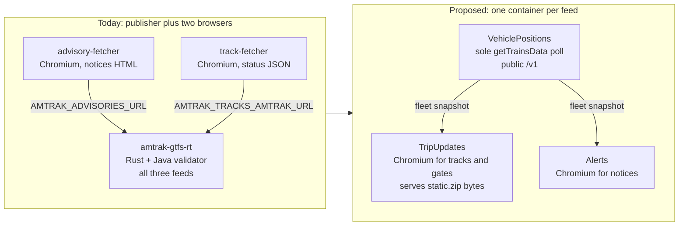
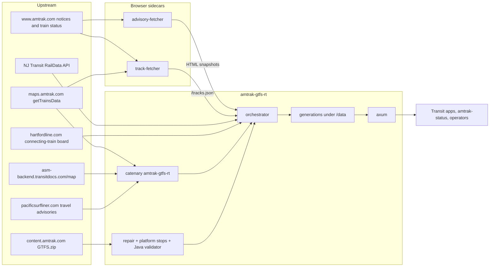
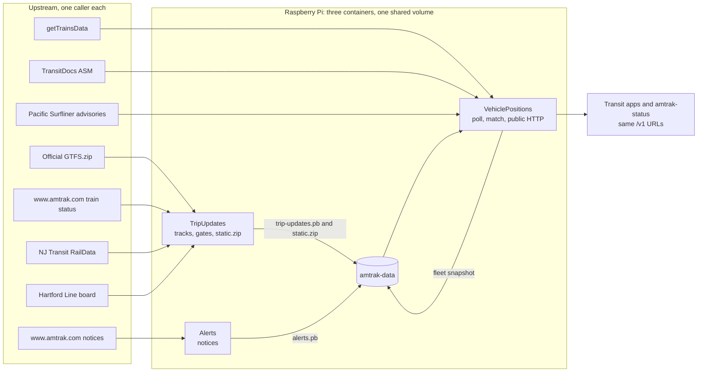

# Re-architecture proposal: one container per GTFS-Realtime feed

- **Status:** proposal only. This document does not change the running service, the images, or the Raspberry Pi.
- **Date:** 2026-11-01
- **Owner intent:** Amtrak already publishes the static GTFS. This project should keep producing the three GTFS-Realtime feeds and stay feature-rich. The target shape is three containers, one per feed: Alerts, TripUpdates, and VehiclePositions.
- **What this proposal does:** splits today's publisher-plus-sidecars stack along those three feeds, keeps every current user-facing feature and public URL, and treats `https://content.amtrak.com/content/gtfs/GTFS.zip` as the schedule. One process polls `getTrainsData`. The other two read that snapshot. A fourth container is not part of the design. Places where our bytes differ from Amtrak's ZIP, and whether a reverse proxy should become a fourth container, are open questions at the end.

The repository has no Kiro spec layout (`.kiro/specs/`). This file is the design.

## Recommendation in one page

Run **three containers**, one per feed. They link one shared Rust library and they do not each poll Amtrak.

1. **VehiclePositions.** Rust, no browser. This is the only process that GETs `getTrainsData`, decrypts it, and matches it to the official static GTFS. It writes the vehicle protobuf and an internal fleet snapshot the other two read. It is also the public HTTP front: `/livez`, `/readyz`, `/v1/feed-set.json`, and all four generation files, on the same host port as today.
2. **TripUpdates.** Rust plus one resident Chromium. It reads the fleet snapshot, stamps `assigned_stop_id` and `platform_code`, and writes the trip-update contribution. The browser fetches Amtrak track and gate documents on a 15-minute base interval, with hot-window checks between those runs. NJ Transit and the Hartford board stay plain HTTP in this process. `AMTRAK_TRACKS_LEAD_TIME_FILE` loads `amtrak-station-lead-time/v1` directly. A `train` or `station` query enqueues a debounced refresh and does not wait. VehiclePositions commits `static.zip` from the snapshot TripUpdates' platforms were matched against.
3. **Alerts.** Rust plus a Chromium that starts for each notices cycle and then exits. It reads the alert entities already in the fleet snapshot (TransitDocs ASM and Pacific Surfliner) and merges Amtrak's service-notices HTML. It writes `alerts.pb`.

`feed-set.json` advances only when that snapshot's three protobufs and the ZIP share one generation id, one timestamp, and one `static_version`. No fourth reverse proxy.

Keep the decrypt-and-match path this repo already uses: the `catenarytransit/amtrak-gtfs-rt` crate (AGPL-3.0) and its `amtk` decryptor, called from the shared library, pointed at a parsed copy of Amtrak's official GTFS. [Piero Maddaleni's `piemadd/amtrak` library](https://github.com/piemadd/amtrak) (v3.0.17) is a TypeScript client of `api.amtraker.com`. It does not decrypt `getTrainsData`, does not emit GTFS-Realtime, and does not join `trip_id`s. Depending on it would add a Node runtime or a third-party API, plus that API's attribution terms. Details and the comparison table are below.

No user-facing feature moves off the public API. `amtrak-status` stays a CLI. There is no dashboard in this repo today.

## Current architecture

There is no systemd unit, cron file, or Pi-specific deploy script in the repo. The Pi instructions are `docker compose pull && docker compose up -d` from a release checkout (`README.md`). Schedulers that run on the device are in-process loops. GitHub Actions cron jobs validate feeds and release gates; they do not run on the Pi.

### Containers and processes

| Piece | Image / binary | What it does | Schedule | Listens |
| --- | --- | --- | --- | --- |
| Publisher | `ghcr.io/sohampatwardhan/amtrak-gtfs-rt` from the root `Dockerfile` `runtime` stage (scratch, UID 10001). Compose service `amtrak-gtfs-rt`. | Downloads static GTFS, repairs and optionally augments it, validates it with MobilityData's Java CLI, polls realtime, stamps tracks, merges advisories, writes an immutable generation, serves HTTP. | Poll every `AMTRAK_POLL_SECS` (45s). Static refresh every `AMTRAK_STATIC_REFRESH_SECS` (86400s), sooner when the platform table changes. Board refresher every `AMTRAK_TRACKS_REFRESH_SECS` (60s). | `8080` in the container. Compose publishes `127.0.0.1:8090`. |
| Advisory sidecar | `ghcr.io/sohampatwardhan/amtrak-gtfs-rt-advisory-fetcher`. Python 3.12, Playwright, `chromium-headless-shell`. | Renders Amtrak's notices list and `/alert/...` detail pages so the publisher can turn them into GTFS-RT alerts. Akamai blocks a plain HTTP client. | List every `POLL_INTERVAL_SECS` (900s). Detail pages reused for `DETAIL_TTL_SECS` (86400s). | `8080` on the Compose network only. Not published on the host. |
| Track sidecar | `ghcr.io/sohampatwardhan/amtrak-gtfs-rt-track-fetcher`. Same browser shape, plus `cryptography`. Compose `mem_limit: 768m`, read-only root, no capabilities. | Decrypts `maps.amtrak.com` `getTrainsData` in Python to choose trains near a stop, then uses one resident browser to read `www.amtrak.com` train-status JSON (track and gate). | Every 60s, at most 24 status fetches per cycle. | `8081` on the Compose network only. |
| `amtrak-status` | Cargo binary, `--features status`. Not in the released image. | Station board and train status from the local publisher, or directly from Amtrak. | On demand. | None. |
| `python -m fetcher.dump` | Inside the track-fetcher image, or a local venv. | Prints tracks and gates for named trains, then exits. | On demand. | None. |

Inside the publisher process the supervised tasks are the poller, the static refresher, and the HTTP server (`src/main.rs`). The track board refresher is a separate spawned task. NJ Transit and the Hartford board are HTTP calls from that refresher. They never had their own container.

`docker-bake.hcl` builds the same three images. The default bake group is the publisher plus advisory-fetcher; track-fetcher is an extra target. Compose always runs all three unless `AMTRAK_TRACKS=off` and `track-fetcher` is scaled to zero.

### Data flow

**Realtime trains.** `AmtrakSource` (`src/sources/amtrak.rs`) calls `amtrak_gtfs_rt::fetch_amtrak_gtfs_rt` with the parsed static feed. That crate (v0.9.1, AGPL-3.0, git dependency) decrypts `https://maps.amtrak.com/services/MapDataService/trains/getTrainsData` through the `amtk` crate, matches each train to a GTFS trip (including a date-offset check for trains that run past midnight), and returns three `FeedMessage`s. The publisher stamps one header on all three: GTFS-Realtime 2.0, `FULL_DATASET`, and `feed_version` equal to the static snapshot's version (`src/orchestrator.rs`).

**Alerts already inside that crate.** Two sources ride along, and both fail open:

- Train-scoped alerts from `https://asm-backend.transitdocs.com/map` (TransitDocs ASM), joined to a train by origin date and train number.
- Pacific Surfliner travel-advisory HTML scraped from `https://www.pacificsurfliner.com/plan-your-trip/alerts/travel-advisories/`.

**Alerts this repo adds.** With `AMTRAK_ADVISORIES=on`, `WithAdvisories` GETs the advisory sidecar and appends entities. A station advisory's `informed_entity.stop_id` is the Amtrak station code, which is the GTFS `stop_id`. A passenger advisory's `route_id`s come from `route_long_name`. `header_text` is the list title. `description_text` is the detail page (effective date, paragraphs, PSN) when the sidecar has it. A missing sidecar or a parse failure publishes the other feeds anyway.

**Tracks and gates.** With `AMTRAK_TRACKS` on (the default), `WithTracks` sets `stop_time_properties.assigned_stop_id` to a platform stop that this service inserted into the static feed, fills `stop_sequence`, and clears `stop_id`, which is what the GTFS-Realtime reference asks for. A gate has no GTFS-RT field, so it lives on that platform stop: `platform_code` `24 (Gate H)`, stop id `{stop}:track:{track}:gate:{gate}`. Vehicle positions are left alone.

Board precedence, unchanged by this proposal:

1. A fresh Amtrak status document (from the track sidecar).
2. NJ Transit RailData, for stations in `AMTRAK_TRACKS_NJT_STATIONS`, when `NJT_RAILDATA_USERNAME` and `NJT_RAILDATA_PASSWORD` are set.
3. The CTrail Hartford Line HTML board, mapped to `AMTRAK_TRACKS_HARTFORD_STOP` (default `NHV`).
4. An older Amtrak track that is still inside the retain-grace window (`AMTRAK_TRACKS_RETAIN_GRACE_SECS`, default 900).

A track label that is not in the seeded list is appended to `{AMTRAK_OUTPUT_DIR}/tracks/observed-platforms.txt`. The static feed is rebuilt after a 30 second debounce, at most once every 10 minutes, then re-validated. If that validation fails, the service rebuilds with the configured platforms only.

**Who calls the publisher.** The README names Transit, Transitland, and OpenTripPlanner as the intended consumers. They are told to GET `/v1/feed-set.json` and then only the four URLs in that document. `amtrak-status --source local` is the in-repo consumer (default `http://127.0.0.1:8080`). Docker's healthcheck and `amtrak-gtfs-rt-service --healthcheck` call `/livez`. The sidecars are consumed only by the publisher. Nothing in the repo is a web dashboard.

The `RtSource` trait can hold a fallback chain. TransitDocs and RailRat position sources are named in the README and are not implemented. The poller has one source.

### What we do to static GTFS that Amtrak already publishes

The bytes start as Amtrak's ZIP (`AMTRAK_STATIC_URL`, default `https://content.amtrak.com/content/gtfs/GTFS.zip`). Before they are served, the publisher may change them:

1. **Dangling stop repair** (`src/static_repair.rs`). `stop_times.txt` rows whose `stop_id` is missing from `stops.txt` are dropped. Amtrak's 20261018 feed calls at Ocean Springs (`OSM`) without defining that stop. `gtfs-structures` then refuses the whole ZIP (`The id OSM is not known`). A clean ZIP is stored unchanged.
2. **Platform augmentation** (`src/static_augment.rs`), when tracks are on. For each station in the platform table the service adds a parent `{stop}:station`, points the original stop at that parent, and adds one stop per track (`{stop}:track:{label}`, `location_type=0`, `platform_code` = the label) plus one more when a gate was posted. `feed_version` becomes `{feed_version}+tracks.{digest}`. Other files are copied through. The GTFS-Realtime `assigned_stop_id` is only valid if the consumer's static feed contains that stop.
3. **Standards gate.** MobilityData gtfs-validator 8.0.1 (a JAR rebuilt in the image, run on a minimized Corretto 17) must accept the bytes. Results are cached by SHA-256 (`AMTRAK_VALIDATOR_CACHE`). This is why the scratch image contains a JRE. The validator runs when the ZIP or the platform table changes, not on every 45 second poll.
4. **Republication.** The accepted ZIP is stored once under `blobs/<sha256>` and hard-linked into each generation as `static.zip`. Clients download it from `/v1/generations/{id}/static.zip`. The three protobuf headers carry that generation's `static_version`, so a client can see which snapshot the realtime was matched against.

Official Amtrak `stops.txt` is one stop per station. It does not contain these platform stops. The schedule files (routes, trips, stop times, calendar) are Amtrak's, aside from repair (1).

### Public and internal endpoints

| Endpoint | Who can call | Body |
| --- | --- | --- |
| `GET /livez` | Anyone who can open the socket | JSON process liveness. Docker health. Independent of feed age. |
| `GET /readyz` | Allowlisted peer. Default: loopback only. `Forwarded` is ignored. | JSON. 200 while the current generation is under 300 seconds old. |
| `GET /v1/feed-set.json` | Same peer gate | `generation_id`, `generated_at_unix`, `static_version`, source name, entity counts, and four relative URLs. |
| `GET /v1/generations/{id}/static.zip` | Same | `application/zip` for that generation only. |
| `GET /v1/generations/{id}/trip-updates.pb` | Same | `application/x-protobuf` |
| `GET /v1/generations/{id}/vehicle-positions.pb` | Same | `application/x-protobuf` |
| `GET /v1/generations/{id}/alerts.pb` | Same | `application/x-protobuf` |

Unknown generation, bad id, or a removed artifact is 404. No current or fresh generation is 503. A peer outside the allowlist is 403. The old mutable paths (`/trip-updates.pb`, `/vehicle-positions.pb`, `/alerts.pb`, `/static.zip`, `/health`) already return 404. This proposal does not bring them back.

Internal, not published on the host:

| Endpoint | Producer | Consumer |
| --- | --- | --- |
| `GET /service-alerts-and-notices` and `GET /alert/<slug>.html` | advisory-fetcher | Publisher, `AMTRAK_ADVISORIES_URL` |
| `GET /healthz` on the advisory sidecar | advisory-fetcher | Operators. Always 200 in current code once the process is up. Staleness is the snapshot's HTTP status. |
| `GET /tracks.json` | track-fetcher | Publisher, `AMTRAK_TRACKS_AMTRAK_URL` |
| `GET /healthz` on the track sidecar | track-fetcher | Docker `HEALTHCHECK`. 503 when no poll has finished within `LIVENESS_SECS`, or after three failed polls in a row. |

`/v1/feed-set.json` on the host, with the Compose stack, is `http://127.0.0.1:8090/v1/feed-set.json`. The allowlisted peer is the Compose bridge gateway `172.31.240.1`.

### Operator surface that is part of the product

Environment variables in the root README (static URL, poll and refresh intervals, Capital Corridor filter, bind address, peer allowlist, public URL, validator path and cache, generation budget / retain / max, advisories URL and TTL, the whole `AMTRAK_TRACKS_*` set, NJ Transit credentials, Hartford URL and stop). Sidecar variables live in `advisory-fetcher/README.md` and `track-fetcher/README.md`.

`amtrak-status station <code> [--limit N] [--source local|amtrak] [--base-url URL]` and `amtrak-status train <number>`. Output includes local time, delay against the schedule, `track N` when a platform was assigned, alerts, and the generation id. Exit codes 0, 1, 2, and 3 are part of the contract.

Persistence and recovery: last-good generation on startup, atomic publish, static dedup, retention window (600s), count cap (20), byte budget (256 MiB). Readiness and liveness stay separate so Docker does not restart a process that is waiting for a first good generation.

Validation: `./scripts/validate-feeds.sh` runs MobilityData's static validator and gtfs-realtime-validator. CI workflow `.github/workflows/validate-feeds.yml` runs that daily at 09:17 UTC, on pipeline pushes, and on demand. New realtime ERROR codes fail unless listed in `validation/baseline.json`. Current baseline codes are E003, E004, E011, E022, E025, E029, E035, E039, E041, E043, E049, mostly trains or stations that exist in the live feed and not in the published schedule. Static ERROR count is gated at zero. `scripts/test-container.sh` is the image smoke test. Release gates (weekly Monday 08:41 UTC, plus image-input PRs) scan the service image.

## `piemadd/amtrak` compared with this repo

Studied on 2026-11-01: [github.com/piemadd/amtrak](https://github.com/piemadd/amtrak), default branch `master`, package version **3.0.17**, last push 2026-08-19, language JavaScript/TypeScript, code license **AGPL-3.0**. Author: Piero Maddaleni. The library README also states that **data from the Amtraker API** is under the Open Data Commons Attribution License (ODC-By) v1.0, adopted 2026-08-19, with a grace period the README sets through 2026-10-31. That data license is separate from the code license. This proposal does not copy either repository's source.

What the published library actually does is in `src/index.ts`: five functions, each an `axios` GET with a `User-Agent` of `AmtrakerAmtrakDotJS/3.0.16`.

| | This repo today | `piemadd/amtrak` 3.0.17 |
| --- | --- | --- |
| Role | GTFS-Realtime producer | Client of a hosted tracking API |
| Fetch | `maps.amtrak.com/.../getTrainsData`, plus ASM, Surfliner, and (via sidecars) `www.amtrak.com` | `https://api.amtraker.com/v3/trains`, `/v3/trains/:id`, `/v3/stations`, `/v3/stations/:id`, `/v3/stale` |
| Decryption | In the `amtk` crate, called by catenary. The ciphertext is Amtrak's map feed. | None in v3. The hosted API returns JSON that Amtraker has already parsed. |
| Polling | Publisher every 45s. Track sidecar every 60s. Advisory sidecar every 15 min. The library has no loop of its own. | The caller polls. The library has no interval. `/v3/stale` reports `avgLastUpdate`, `activeTrains`, and a `stale` flag. |
| Data model | GTFS-RT `FeedMessage`: `trip_id`, `route_id`, stop-time events, vehicle position (lat, lon, speed, bearing), alerts with `informed_entity`. | `Train` keyed by train number: `trainID` like `5-9` (number plus origin day-of-month), lat/lon, speed in MPH, 8-way heading, station list (`code`, scheduled and actual times, `bus`, `platform` string, status), free-text `alerts[]`. `StationMeta` is a directory (name, code, tz, lat/lon, address, train ids), not GTFS `stops.txt`. |
| Stop / trip matching | Catenary joins the map feed to the official GTFS (`trip_short_name`, date offset, `stop_id`). This repo then joins boards to that trip by train number and station code. | Station codes are Amtrak codes. There is no GTFS `trip_id` or `stop_id` join, and no static GTFS input. |
| Tracks | `assigned_stop_id` plus a platform stop in the served static feed. Gates in `platform_code`. | `Station.platform` string on the train object, when Amtraker filled it. |
| License fit | This repo is AGPL-3.0-only because it links catenary. | Code is AGPL-3.0, which can sit beside this repo's license. The **API data** terms in the library README require attribution that a person using the product can actually see, with a link to Amtraker. Redistributing that JSON inside a GTFS-RT feed would have to carry that notice. Their README asks for a project `User-Agent`. |

Older trees associated with the same author (for example historical `fetchTrainData` against `getTrainsData`) did decrypt the map feed with the same general scheme `amtk` already implements: a trailing key segment, then AES-CBC with a PBKDF2-derived key. That code is not in `piemadd/amtrak` v3. This proposal does not port it and does not paste it. Re-implementing a decryptor we already link would be a second copy to keep correct when Amtrak rotates the map script.

### Options

**(a) Depend on the library.** Poor fit. It is Node, not Rust. Calling it means a Node process beside the publisher, which is another container, or shelling out on each poll. The functions return Amtraker JSON, so GTFS matching would still be our code, pointed at a feed we do not control. Freshness, outages, and the ODC-By notice become part of every feed we publish. The `/v3/stale` flag is a useful idea and we already have a local equivalent in `/readyz`.

**(b) Port or borrow the approach.** The v3 approach is "HTTP GET a third-party API." Borrowing that replaces a direct read of Amtrak with Amtraker as the source of trains. The historical decrypt approach duplicates `amtk`. Two ideas in their model are already how this system works, and this document attributes them: a platform string on the station event (we publish that as `assigned_stop_id` / `platform_code`), and a train identity of number plus origin day (catenary's date-offset join is the GTFS form of that). Nothing else in v3 fills a hole in our feeds.

**(c) Keep our own path. This is the recommendation.** Stay on catenary + `amtk` + Amtrak's official GTFS for TripUpdates and VehiclePositions. Keep ASM and Surfliner alerts that the crate already returns. Keep advisory and track features: notices in the Alerts container, track and gate documents in the TripUpdates container, one shared poll in VehiclePositions. Do not add `api.amtraker.com` as a source. If a later change quotes their code, keep this repo AGPL-3.0-only, keep their copyright notice, and do not drop the catenary repository-link requirement that crate's manifest states.

## Piero Maddaleni's other transit projects

Surveyed 2026-11-01 from the public profile [github.com/piemadd](https://github.com/piemadd) (Piero Maddaleni, Chicago; the profile README points at Amtraker and Transitstatus). The profile has on the order of 200 public repositories. Most are unrelated to this feed. The ones that touch Amtrak, Via, Brightline, GTFS, or live train maps are below. Several of the live services sit in the `transitstatus` organization rather than under `piemadd/` itself; they are included because his profile lists them as his projects.

License note used in the table: "no LICENSE file" means GitHub has no license file to detect. A `package.json` `"license"` field is recorded where one exists, and it is not treated as permission to copy source. No code from these repositories is copied into this proposal.

| Repository | What it is | License as published | Use in this re-architecture |
| --- | --- | --- | --- |
| [piemadd/amtrak](https://github.com/piemadd/amtrak) | npm client of `api.amtraker.com` v3. See the comparison above. | Code: AGPL-3.0, with a `LICENSE` file. README: ODC-By for Amtraker API data. | Do not depend on it. Credit the train-id and platform ideas already attributed above if the implementation mentions them. |
| [piemadd/amtraker-v3](https://github.com/piemadd/amtraker-v3) | Bun service behind that API. Fork of `eiiot/amtraker-v3`. Polls about every 15 seconds and folds Amtrak, Via Rail, and Brightline into one train model. Platforms come from `platformsapi.amtraker.com`; a stops backup is `gtfs.piemadd.com`. | No `LICENSE` file. `package.json` says ISC. The parent repo also has no GitHub license. | Do not copy. It explains where the npm client's Via and Brightline rows come from. Via and Brightline are outside this Amtrak GTFS-RT product. |
| [transitstatus/store](https://github.com/transitstatus/store) | Multi-feed collector. Relevant jobs: Amtrak map-feed proxy (~30s), Amtrak alerts (~10 min), merged platform boards (~10s) from NJ Transit RailData, Moynihan Train Hall, and Metrolink. A CTrail job exists and is disabled in its config. | No `LICENSE` file. `package.json` says ISC. | Do not copy. Useful as a map of extra platform boards (Moynihan is one this repo does not read). If a later change adopts that approach, credit him and still do not paste the unlicensed script. |
| [transitstatus/gtfs-schedule-data](https://github.com/transitstatus/gtfs-schedule-data) | Downloader for many official GTFS zips, including `content.amtrak.com` `GTFS.zip`, Hartford Line, Via, Brightline, and NJ Transit. For Amtrak it inserts a synthetic Ocean Springs stop instead of dropping those stop times. | No `LICENSE` file. `package.json` says ISC. | Do not switch our static URL to `gtfs.piemadd.com`. The official ZIP URL matches ours. The Ocean Springs idea is an alternative to our row-drop repair; see open question 2. Do not copy coordinates or files. |
| [piemadd/amtraker-fetch-proxy](https://github.com/piemadd/amtraker-fetch-proxy) | Small proxy in front of Amtrak requests. The store's map-feed job calls a worker under this name. | No license file. | Do not reuse. Our publisher already fetches the map host directly. |
| [piemadd/better-transit-alerts-spec](https://github.com/piemadd/better-transit-alerts-spec) | "Better Transit Alerts Specification", a GTFS extension sketch. | MIT, `LICENSE` present, copyright 2023 Piero Maddaleni. | Wire format stays GTFS-Realtime. No spec text is copied. A later borrow of a field idea would need the MIT notice. |
| [piemadd/amtraker-vite](https://github.com/piemadd/amtraker-vite) and [transitstatus/transitstatus-react](https://github.com/transitstatus/transitstatus-react) | Map UIs (amtraker.com, transitstat.us). | No `LICENSE` file. | Viewers, not feed producers. Nothing to link into the publisher. |
| [piemadd/amtraker-next](https://github.com/piemadd/amtraker-next) | Older cross-platform tracker, last push 2022. | GPL-3.0. | Historical. Do not revive it. |
| [piemadd/amtrak-api](https://github.com/piemadd/amtrak-api) and [piemadd/Piero-Amtrak-API-Docs](https://github.com/piemadd/Piero-Amtrak-API-Docs) | Old API and docs. The docs README points at `api.amtraker.com/docs`. | No license file. | Superseded by `amtraker-v3`. Do not use. |

He also forks other people's GTFS routers (`public-transit-service`, `gtfs-stream`, `transitous`, and similar). Those licenses belong to the upstream projects. This design does not route trips, so those forks are not inputs.

CTA, Metra announcement, and snowplow repositories on the same profile do not change this Amtrak feed.

### Credit, when any of this is actually used

This proposal only uses his work as background. The implementation must still be ready to credit him if that changes. Any later PR that uses his code, his approach, or his data handling adds all of the following:

1. A `## Acknowledgements` section in `README.md` (a `CREDITS.md` is fine if the README links it). For each use, name Piero Maddaleni, the repository URL, what was used (code, approach, or data handling), and the license.
2. A license-compliant notice next to reused code. AGPL material (`piemadd/amtrak`, or `amtraker-next` if it were ever used) keeps this repo AGPL-3.0-only, keeps his copyright and the AGPL text, and adds a `NOTICE` or third-party entry with the source URL. MIT material (`better-transit-alerts-spec`) carries his copyright line and the MIT permission notice in the file header and in that same notice file. Do not drop catenary's repository-link requirement either.
3. No copy from a repository that has no `LICENSE` file (`amtraker-v3`, `store`, `gtfs-schedule-data`, the proxies, the map UIs), even where `package.json` says ISC. Approach notes and the acknowledgement section are enough. A port waits until he publishes a license file.
4. No redistribution of `api.amtraker.com` payloads unless the product also carries the ODC-By attribution his `amtrak` README describes, in a place a user of the feed will see, with a link to Amtraker. This design does not take that data.
5. No commit of his GTFS extracts, station JSON, or platform dumps into this repository.

## What Amtrak's Track Your Train page actually loads

Two looks on 2026-11-01, and they disagree only about who can fetch the HTML.

A plain GET of `https://www.amtrak.com/track-your-train` and `https://www.amtrak.com/track-your-train.html`, with an identifying user agent and no cookies, returned **403 from Akamai**. This work did not retry that host with a browser and did not try to pass the check. A separate normal browser session opened the same URL with no challenge. In that session the page's only Amtrak data requests were:

| Request | What the browser saw | What it feeds in the UI |
| --- | --- | --- |
| `maps.amtrak.com/services/MapDataService/trains/getTrainsData` | `text/plain`, encoded, and polled | The train list, the train panel (speed, next station, ETA, lateness), and the full stop-by-stop Detailed Train Status. Opening a train does not fire another request. |
| `maps.amtrak.com/services/MapDataService/stations/trainStations` | `text/plain`, about 357 KB | Station layer for the map. |
| `maps.amtrak.com/services/MapDataService/stations/nationalRoute?routeName=<name>` | Route geometry JSON. An empty `routeName` is the whole network, about 2.38 MB. | The lines on the map. |
| `maps.amtrak.com/services/MapDataService/stations/AllTTMTrains` | Plain JSON, about 136 KB on the wire | Fired when a station's arrivals/departures board is opened. Not part of the train-list poll. |
| `maps.amtrak.com/rttl/js/RoutesList.json`, `RoutesList.v.json`, `route_properties.json` | Small static JSON | Route list, the file the map loads beside the ciphertext, and label boxes. |
| `www.amtrak.com/services/staticmappingjson` | One configuration document | Booking-form labels, not a train, track, or alert feed. This repo's earlier notes already treat it that way. |

No track, platform, gate, or service-alert payload showed up in that session, in the UI or in the request list. The map drawing is Google Maps (`google.maps` in the public `mapApplication.js` on `maps.amtrak.com`). It is not an ArcGIS feature layer. FEMA's `Partner/Amtrak_Train_Status` layer is a separate copy of TransitDocs, about every 15 minutes, and the tracker did not call it.

The public map script agrees with that session. `getStationStatus()` GETs `AllTTMTrains` with no query string when it builds a station board. Route geometry uses `nationalRoute?routeName=`, and an empty name is the network-wide file. The fleet reload timer in that script is 300 seconds. `maps.amtrak.com` itself answers a plain GET; the HTML page does not, from this environment.

No `Retry-After` or rate-limit header was present on the map responses below. That is not permission to poll. Amtrak's terms page sits on the host that returned 403 here, so it was not re-read. The track-fetcher README already says to check those terms before sending status traffic. This proposal does not raise that volume.

### Freshness: `getTrainsData` moves, `AllTTMTrains` does not

An earlier note in this section treated `AllTTMTrains` as one object cached for about 2.5 hours. That was one `max-age`, not the age of the train times. Three plain GETs, at 04:39:58, 04:40:33, and 04:41:08 UTC, checked both feeds. Nothing was saved into the repo.

`getTrainsData` sent no `cache-control`. The ciphertext was about 630 KB and its SHA-256 changed on every poll. One following response was decoded only long enough to read clocks and field names, then dropped. It had 62 features (61 `Active`, one `Completed`). `updated_at` and `created_at` were `11/1/2026 12:40 AM`, and `LastValTS` ran up to `11/1/2026 12:40:04 AM`. At 04:40 UTC that is the current minute on US Eastern time. Station blobs in that payload use the same keys as below. None of them named a track, platform, or gate.

`AllTTMTrains` alternated between two cached bodies, and neither one advanced:

| Body | Size | `cache-control` | Trains inside | Stamps |
| --- | --- | --- | --- | --- |
| The one the browser's 136 KB matches | 1,738,696 bytes of JSON. With `Accept-Encoding: gzip` the `content-length` was **136,376**. | `max-age` about 27,100 seconds (about 7.5 hours), `expires` 12:15 UTC. Same SHA-256 on the first and third polls. | 313 features, 78 `Active`, 235 `Predeparture` | `updated_at` on every active feature was `10/31/2026 8:13:02 AM`. `lastvalts` values were also on Oct 31, not Nov 1. |
| The smaller cached object | 354,313 bytes | `max-age` 8,694 seconds (about 2.4 hours), `expires` 07:05 UTC. This is the old "2.5 hour" reading. | 40 features | `updated_at` around `10/31/2026 3:00 AM` |

So the 136 KB figure is the compressed size of the larger stale snapshot, not a third, fresher feed. The CDN lifetime is real and it is not a single 2.5 hour number. The train times inside both snapshots sat still across the three polls and were many hours behind `getTrainsData` (8:13 AM on Oct 31, against 12:40 AM on Nov 1 in the fleet feed). The station board really is this endpoint. The copy a plain GET receives is not live in the way the fleet feed is.

### Fields

On both feeds, each station blob has `code`, `tz`, `bus`, scheduled / estimated / posted arrival and departure, comments, and `autoarr` / `autodep`. On the 313-feature `AllTTMTrains` body that was 4,949 station rows, and on the decoded fleet response 1,474 rows. No row mentioned a track, platform, or gate. Position on the fleet feed is `lat` / `lon` plus `Velocity` and `Heading`. On `AllTTMTrains` the point is the GeoJSON geometry; the `lat` property was empty. There is no alerts array on either payload. The "service disruption" sentence in the map script is fixed popup copy.

Track, gate, and the notices page are other Amtrak surfaces, on `www.amtrak.com`, which this environment left alone after the 403.

### Comparison

| | Track Your Train | This repo | Piero's stack |
| --- | --- | --- | --- |
| Train list, panel, and stop-by-stop status | Polled `getTrainsData`. Opening a train adds no request. | Same URL, every 45s, decoded in-process by catenary / `amtk`, matched to official GTFS | `amtraker-v3` / `store` decode the same map feed (about every 15–30s) and also fold in Via and Brightline. The npm library only reads `api.amtraker.com`. |
| Station board | `AllTTMTrains`, on open, plaintext, and the copies checked here were hours behind the fleet feed | Not used. Station times in our TripUpdates come from `getTrainsData`. | His collector also knows this URL |
| Map chrome | `trainStations`, `nationalRoute`, `RoutesList.json`, `route_properties.json`, `staticmappingjson` | Official GTFS for stops. We do not republish route geometry. | `gtfs.piemadd.com` stops JSON and his own station files |
| Track and gate | Absent from the tracker UI and from every request it made | Status documents, NJ Transit, Hartford board, written as `assigned_stop_id` | Merged platform boards, including Moynihan, as a `platform` string |
| Alerts | Absent from the tracker | ASM, Pacific Surfliner, and the notices HTML | His alerts job and the notices he proxies |
| ArcGIS | Not requested | Not used | Not used |
| Access | The browser session loaded the HTML. A plain GET from here got 403. The map host answers a plain GET. | Same split. Browser only for `www.amtrak.com`. | Proxies and a hosted API in front of the same split |

### Recommendation

Keep `getTrainsData` as the fleet source. It is the request the tracker polls for the train list, the train panel, and Detailed Train Status, and a plain GET of it was current at the minute of the check. Leave decoding where it is, inside the existing crate. Do not add a second decoder, and do not start polling `www.amtrak.com` from the Rust process.

Do not switch that poll to `AllTTMTrains`. The tracker uses it for the station board only. It is plaintext, which is attractive, and the bodies served during this check were cached snapshots whose `updated_at` did not move and lagged the fleet feed by many hours. It still has no track, gate, or alert, and it does not remove the need to match `trip_id`s. `staticmappingjson`, `trainStations`, and `nationalRoute` are map chrome and configuration, not a second realtime product.

Do not use the FEMA ArcGIS layer. It is a 15-minute copy of TransitDocs, and the tracker does not call it.

Track, gate, and service-alert HTML stay browser work, because the tracker never had them. Notices move into the Alerts container. Track and gate documents move into the TripUpdates container. The fleet poll stays a single `getTrainsData` request per cycle, inside VehiclePositions, shared with the other two through the snapshot. The map's own timer is 300 seconds; this service's 45-second poll is one request, and on this check the origin was already changing inside that window. Per-train status fetches stay capped (24 per minute in the current sidecar) and still need a terms check by the operator. No login, no credential, and no attempt to get past the 403 is part of this design.

## Proposed architecture

### Why one poll, shared as a library

`fetch_amtrak_gtfs_rt` already returns TripUpdates, VehiclePositions, and Alerts from **one** `getTrainsData` body, plus one TransitDocs ASM fetch and one Pacific Surfliner page. The three products are slices of that result. Track Your Train does the same thing: one polled fleet request fills the train list, the panel, and the stop-by-stop list, and opening a train adds no request.

Two ways to share that across three binaries:

| Approach | What hits Amtrak per cycle | Why it loses or wins |
| --- | --- | --- |
| Each container links the crate and polls on its own | Three `getTrainsData` GETs, three ASM GETs, three Surfliner GETs, every 45 seconds. The TripUpdates browser would be a fourth maps fetch if it still decrypts the fleet to choose who is near a stop, which the track sidecar does today. | The extra responses are the same trains. The tracker's own timer is 300 seconds. On 2026-11-01 the ciphertext was already changing inside 35 seconds, so one 45-second poll is enough. Tripling it spends Amtrak's origin budget for no fresher feed. |
| **Shared library, one caller. This is the recommendation.** | One `getTrainsData`, one ASM, one Surfliner, every 45 seconds. One official GTFS download per day, plus a platform rebuild at most every 10 minutes. Status-document fetches stay capped at 24 per minute, and only from TripUpdates. | The library keeps matching, header stamping, and the Capital Corridor filter in one place so the three binaries cannot drift. Only VehiclePositions calls the network. The other two read a snapshot on the shared volume. TripUpdates chooses who is near a stop from that snapshot, so the second maps decrypt the track sidecar does today goes away. |

The library is a crate in this repo, wrapping catenary. It is not a fourth process. All three binaries link it. The credit rules later in this document still apply if an implementation copies anything of Piero Maddaleni's: his npm client is not this library, and repositories of his with no `LICENSE` file are not copied into it.

### VehiclePositions

Rust, no browser, no JRE. Image stays scratch and non-root, in the spirit of today's publisher, without the validator JAR.

- Every `AMTRAK_POLL_SECS` (45), call the shared library once against the active static snapshot on disk. That decrypts `getTrainsData` and matches `trip_id` / `stop_id` / `route_id` to the official schedule, including catenary's date-offset check.
- Write `vehicle-positions.pb` for that generation. Vehicle positions stay free of track and gate fields, as today.
- Write an internal fleet snapshot beside it: the matched trip updates **before** track stamping, the ASM and Surfliner alerts, the generation id, the timestamp, and the `static_version`. Mode `0600`, not served over HTTP.
- Apply `AMTRAK_FILTER_CAPITAL_CORRIDOR` here, so all three products see the same filter.
- Serve the public API on `127.0.0.1:8090` (container port 8080). Paths, content types, peer allowlist, 403 / 404 / 503, `/livez`, and `/readyz` (300 seconds) stay as they are. `feed-set.json` gains no fields.
- Advance the current generation only when the directory holds `static.zip`, `trip-updates.pb`, `vehicle-positions.pb`, and `alerts.pb`, and the three protobuf headers share that snapshot's timestamp and `static_version`. Until then the previous generation stays current. Last-good recovery on startup stays.
- Retention window, count cap, and byte budget stay on this volume. The ZIP is still one blob, hard-linked into each generation.

This container does not download `GTFS.zip` itself. It parses the ZIP TripUpdates has already committed to the volume. A missing ZIP on first boot waits for TripUpdates; the process stays live and `/readyz` stays false.

### TripUpdates

Rust, plus the track sidecar's browser moved in-process. One resident `chromium-headless-shell`. NJ Transit and Hartford stay plain HTTP here. The Java validator moves here too, because this container writes the ZIP consumers download.

Each fleet snapshot:

- Read the pre-stamp trip updates.
- Stamp `stop_time_properties.assigned_stop_id`, `stop_sequence`, and clear `stop_id`, from the latest board. Same precedence as today: fresh Amtrak status, then NJ Transit RailData, then the Hartford board, then an older Amtrak track still inside `AMTRAK_TRACKS_RETAIN_GRACE_SECS`.
- A gate still has no GTFS-RT field. It rides on the platform stop: `platform_code` `24 (Gate H)`, stop id `{stop}:track:{track}:gate:{gate}`.
- Write `trip-updates.pb` into that generation directory. Stamping reads the board store only, so a slow browser does not hold up the generation. Fail-open stays: no board means the inner trip updates publish anyway.
- `python -m fetcher.dump` stays in this image.

Browser and boards:

- Amtrak status documents, same cap as today (at most 24 fetches a cycle, hot trains every cycle, others on a 90 second cooldown). The "who is near a stop" decision reads the fleet snapshot. It does not GET `getTrainsData` again.
- **Lead-time profiles.** A separate PR will add a deterministic track survey script. Its output is a per-station profile of how far ahead a track is usually posted. This container should use that profile to set the lookahead for each station, instead of one window for the whole railroad. Until the file is present, keep today's window: 10 minutes back, 30 minutes ahead, and a 12 minute hot window. A missing or unreadable profile is that fallback, not a startup failure. The survey script's format belongs to that PR; this design only requires a station code and a lead time this poller can read. Fetches stay inside the 24-per-cycle cap either way.
- NJ Transit token file stays under `{output}/tracks/` and is still not served. Hartford stays one HTML page.
- Isolation of the browser matches today's track sidecar: read-only root where the browser can live that way, dropped capabilities, `no-new-privileges`, `init`, 768 MiB limit, 256 pids, 64 MiB `/dev/shm`, no host port. The Rust server in this container is not published. The Pi spike in `advisory-fetcher/spike/results.md` found `cgroup_disable=memory` on one device, which makes a Docker memory limit a no-op. Turning the memory cgroup on is an operator step on the device, outside this repo.

Static ZIP, written only by this container:

- Download official `GTFS.zip` on `AMTRAK_STATIC_REFRESH_SECS` (86400), and sooner when the platform table changes.
- Repair dangling stop times so the parser can load the schedule.
- If tracks are on, add parent stations and platform stops from `AMTRAK_TRACKS_PLATFORMS` plus `observed-platforms.txt`. `feed_version` keeps the `+tracks.{digest}` suffix.
- Run the MobilityData validator when the bytes are new. On rejection, keep the previous ZIP. If the rejection is an observed-platform rebuild, retry with the configured list only.
- Hold the new ZIP as pending. VehiclePositions stamps headers with it only on the next fleet snapshot that commits after the ZIP is accepted. Unchanged bytes stay one blob.

`AMTRAK_TRACKS=off` skips the browser, the boards, and the platform stops, and still writes trip updates from the snapshot. Compose can run that way without Chromium in this image only if the image build grows a no-browser variant; until then the process simply does not launch Chromium. That is the same fail-open switch as today.

### Alerts

Rust, plus the advisory sidecar's browser moved in-process. The browser starts for a notices cycle and exits, which is how `advisory-fetcher` already works. It is not a second resident Chromium.

Each fleet snapshot:

- Start from the ASM and Surfliner entities in the snapshot. This container does not fetch those itself.
- When `AMTRAK_ADVISORIES` is on, merge station and passenger notices. `stop_id` is the station code. `route_id` comes from `route_long_name`. `header_text` is the list title. `description_text` is the detail page when that render succeeded. TTL, last-good advisories, and list versus detail staleness stay.
- Write `alerts.pb`. A failed notices cycle still writes the ASM and Surfliner entities. Unsetting advisories writes those entities alone.
- No host port. Notices HTML stays inside the container. The old `/service-alerts-and-notices` URL was only for the publisher and does not need to survive.

Headless-shell is the default. The headful Chromium fallback (`FETCHER_BROWSER_BUNDLE=full`, `FETCHER_BROWSER_MODE=xvfb-headful`) still applies to this image and to TripUpdates, as separate build args.

### Generation consistency, and no fourth container

Today one process writes all four files and then moves the current marker. Three writers need the same rule or clients will pair a new vehicle file with an old trip file.

The rule: VehiclePositions mints the generation id when it polls. TripUpdates and Alerts must write their protobufs into that directory, with headers copied from the snapshot (timestamp and `static_version`, including `+tracks.{digest}`). VehiclePositions publishes `/v1/feed-set.json` for that id only after all four files are present and the headers match. Readers who already hold the previous manifest can still download it until the retention window deletes it.

A tiny reverse proxy in front of three public ports would also keep one URL, and it would be a **fourth** container. This proposal does not add it. The open question below records that choice. The default is the shared volume plus the HTTP server already required for VehiclePositions.

### What happens to today's containers

| Today | After cutover |
| --- | --- |
| `amtrak-gtfs-rt` publisher | Replaced by the three binaries. The public port, peer policy, and generation store move to VehiclePositions. The ZIP writer and the validator move to TripUpdates. |
| `advisory-fetcher` | Removed as its own image. The notices browser runs inside Alerts. |
| `track-fetcher` | Removed as its own image. The status browser and `fetcher.dump` run inside TripUpdates. |

Until the implementation's Compose file switches, the current three images keep working. Rollback is the previous Compose file and the previous digests, on the same `/data` volume. This PR does not publish an image.

### Public URLs

No consumer migration. These stay:

- `http://127.0.0.1:8090/v1/feed-set.json` on the Compose stack
- `/v1/generations/{id}/static.zip`
- `/v1/generations/{id}/trip-updates.pb`
- `/v1/generations/{id}/vehicle-positions.pb`
- `/v1/generations/{id}/alerts.pb`
- `/livez`, `/readyz`
- peer policy and the 403 / 404 / 503 meanings
- `amtrak-status` flags and exit codes

`amtrak-status --source local` keeps talking to that one base URL. It does not learn three hosts. Internal sidecar URLs (`AMTRAK_ADVISORIES_URL`, `AMTRAK_TRACKS_AMTRAK_URL`) go away because the browsers are in-process. During a staged rollout those variables can still point at the old sidecars; the implementation may support that for one release and then drop it.

Clients that follow the manifest still receive a ZIP that contains platform stops while tracks are on. Clients that instead download `content.amtrak.com` themselves will see official `trip_id`s match, and will not find `{stop}:track:...` stops. That is open question 1.

### Config

Every current `AMTRAK_*` variable and both NJ Transit variables keep their names and defaults. They are set on the container that uses them:

| Variable group | Container |
| --- | --- |
| `AMTRAK_POLL_SECS`, `AMTRAK_FILTER_CAPITAL_CORRIDOR`, bind address, peer allowlist, public URL, generation budget / retain / max | VehiclePositions |
| `AMTRAK_STATIC_URL`, static refresh, validator path and cache, all `AMTRAK_TRACKS_*`, NJ Transit credentials | TripUpdates |
| `AMTRAK_ADVISORIES`, advisory URL override (only if an external snapshot is still used during rollout), advisory TTL, notices poll interval | Alerts |

`AMTRAK_OUTPUT_DIR` is the shared volume, mounted in all three. TripUpdates is the only writer of `static.zip`, `observed-platforms.txt`, and the RailData token. Alerts is the only writer of `alerts.pb`. VehiclePositions is the only writer of the fleet snapshot, `vehicle-positions.pb`, and the current marker.

### Raspberry Pi 5

Container count stays three. The split is by feed, not "publisher plus two browsers." Chromium count stays two, and they no longer share a process, so a wedged status browser does not take notices down.

| Container | Steady cost | Peak |
| --- | --- | --- |
| VehiclePositions | Rust poll and the in-memory generation cache (count cap 20). No JRE, no Chromium. | A GTFS parse of the ZIP already on disk when the version changes. |
| TripUpdates | One resident Chromium under the current 768 MiB limit, 64 MiB `/dev/shm`, plus the board refresher (RailData and one Hartford page). | A Java validator run when the ZIP or the platform table changes. That JRE is only in this image. |
| Alerts | Idle between notices cycles. | One headless Chromium for a render every 15 minutes, then the process exits the browser, same as today's advisory fetcher. |

Disk stays the 256 MiB generation budget plus one ZIP of headroom. Host port 8090 and the `172.31.240.0/24` network stay. `linux/arm64` remains a release target. There is still no `linux/arm/v7` build. The memory cgroup on the Pi has to be enabled before either browser limit is real.

Compared with today, Amtrak sees fewer calls: the publisher's 45-second fleet poll remains, and the track sidecar's extra `getTrainsData` decrypt goes away. Status-document volume is unchanged. Official GTFS is still one daily download.

### Testing and validation

- `cargo test` for the shared library and all three binaries, plus `cargo test --features status` for `amtrak-status`.
- Pytest for the notices renderer and the status fetcher, moved with their code, offline. The on-device Akamai check stays a Pi step.
- `./scripts/validate-feeds.sh` and the nightly workflow. Run gtfs-realtime-validator against the official ZIP (trip and stop ids) and against the served ZIP (platform `assigned_stop_id`s). ERROR codes outside `validation/baseline.json` still fail. A generation used in that run must be one `feed-set.json` says is current, so the three protobufs and the ZIP are the matched set.
- `scripts/test-container.sh` against the VehiclePositions image for peer policy, readiness, and retained-volume recovery. TripUpdates and Alerts get the sidecar smoke shape: `SIGTERM`, and no host port.
- A fixture snapshot with a platform stop, a gate, an advisory with a detail body, an NJ Transit row, and a Hartford row. Assert the manifest does not flip until all four files exist, and that a second poll is not sent when only TripUpdates restarts.
- With a sample lead-time profile, a station whose profile says the track appears hours ahead is eligible earlier than the default 30 minute window, and the 24-fetch cap still holds.

## Feature-parity checklist

Each row is something an operator or a feed consumer can observe today. The proposed column is which of the three containers owns it. Nothing in this table is dropped. Public URLs do not change, so there is no consumer migration.

| Current feature | Where it lives today | Where it lives in the proposal |
| --- | --- | --- |
| TripUpdates protobuf | Publisher, via catenary | TripUpdates, from the shared snapshot. Official GTFS is the match input. |
| VehiclePositions protobuf (lat, lon, speed, bearing) | Publisher, via catenary | VehiclePositions, same snapshot. No track fields added. |
| Alerts from TransitDocs ASM, scoped to a train | Catenary, inside the one poll | Still produced by that one poll. Alerts writes them into `alerts.pb`. |
| Pacific Surfliner travel advisories in `alerts.pb` | Catenary | Same poll. Alerts container writes the file. |
| Amtrak station and passenger advisories, with detail text, effective dates, stop and route selectors | advisory-fetcher + `WithAdvisories` | Alerts container, in-process browser. Fail-open kept. |
| Advisory TTL, last-good advisories, list vs detail staleness | Sidecar + publisher cache | Alerts container, same knobs |
| Live track via `assigned_stop_id` and `stop_sequence` | `WithTracks` + augmented static | TripUpdates. Served `static.zip` still contains the platform stop. |
| Boarding gate in `platform_code` (`24 (Gate H)`) | Platform stop id `{stop}:track:{t}:gate:{g}` | TripUpdates |
| Amtrak's own track and gate documents | track-fetcher `/tracks.json` | TripUpdates, in-process browser. Poll window follows the lead-time profiles once that separate PR lands. |
| NJ Transit RailData tracks, token cache, 10-token budget, one-hour pause on failure | Publisher refresher | TripUpdates |
| Hartford Line board for New Haven | Publisher refresher, plain HTTP | TripUpdates |
| Source precedence and retain-grace | `AssignmentStore` | TripUpdates |
| Seeded platform list `AMTRAK_TRACKS_PLATFORMS` | Publisher config | TripUpdates |
| Observed platforms file and debounced static rebuild | Publisher | TripUpdates |
| `AMTRAK_TRACKS=off` publishes feeds without platform stops | Publisher + Compose scale | TripUpdates writes an unaugmented ZIP and does not launch Chromium. VehiclePositions and Alerts keep publishing. |
| Capital Corridor filter | `AMTRAK_FILTER_CAPITAL_CORRIDOR` | VehiclePositions, applied to the snapshot so all three products match |
| Official GTFS download and daily refresh | Publisher | TripUpdates, one download. The others read the volume. |
| Dangling stop-time repair | Publisher, before parse and before serve | TripUpdates. Open question 2 asks whether the served ZIP should stay repaired. |
| `feed_version` on all three headers, including `+tracks.{digest}` | Orchestrator | Shared snapshot. The front door refuses a generation whose headers disagree. |
| Immutable generations and manifest-first URLs | `/v1/feed-set.json` and `/v1/generations/...` | Same paths, served by VehiclePositions |
| Last-good serve, atomic publish, pending static until realtime commits | Publisher store | Same, on the shared volume |
| Retention window, count cap, byte budget, blob hard-link | `/data` | VehiclePositions, same volume |
| `/livez`, `/readyz` (300s), Docker healthcheck | Publisher | Public routes on VehiclePositions. Each container also has its own Docker healthcheck. `/readyz` stays generation age. |
| Peer allowlist, loopback default, no `X-Forwarded-For` trust | Publisher | VehiclePositions |
| Startup banner and first-generation URLs | stdout | VehiclePositions prints the public URLs. TripUpdates prints which track sources are on. |
| `amtrak-status station` and `train`, local or `--source amtrak`, delay, track, zone, alerts, generation id, exit codes | CLI, not a container | Same CLI, same default base URL |
| `fetcher.dump` one-shot | track-fetcher image | TripUpdates image |
| Compose loopback publish `127.0.0.1:8090`, subnet `172.31.240.0/24` | `docker-compose.yml` | Same host port and peer, aimed at VehiclePositions only |
| Fail-open advisories and tracks | Decorators | Alerts and TripUpdates. A missing board or a missed notices cycle does not block the other feeds. |
| Headless-shell default and headful Chromium fallback | Both sidecar Dockerfiles | TripUpdates and Alerts, separate images, same build args |
| arm64 and amd64 images, digest pin via `image-release.txt` | Release workflow | Three feed images. Old sidecar tags stay for rollback until the release notes say otherwise. |
| GTFS and GTFS-RT validator gate, baseline ERROR list | `scripts/validate-feeds.sh`, nightly workflow | Same, on one manifest-selected generation, plus realtime checked against the served ZIP |
| Container smoke test, SBOM, vulnerability policy | Release workflows | VehiclePositions keeps the scratch-image gate. TripUpdates and Alerts use the current sidecar policy (fixable Critical or High). |
| `RtSource` seam | `src/sources` | Kept inside the shared library. TransitDocs and RailRat position fallbacks stay unimplemented. |

There is no web dashboard, no extra public feed, no oEmbed endpoint, and no GraphQL or JSON trip API in this repo. `amtrak-status` is the query tool. Those are not gaps to fill in this proposal.

## Container-by-container decision

| Current | Decision | Why |
| --- | --- | --- |
| `amtrak-gtfs-rt` publisher | **Split** into VehiclePositions, TripUpdates, and Alerts | One feed per container. The public HTTP front and the single fleet poll stay together on VehiclePositions so URLs and Amtrak load do not multiply. |
| Java validator inside that image | **Move** to TripUpdates. Whether the JRE stays on the Pi is open question 3. | Only the ZIP writer needs it. The other two images stay free of Corretto. |
| `advisory-fetcher` | **Merge** into Alerts | Notices become `alerts.pb`. A separate Chromium container is an extra hop. |
| `track-fetcher` | **Merge** into TripUpdates | Tracks and gates become `assigned_stop_id` / `platform_code` on trip updates. Its extra `getTrainsData` decrypt is replaced by the shared snapshot. |
| NJ Transit client | **Move** to TripUpdates | It only exists to stamp trip updates. A fourth hop for one HTTPS API is not worth it. |
| Hartford parser | **Move** to TripUpdates | One public HTML page, no browser, same reason. |
| `amtrak-status` | **Keep** as a CLI | It is a consumer of the public front door. |
| `fetcher.dump` | **Move** to the TripUpdates image | Operators use it to see what Amtrak posted. |
| GitHub `validate-feeds` and `release-gates` cron | **Keep** in CI | They are not Pi processes. |
| Mutable `/*.pb` and `/health` routes | **Already gone.** Stay gone. | Consumers use the manifest. |
| TransitDocs / RailRat fallbacks | **Leave unimplemented** | They are not a current feature. The shared library keeps the seam. |
| A reverse proxy in front of the three feeds | **Do not add.** Open question 6. | It would be a fourth container. The shared volume already presents one URL. |

## Matching, static updates, and the served ZIP

1. TripUpdates loads the last accepted ZIP from the volume, or downloads official `GTFS.zip` if there is none.
2. It repairs dangling stop times so the parser can load the schedule, and records whether any row was dropped.
3. If tracks are on, it adds platform stops from the configured list plus `observed-platforms.txt`.
4. It runs the validator when the bytes are new. On rejection, it keeps the previous ZIP. If the rejection is the observed-platform rebuild, it retries with the configured list only.
5. The new ZIP stays pending until VehiclePositions builds a fleet snapshot against it.
6. That poll writes the snapshot. TripUpdates stamps tracks and writes `trip-updates.pb`. Alerts merges notices and writes `alerts.pb`. VehiclePositions writes `vehicle-positions.pb` and, once all four files match, moves the current marker.
7. A consumer that follows `feed-set.json` always pairs the three protobufs with the ZIP those headers name.

Catenary's known mismatches stay visible as the baseline ERROR codes (extra sections, stations missing from the schedule, estimates out of order). This proposal does not promise those go away. San Joaquins trip ids are a catenary concern (their README says that route's ids follow the train number and route `GR`, and that Amtrak no longer ships it in the same ZIP). The implementation should re-check that against the current official ZIP and record the result in the validator report, rather than guessing here.

## Config, health, and resources (summary)

| Concern | Proposal |
| --- | --- |
| Public config | Same variables and defaults, placed on the container in the table above. |
| Browser config | Notices settings on Alerts. Status-fetch settings on TripUpdates. Lead-time profile path on TripUpdates, optional until the survey PR. |
| Liveness | Public `/livez` on VehiclePositions. Each image has its own Docker healthcheck. |
| Readiness | Public `/readyz` on VehiclePositions, still generation age at 300 seconds. A browser being down does not by itself flip readiness if the last generation is young. |
| Secrets | `NJT_RAILDATA_USERNAME` and `NJT_RAILDATA_PASSWORD` stay in the TripUpdates environment only. |
| Disk | 256 MiB generation budget plus one ZIP of headroom, one shared volume. |
| RAM | TripUpdates holds the resident Chromium (768 MiB cap). Alerts holds a Chromium only during a notices render. VehiclePositions holds the generation cache and no browser. |
| CPU | One 45s map poll, one 60s status cycle (≤24 browser fetches, windows from the lead-time profiles when present), one 15 min notices render, one daily static parse. |
| Amtrak load | One fleet GET per cycle. No second decrypt from the track path. Official GTFS at most once a day, plus a platform rebuild at most every 10 minutes. |

## Testing matrix for the implementation PR

| Check | Pass |
| --- | --- |
| Unit tests | Shared library, three binaries, status CLI, notices and status pytest, all offline |
| Live smoke | One generation appears on the public port; manifest URLs return the four artifacts; protobufs decode |
| Single poll | While a generation is produced, `getTrainsData` is requested once, not three times. Restarting Alerts does not add a maps request. |
| Trip identity | Sample of `trip_id`s exist in the official ZIP's `trips.txt` |
| Tracks | A stop time with a known board value has `assigned_stop_id` equal to a stop in the **served** ZIP, with `platform_code` set, and `stop_sequence` set |
| Gate | A gated track uses the `:gate:` stop id and the `platform_code` text |
| Lead time | With a fixture profile, a station is eligible according to that lead time, and the 24-fetch cap still holds. With no profile, the current 30 minute window is used. |
| Advisories | With Alerts up, `alerts.pb` contains a station or route entity from the notices page; with Alerts stopped, the previous generation remains and VehiclePositions does not go unready solely because notices are quiet if that generation is still young |
| Consistency | The manifest does not name a generation until all four files exist and the three headers share `static_version` |
| NJT / Hartford | Fixture HTML and fixture JSON stamp the same way they do now |
| Peer policy | Non-allowlisted peer gets 403 on the public port; spoofed `X-Forwarded-For` does not admit. TripUpdates and Alerts are not reachable on the host. |
| Recovery | Restart on the same volume serves the previous generation before the next poll |
| Validator | `validate-feeds.sh` reports no new ERROR code |
| Images | VehiclePositions scratch smoke; TripUpdates and Alerts exit on `SIGTERM`; arm64 builds exist before a release tag |
| Pi | One hour with TripUpdates RSS inside the cap once the memory cgroup is on, `rejected=` near zero, and a track visible in a trip update |

## Open questions for the owner

These are the decisions this proposal does not make. The design above keeps today's behavior unless the question says otherwise.

1. **Serving a full `static.zip`.** Amtrak's official ZIP is the schedule. Our ZIP is that schedule, plus repair, plus platform stops that official `stops.txt` does not have. Those platform stops are what make track and gate assignments valid for a consumer who trusts `assigned_stop_id`. Options that preserve the feature: keep serving the combined ZIP at the current URL (this proposal's default, written by TripUpdates), or publish the official ZIP unchanged and also publish a small platform overlay consumers must load. Dropping our ZIP and telling everyone to use only `content.amtrak.com` would make `{stop}:track:...` ids fail validation. That drop is not recommended. The question is whether you want the overlay split out later.

2. **Dangling stop repair in the bytes we serve.** The repair exists because official stop times sometimes name a stop the official `stops.txt` omits, and the parser then rejects the entire file. Repair changes `stop_times.txt` relative to Amtrak. It is not redundant with the official file; it is a local fix so matching and serving can proceed. Question: keep writing the repaired rows into the served ZIP (current behavior, kept above), or repair only the in-memory copy used for matching and serve Amtrak's stop times untouched. The second choice can put the parser bug back in front of consumers who download our ZIP. A third approach shows up in `transitstatus/gtfs-schedule-data`: keep the stop times and insert a synthetic Ocean Springs stop. That repository has no `LICENSE` file, so the idea can be discussed and must not be copied as data. This proposal does not switch to it.

3. **JRE on the Pi.** The validator is a gate, not a feed feature. It runs on static change, and only TripUpdates would ship it. Question: leave Corretto in that one image (safest for a platform rebuild on the device), or run the full validator only in CI and keep a smaller on-device check. The second choice means a bad observed-platform list might not be caught until the nightly workflow.

4. **Restart rule for the status browser.** Splitting the containers already answers the old question: a failed status poll cannot take the notices renderer down, because that renderer is the Alerts container. What is still open: should Docker restart TripUpdates after three failed status polls, as today's track image does, or only when the process itself is wedged? The feed stays on the previous generation either way.

5. **Amtraker as a future source.** Closed unless you disagree: do not call `api.amtraker.com` for the feeds. Their `/v3/stale` shape is worth copying only as an idea if you ever want a public freshness JSON beside `/readyz`. Track Your Train's fleet source stays `getTrainsData`, polled once. Do not replace it with `AllTTMTrains`, the FEMA ArcGIS copy, or his proxy.

6. **A fourth container for HTTP.** A reverse proxy could own `127.0.0.1:8090` and forward to three private ports. That keeps the poller from also being the public edge. It is also a fourth process, a fourth image, and another thing to health-check on the Pi. This proposal keeps the edge inside VehiclePositions and does not add the proxy. Say if you want the proxy anyway.

7. **Lead-time profile file.** The survey script is a separate PR. This design assumes TripUpdates can read per-station lead times and fall back to today's fixed window when the file is absent. The column names and the path can wait for that PR, as long as a station with a longer lead time is fetched earlier and the 24-fetch cap still applies.

## Implementation sequence (later PRs, not this one)

1. Extract the shared library and the VehiclePositions binary. It performs the one fleet poll, writes the snapshot and `vehicle-positions.pb`, and serves the existing HTTP API from the volume. Trip updates and alerts can still be produced in-process for one release so the public URLs never go empty.
2. Move track stamping, the status browser, NJ Transit, Hartford, and the ZIP writer into TripUpdates. Point its near-stop selection at the snapshot. Add an optional lead-time profile path, defaulting to the current window, ready for the survey PR.
3. Move notices into Alerts. ASM and Surfliner come from the snapshot.
4. Switch the current marker so it waits for all four files. Confirm one poll per cycle under test.
5. If any of those PRs use Piero Maddaleni's code, approach, or data handling, add the README acknowledgements and the `NOTICE` headers described above before merge. Wrapping catenary, which this repo already links, is not such a use.
6. Release the three images. Leave the old publisher and sidecar tags in place for rollback. Re-run the validator and the Pi hour check before deleting the old Dockerfiles.

No step deploys to a device from CI. Rollback is the previous Compose file and the previous image digests, on the same `/data` volume.

## Sources

- This repo: `docker-compose.yml`, root `Dockerfile`, `docker-bake.hcl`, `advisory-fetcher/`, `track-fetcher/`, `src/main.rs`, `src/sources/amtrak.rs`, `src/sources/advisories.rs`, `src/sources/tracks/`, `src/static_augment.rs`, `src/static_repair.rs`, `src/static_gtfs.rs`, `src/orchestrator.rs`, `src/serve.rs`, `src/bin/amtrak_status.rs`, `README.md`, `CHANGELOG.md`, `validation/baseline.json`, `.github/workflows/validate-feeds.yml`, `.github/workflows/release-gates.yml`.
- Catenary `amtrak-gtfs-rt` 0.9.1 README and public source layout (map feed, ASM URL, Surfliner URL, `fetch_amtrak_gtfs_rt`). AGPL-3.0. https://github.com/catenarytransit/amtrak-gtfs-rt
- Piero Maddaleni, `amtrak` 3.0.17, `src/index.ts`, `src/types.ts`, `readme.md`, `package.json`, `LICENSE`. AGPL-3.0 code. README states ODC-By for Amtraker API data. https://github.com/piemadd/amtrak
- Same author's public profile and the repositories named in the table above, including `transitstatus/store` and `transitstatus/gtfs-schedule-data`. No source from those trees is copied here.
- Amtrak Track Your Train, 2026-11-01. A plain GET of the HTML returned 403. A normal browser session on that URL (no challenge) supplied the request list above. Three polite polls of `getTrainsData` and `AllTTMTrains` compared hashes, `cache-control`, and timestamps. Ciphertext, `RoutesList.v.json` values, and decoded train rows were not copied into this file.
